```{r setup, include=FALSE}
knitr::opts_chunk$set(cache = FALSE,
                      echo = FALSE,
                      warning = FALSE,
                      message = FALSE,
                      progress = FALSE,
                      verbose = FALSE,
                      dev = 'png',
                      fig.height = 3,
                      dpi = 300,
                      fig.align = 'center')

options(htmltools.dir.version = FALSE, width = 52)

miamired = '#C3142D'

if(require(pacman)==FALSE) install.packages("pacman")
if(require(devtools)==FALSE) install.packages("devtools")
if(require(countdown)==FALSE) devtools::install_github("gadenbuie/countdown")
if(require(xaringanExtra)==FALSE) devtools::install_github("gadenbuie/xaringanExtra")

pacman::p_load(tidyverse, magrittr, lubridate, janitor, # data analysis pkgs
               colorspace, # color-vision simulation
               fontawesome, xaringanExtra, countdown) # for slides

ggplot2::theme_set(ggplot2::theme_bw(base_size = 12))

# Code styling shared by all ISA 401 decks: hl_r() + knitr source hook (see style_files/hl_r.R)
source("../../style_files/hl_r.R")

# a data frame as a plain HTML table (inherits the theme's default table style)
tbl = function(df, align = NULL) {
  knitr::kable(df, format = "html", align = align, escape = FALSE) |> as.character()
}
```

```{r xaringan-themer, include=FALSE, warning=FALSE}
if(require(xaringanthemer) == FALSE) install.packages("xaringanthemer")
library(xaringanthemer)

style_mono_accent(base_color = "#84d6d3",
                  base_font_size = "20px")

xaringanExtra::use_xaringan_extra(c("tile_view", "animate_css", "tachyons", "panelset", "broadcast", "share_again", "search", "fit_screen", "editable"))

xaringanExtra::use_clipboard(button_text = paste0(fontawesome::fa("clipboard", fill = "#dedede", height = "0.9em"), " Copy"), success_text = paste0(fontawesome::fa("check", fill = "#b9ca4a", height = "0.9em"), " Copied"))
```

```{r data, include=FALSE}
# Anscombe's quartet from base R, one row per point
quartet = datasets::anscombe |>
  tidyr::pivot_longer(dplyr::everything(),
                      names_to = c(".value", "set"),
                      names_pattern = "(.)(.)") |>
  dplyr::mutate(set = paste("Set", set))

quartet_stats = quartet |>
  dplyr::group_by(Set = set) |>
  dplyr::summarise(`Mean of x` = mean(x), `SD of x` = sd(x),
                   `Mean of y` = mean(y), `SD of y` = sd(y),
                   `Correlation` = cor(x, y)) |>
  dplyr::mutate(dplyr::across(-Set, \(v) formatC(v, format = "f", digits = 2)))

# the raw quartet as printed in Anscombe (1973): 11 rows, x1..x4 and y1..y4
quartet_raw = datasets::anscombe |>
  dplyr::select(x1, y1, x2, y2, x3, y3, x4, y4)

# Playfair's 22 European cities (population in thousands)
playfair = read.table("http://www.stat.uiowa.edu/~luke/data/Playfair") |>
  tibble::rownames_to_column(var = "city") |>
  tibble::as_tibble() |>
  dplyr::arrange(dplyr::desc(population)) |>
  dplyr::mutate(position = c(rep("top", 11), rep("bottom", 11)),
                rank = c(1:11, 1:11))

# lie factor arithmetic (numbers printed on Tufte's fuel economy chart)
lf_tufte = list(d0 = 18, d1 = 27.5, g0 = 0.6, g1 = 5.3)
lf_tufte$dchg = (lf_tufte$d1 - lf_tufte$d0) / lf_tufte$d0
lf_tufte$gchg = (lf_tufte$g1 - lf_tufte$g0) / lf_tufte$g0
lf_tufte$lf = lf_tufte$gchg / lf_tufte$dchg

stopifnot(round(lf_tufte$lf, 1) == 14.8)

pct = function(v) paste0(formatC(100 * v, format = "f", digits = 0), "%")

# ---- small "less effective vs. better" figures for the nine principles (step-through slide) ----
gp_dir = file.path(tempdir(), "gp_figs"); dir.create(gp_dir, showWarnings = FALSE)
gp_file = function(n) file.path(gp_dir, paste0("gp", n, ".png"))
oi3 = c(Adelie = "#E69F00", Chinstrap = "#56B4E9", Gentoo = "#009E73")
t_bad = ggplot2::theme(plot.title = ggplot2::element_text(color = "#585E60", face = "bold", size = 9))
t_good = ggplot2::theme(plot.title = ggplot2::element_text(color = miamired, face = "bold", size = 9))
t_neutral = ggplot2::theme(plot.title = ggplot2::element_text(color = "#1b1b1b", face = "bold", size = 9))
gp_save = function(p1, p2, n) {
  p = patchwork::wrap_plots(p1, p2, nrow = 1) &
    ggplot2::theme(plot.title.position = "plot", plot.margin = ggplot2::margin(4, 8, 4, 4))
  ggplot2::ggsave(gp_file(n), p, width = 5, height = 2.45, dpi = 240)
}
ggplot2::theme_set(ggplot2::theme_bw(base_size = 8.5))

# 1. show the data: Anscombe set 2, line only vs line + points
s2 = quartet |> dplyr::filter(set == "Set 2")
p_line = ggplot2::ggplot(s2, ggplot2::aes(x, y)) +
  ggplot2::geom_smooth(method = lm, se = FALSE, formula = y ~ x, color = miamired, linewidth = 0.7) +
  ggplot2::coord_cartesian(xlim = c(3, 15), ylim = c(2, 11))
gp_save(p_line + ggplot2::annotate("text", x = 3.3, y = 10.4, hjust = 0, size = 2.8,
                                   label = paste0("mean of y = ", formatC(mean(s2$y), format = "f", digits = 2),
                                                  "\nr = ", formatC(cor(s2$x, s2$y), format = "f", digits = 2))) +
          ggplot2::labs(title = "Less effective: line only") + t_bad,
        p_line + ggplot2::geom_point(size = 1.4) +
          ggplot2::labs(title = "Better: line and 11 points") + t_good, 1)

# 2. substance: the 2020 defense budgets (values printed on the Terrible Charts example)
budgets = tibble::tibble(country = c("Russia", "Ukraine"), usd = c(60.6, 4.32))
gp_save(ggplot2::ggplot(budgets, ggplot2::aes(country, usd, fill = country)) +
          ggplot2::geom_col(color = "black", linewidth = 1.2, width = 0.6) +
          ggplot2::geom_text(ggplot2::aes(label = paste0("$", usd, "B")), vjust = -0.3, size = 3.4, fontface = "bold", color = "#ffe600") +
          ggplot2::scale_fill_manual(values = c(Russia = "#ff2bd6", Ukraine = "#00e5ff")) +
          ggplot2::scale_y_continuous(limits = c(0, 70)) +
          ggplot2::labs(x = NULL, y = "US$ billion", title = "Less effective: decoration") +
          ggplot2::theme(legend.position = "none", panel.background = ggplot2::element_rect(fill = "#0b1d51"),
                         panel.grid.major = ggplot2::element_line(color = "#ffcc00", linewidth = 0.5),
                         plot.background = ggplot2::element_rect(fill = "#d9c7ff")) + t_bad,
        ggplot2::ggplot(budgets, ggplot2::aes(country, usd)) +
          ggplot2::geom_col(fill = "#8a8f91", width = 0.6) +
          ggplot2::geom_text(ggplot2::aes(label = paste0("$", usd, "B")), vjust = -0.3, size = 2.8) +
          ggplot2::scale_y_continuous(limits = c(0, 70), expand = c(0, 0)) +
          ggplot2::labs(x = NULL, y = "Defense budget, 2020 (US$ billion)", title = "Better: plain bars") + t_good, 2)

# 3. distortion: the Fox News values (Pew Research Center), axis from 58 vs from 0
christ = tibble::tibble(year = c("2009", "2019"), pct = c(77, 65))
p_ch = ggplot2::ggplot(christ, ggplot2::aes(year, pct)) +
  ggplot2::geom_col(fill = "#e0b100", width = 0.6) +
  ggplot2::geom_text(ggplot2::aes(label = paste0(pct, "%")), vjust = -0.3, size = 2.8) +
  ggplot2::labs(x = NULL, y = "Identify as Christian (%)")
gp_save(p_ch + ggplot2::coord_cartesian(ylim = c(58, 80), expand = FALSE, clip = "off") +
          ggplot2::labs(title = "Less effective: axis from 58%") + t_bad,
        p_ch + ggplot2::scale_y_continuous(limits = c(0, 100), expand = c(0, 0)) +
          ggplot2::labs(title = "Better: axis from 0%") + t_good, 3)

# 4. many numbers in a small space: 3 species means vs every penguin
peng_all = datasets::penguins |> dplyr::filter(!is.na(bill_len), !is.na(flipper_len))
p_means = peng_all |> dplyr::group_by(species) |> dplyr::summarise(flipper = mean(flipper_len))
# species means as triangles, labelled (mean bill length, mean flipper length) in empty corners of the plot
peng_mean = peng_all |> dplyr::group_by(species) |>
  dplyr::summarise(bill_len = mean(bill_len), flipper_len = mean(flipper_len)) |>
  dplyr::mutate(lab = paste0("(", formatC(bill_len, format = "f", digits = 1), ", ", formatC(flipper_len, format = "f", digits = 1), ")"),
                lx = c(Adelie = 35, Chinstrap = 56.5, Gentoo = 39.5)[as.character(species)],
                ly = c(Adelie = 175, Chinstrap = 191, Gentoo = 227)[as.character(species)])
gp_save(ggplot2::ggplot(p_means, ggplot2::aes(species, flipper, fill = species)) +
          ggplot2::geom_col(width = 0.6) + ggplot2::scale_fill_manual(values = oi3) +
          ggplot2::labs(x = NULL, y = "Mean flipper length (mm)", title = "Less effective: 3 means") +
          ggplot2::theme(legend.position = "none") + t_bad,
        ggplot2::ggplot(peng_all, ggplot2::aes(bill_len, flipper_len, color = species)) +
          ggplot2::geom_point(size = 0.7, alpha = 0.6) +
          ggplot2::geom_segment(data = peng_mean, ggplot2::aes(xend = lx, yend = ly), color = "#585E60", linewidth = 0.3) +
          ggplot2::geom_point(data = peng_mean, ggplot2::aes(fill = species), shape = 24, size = 2.6, color = "black", stroke = 0.6) +
          ggplot2::geom_label(data = peng_mean, ggplot2::aes(x = lx, y = ly, label = lab), size = 2.3, color = "#1b1b1b",
                              fill = "white", label.size = 0.2, label.padding = ggplot2::unit(0.12, "lines")) +
          ggplot2::scale_color_manual(values = oi3, name = NULL) + ggplot2::scale_fill_manual(values = oi3, guide = "none") +
          ggplot2::labs(x = "Bill length (mm)", y = "Flipper length (mm)",
                        title = paste0("Better: all ", nrow(peng_all), " penguins and the means")) +
          ggplot2::theme(legend.position = "bottom", legend.margin = ggplot2::margin(0, 0, 0, 0)) + t_good, 4)

# 5. coherent: 1976 murder rate (per 100,000) in the 48 contiguous states, alphabetical bars vs a map
st = tibble::tibble(state = rownames(datasets::state.x77), murder = datasets::state.x77[, "Murder"]) |>
  dplyr::filter(!state %in% c("Alaska", "Hawaii")) |>
  dplyr::mutate(region = tolower(state))
us = ggplot2::map_data("state") |> dplyr::inner_join(st, by = "region")
stopifnot(nrow(st) == 48, dplyr::n_distinct(us$region) == 48)
gp_save(ggplot2::ggplot(st, ggplot2::aes(state, murder)) + ggplot2::geom_col(fill = "#8a8f91", width = 0.75) +
          ggplot2::scale_y_continuous(expand = ggplot2::expansion(mult = c(0, 0.05))) +
          ggplot2::labs(x = "48 states, alphabetical", y = "Per 100,000", title = "Less effective: alphabetical bars") +
          ggplot2::theme(axis.text.x = ggplot2::element_blank(), axis.ticks.x = ggplot2::element_blank()) + t_bad,
        ggplot2::ggplot(us, ggplot2::aes(long, lat, group = group, fill = murder)) +
          ggplot2::geom_polygon(color = "white", linewidth = 0.15) + ggplot2::coord_quickmap() +
          ggplot2::scale_fill_distiller(palette = "Reds", direction = 1, name = "Murders per\n100,000") +
          ggplot2::labs(title = "Better: the same 48 values on a map") + ggplot2::theme_void(base_size = 8.5) +
          ggplot2::theme(legend.position = "bottom", legend.key.height = ggplot2::unit(0.35, "lines"),
                         legend.key.width = ggplot2::unit(1.4, "lines")) + t_good, 5)
# Census regions from base R (datasets::state.region)
south = datasets::state.name[datasets::state.region == "South"]
top10 = st |> dplyr::slice_max(murder, n = 10)
n_south_top10 = sum(top10$state %in% south)

# 6. compare: penguin counts by island, three pies vs one common axis
cnt = peng_all |> dplyr::count(island, species)
gp_save(ggplot2::ggplot(cnt, ggplot2::aes(x = "", y = n, fill = species)) +
          ggplot2::geom_col(width = 1, color = "white") + ggplot2::coord_polar(theta = "y") +
          ggplot2::facet_wrap(~island) + ggplot2::scale_fill_manual(values = oi3, name = NULL) +
          ggplot2::labs(title = "Less effective: three pies") + ggplot2::theme_void(base_size = 8.5) +
          ggplot2::theme(legend.position = "bottom") + t_bad,
        ggplot2::ggplot(cnt, ggplot2::aes(island, n, fill = species)) +
          ggplot2::geom_col(position = ggplot2::position_dodge(preserve = "single"), width = 0.8) +
          ggplot2::scale_fill_manual(values = oi3, name = NULL) + ggplot2::scale_y_continuous(expand = c(0, 0), limits = c(0, 130)) +
          ggplot2::labs(x = NULL, y = "Number of penguins", title = "Better: one common axis") +
          ggplot2::theme(legend.position = "bottom") + t_good, 6)

# 7. levels of detail: monthly airline passengers (thousands), 1949 to 1960
ap = tibble::tibble(t = as.numeric(stats::time(datasets::AirPassengers)), n = as.numeric(datasets::AirPassengers)) |>
  dplyr::mutate(year = floor(t + 1e-6))
ap_year = ap |> dplyr::group_by(year) |> dplyr::summarise(avg = mean(n), total = sum(n))
yr_breaks = ggplot2::scale_x_continuous(breaks = c(1950, 1955, 1960))
gp_save(ggplot2::ggplot(ap_year, ggplot2::aes(year + 0.5, avg)) + ggplot2::geom_line(color = miamired, linewidth = 0.8) +
          ggplot2::geom_point(color = miamired, size = 1) + ggplot2::coord_cartesian(ylim = c(100, 630)) + yr_breaks +
          ggplot2::labs(x = NULL, y = "Passengers per month (thousands)", title = "Less effective: yearly only") + t_bad,
        ggplot2::ggplot(ap, ggplot2::aes(t, n)) + ggplot2::geom_line(color = "#8a8f91", linewidth = 0.4) +
          ggplot2::geom_line(data = ap_year, ggplot2::aes(year + 0.5, avg), color = miamired, linewidth = 0.8) +
          ggplot2::coord_cartesian(ylim = c(100, 630)) + yr_breaks +
          ggplot2::labs(x = NULL, y = "Passengers per month (thousands)", title = "Better: yearly and monthly") + t_good, 7)

# 8. purpose: the same yearly totals as a table (look up) and a line (trend)
tab = ap_year |> dplyr::mutate(row = dplyr::row_number(), col = ifelse(row > 6, 2, 1), r = ifelse(row > 6, row - 6, row))
gp_save(ggplot2::ggplot(tab) +
          ggplot2::geom_text(ggplot2::aes(x = col * 2 - 1, y = -r, label = year), hjust = 0, size = 2.5, color = "#585E60") +
          ggplot2::geom_text(ggplot2::aes(x = col * 2 + 0.3, y = -r, label = scales::comma(total)), hjust = 1, size = 2.5) +
          ggplot2::annotate("text", x = c(1, 3), y = 0, label = "Year", hjust = 0, size = 2.4, fontface = "bold") +
          ggplot2::annotate("text", x = c(2.3, 4.3), y = 0, label = "Total (K)", hjust = 1, size = 2.4, fontface = "bold") +
          ggplot2::coord_cartesian(xlim = c(0.8, 4.5), ylim = c(-6.5, 0.4)) +
          ggplot2::labs(title = "To look up a value: table") + ggplot2::theme_void(base_size = 8.5) + t_neutral,
        ggplot2::ggplot(ap_year, ggplot2::aes(year, total)) + ggplot2::geom_line(color = miamired, linewidth = 0.8) + ggplot2::geom_point(color = miamired, size = 1) +
          ggplot2::scale_y_continuous(labels = scales::comma) + yr_breaks +
          ggplot2::labs(x = NULL, y = "Passengers per year (thousands)", title = "To see the trend: line") + t_neutral, 8)

# 9. integrated with the text: a bare chart vs a title that states the finding
y0 = ap_year$total[ap_year$year == 1949]; y1 = ap_year$total[ap_year$year == 1960]
p_tot = ggplot2::ggplot(ap_year, ggplot2::aes(year, total)) + ggplot2::geom_line(color = "#585E60", linewidth = 0.8) +
  ggplot2::scale_y_continuous(labels = scales::comma, limits = c(0, 6500)) + yr_breaks
gp_save(p_tot + ggplot2::labs(x = NULL, y = NULL, title = "Less effective: no message", subtitle = "Figure 1") + t_bad,
        p_tot + ggplot2::geom_point(data = ap_year[c(1, nrow(ap_year)), ], color = miamired, size = 1.6) +
          ggplot2::geom_text(data = ap_year[c(1, nrow(ap_year)), ], ggplot2::aes(label = scales::comma(total)), vjust = -0.9, hjust = c(0, 1), size = 2.7, color = miamired) +
          ggplot2::labs(x = NULL, y = "Passengers per year (thousands)", title = "Better: title states the finding",
                        subtitle = paste0("Airline passengers grew from\n", scales::comma(y0), "K (1949) to ", scales::comma(y1), "K (1960)")) + t_good, 9)

ggplot2::theme_set(ggplot2::theme_bw(base_size = 12))
stopifnot(all(file.exists(gp_file(1:9))))

# data terminology activity
shipping_data = readr::read_csv("../../data/shipping_data.csv", show_col_types = FALSE) |>
  dplyr::rename_with(trimws) |>
  dplyr::mutate(dplyr::across(dplyr::where(is.character), trimws))
```

<style>
/* shared cards */
.card { border:1px solid #d1d5db; border-radius:8px; overflow:hidden; box-shadow:0 1px 3px rgba(0,0,0,0.1); background:#ffffff; }
.card .ch { background:#c3142d; color:#fff; font-weight:700; font-size:14.5px; padding:7px 12px; }
.card .ch.gray { background:#585E60; }
.card .cb { padding:9px 12px; font-size:13.5px; line-height:1.45; }
.lesson { margin-top:12px; border:1px solid #d1d5db; border-left:6px solid #c3142d; border-radius:8px; padding:9px 16px; background:#ffffff; box-shadow:0 1px 3px rgba(0,0,0,0.1); font-size:14.5px; line-height:1.5; }
.lesson b.r { color:#c3142d; }
.qbar { border:1px solid #d1d5db; border-left:6px solid #c3142d; border-radius:8px; padding:5px 14px; background:#ffffff; box-shadow:0 1px 3px rgba(0,0,0,0.1); font-size:14px; line-height:1.4; margin:0 0 6px 0; }
.qbar b { color:#c3142d; }
.src { font-size:11.5px; color:#585E60; line-height:1.4; }
.xaringanextra-clipboard-button { display:none; }
.rcode .xaringanextra-clipboard-button { display:block !important; }
.rcode { position: relative; padding-top: 18px !important; }
.rcode .xaringanextra-clipboard-button { opacity: 0.55; top: 0; right: 4px; padding: 2px 6px; font-size: 11px; font-family: Lato, sans-serif; color: #dedede; cursor: pointer; }
.tbl-sm table { font-size:13px !important; line-height:1.3 !important; }
.tbl-sm table td, .tbl-sm table th { padding:4px 10px !important; }
/* fractions without MathJax */
.eq { display:flex; align-items:center; gap:12px; font-size:19px; color:#1b1b1b; flex-wrap:wrap; }
.frac { display:inline-flex; flex-direction:column; align-items:center; vertical-align:middle; }
.frac .ft { padding:0 6px 3px 6px; border-bottom:2px solid #1b1b1b; text-align:center; }
.frac .fb { padding:3px 6px 0 6px; text-align:center; }
.eq .lab { font-weight:700; color:#c3142d; min-width:150px; }
.eq .res { font-weight:700; }
.steprow { border:1px solid #d1d5db; border-left:6px solid #585E60; border-radius:8px; padding:8px 14px; background:#ffffff; box-shadow:0 1px 3px rgba(0,0,0,0.1); margin-top:10px; }
.steprow.red { border-left-color:#c3142d; }
.tg { display:grid; grid-template-columns:repeat(3, minmax(0,1fr)); gap:10px; margin-top:10px; }
.tg .card .cb { font-size:14.5px; }
</style>

<style>
.sc-bar { display:flex; gap:6px; align-items:center; margin-top:6px; font-family:'Noto Sans','Roboto',Arial,sans-serif; }
.sc-btn { background:#ffffff; color:#374151; border:1px solid #d1d5db; border-radius:6px; padding:4px 11px; font-size:12.5px; font-weight:600; cursor:pointer; line-height:1.2; }
.sc-btn:disabled { opacity:0.4; cursor:default; }
.sc-btn.sc-primary { background:#c3142d; color:#ffffff; border-color:#c3142d; }
.sc-spds { display:inline-flex; border:1px solid #d1d5db; border-radius:6px; overflow:hidden; margin-left:4px; }
.sc-spd { background:#ffffff; color:#374151; border:0; border-right:1px solid #d1d5db; padding:4px 8px; font-size:11.5px; cursor:pointer; }
.sc-spd:last-child { border-right:0; }
.sc-spd.on { background:#585E60; color:#ffffff; }
.sc-count { margin-left:auto; color:#585E60; font-size:12px; font-variant-numeric:tabular-nums; }
.sc-caps { position:relative; margin-top:8px; border:1px solid #d1d5db; border-left:5px solid #c3142d; border-radius:8px; background:#fdf2f2; padding:8px 12px; font-size:13.5px; line-height:1.45; color:#1b1b1b; min-height:46px; }
.sc-cap { display:none; }
.sc-cap.on { display:block; }
.sc-cap b { color:#c3142d; }
</style>
<script>
(function () {
  if (window.isaStepper) { return; }
  window.isaStepper = function (root, scene) {
    if (root.getAttribute('data-built')) { return; }
    root.setAttribute('data-built', '1');
    var i = 0, timer = null, speed = 1;
    var q = function (s) { return root.querySelector(s); };
    var bBack = q('.sc-back'), bStep = q('.sc-step'), bPlay = q('.sc-play'), bReset = q('.sc-reset'), cnt = q('.sc-count');
    var spd = root.querySelectorAll('.sc-spd');
    var caps = root.querySelectorAll('.sc-cap');
    var flagged = root.querySelectorAll('[data-from]');
    function applyFlags(j) {
      flagged.forEach(function (el) {
        var f = Number(el.getAttribute('data-from'));
        var t = el.hasAttribute('data-to') ? Number(el.getAttribute('data-to')) : 9999;
        el.classList.toggle('on', j >= f && !(j >= t));
      });
      caps.forEach(function (c) { c.classList.toggle('on', Number(c.getAttribute('data-step')) === j); });
    }
    function paint() {
      bBack.disabled = (i === 0);
      bStep.disabled = (i === scene.n);
      bPlay.textContent = (timer !== null) ? 'Pause' : 'Play';
      cnt.textContent = i + ' / ' + scene.n;
    }
    function go(j, dir) { i = j; applyFlags(j); if (scene.render) { scene.render(j, dir, speed, root); } paint(); }
    function stop() { if (timer !== null) { clearTimeout(timer); timer = null; } paint(); }
    function tick() {
      timer = null;
      if (i === scene.n) { paint(); return; }
      go(i + 1, 1);
      if (i !== scene.n) { timer = setTimeout(tick, scene.dwell[i] / speed); }
      paint();
    }
    bStep.addEventListener('click', function () { stop(); if (i !== scene.n) { go(i + 1, 1); } });
    bBack.addEventListener('click', function () { stop(); if (i !== 0) { go(i - 1, -1); } });
    bReset.addEventListener('click', function () { stop(); go(0, -1); });
    bPlay.addEventListener('click', function () {
      if (timer !== null) { stop(); return; }
      if (i === scene.n) { go(0, -1); }
      timer = setTimeout(tick, scene.dwell[i] / speed);
      paint();
    });
    spd.forEach(function (b) {
      b.addEventListener('click', function () {
        speed = Number(b.getAttribute('data-spd'));
        spd.forEach(function (o) { o.classList.toggle('on', o === b); });
      });
    });
    ['keydown', 'keypress', 'keyup'].forEach(function (t) { root.addEventListener(t, function (e) { e.stopPropagation(); }); });
    root.addEventListener('mousedown', function (e) { if (e.target.tagName === 'BUTTON') { e.preventDefault(); } });
    root.addEventListener('focusin', function () { if (window.slideshow) { window.slideshow.pause(); } });
    root.addEventListener('focusout', function () { if (window.slideshow) { window.slideshow.resume(); } });
    if (window.slideshow) { window.slideshow.on('hideSlide', stop); }
    go(0, -1);
  };
  window.isaTypewriter = function (el, text, msPerChar, done) {
    var k = 0, h = null;
    function step() {
      k = k + 1;
      el.textContent = text.slice(0, k);
      if (k !== text.length) { h = setTimeout(step, msPerChar); } else { h = null; if (done) { done(); } }
    }
    el.textContent = '';
    h = setTimeout(step, msPerChar);
    return function () { if (h !== null) { clearTimeout(h); h = null; } };
  };
})();
</script>
<style>
.gp-grid { display:grid; grid-template-columns:minmax(0,0.85fr) minmax(0,1.15fr); gap:16px; margin-top:0; align-items:start; }
.gp-list { display:flex; flex-direction:column; gap:3px; }
.gp-row { position:relative; display:flex; gap:9px; align-items:center; padding:4px 9px; border-radius:6px; font-size:13.5px; line-height:1.3; color:#1b1b1b; opacity:0.38; transition:opacity 0.3s; }
.gp-row.on { opacity:1; }
.gp-hl { position:absolute; top:0; left:0; right:0; bottom:0; border-radius:6px; background:#fdf2f2; border-left:5px solid #c3142d; opacity:0; transition:opacity 0.3s; }
.gp-hl.on { opacity:1; }
.gp-n, .gp-t { position:relative; }
.gp-n { flex:0 0 24px; height:24px; border-radius:50%; background:#585E60; color:#fff; font-weight:700; font-size:13px; text-align:center; line-height:24px; }
.gp-caps { margin-top:0; font-size:14.5px; line-height:1.45; min-height:300px; padding:8px 12px; }
.gp-img { display:block; width:100%; margin-top:6px; border-radius:4px; background:#ffffff; }
.gp-next { margin-top:8px; color:#585E60; font-size:14px; }
</style>

# Before We Start

<div style="display:grid; grid-template-columns:1fr 1fr; gap:14px; margin-top:16px;">
  <div class="card">
    <div class="ch">1 &nbsp; Join today's Zoom</div>
    <div class="cb" style="font-size:14px; line-height:1.5;">Use the Zoom link in the <a href="https://miamioh.instructure.com/courses/258169/modules/981092" target="_blank"><b>Week 0 Module</b></a> on Canvas. <b>Mute</b> your mic and <b>turn off</b> your video.<br><span style="color:#585E60;">There is no R today. Keep a piece of paper and a pen ready: one activity asks you to sketch a chart.</span></div>
  </div>
  <div class="card">
    <div class="ch gray">2 &nbsp; Today's plan</div>
    <div class="cb" style="font-size:14px; line-height:1.5;"><b>35 min.</b> Graphical excellence and graphical integrity.<br><b>10 min.</b> Data-ink and chartjunk.<br><b>18 min.</b> Data types and visual encoding.<br><b>7 min.</b> Color.<br><span style="color:#585E60;"><b style="color:#c3142d;">Monday:</b> we turn these principles into ggplot2 code.</span></div>
  </div>
</div>

???

Two minutes while people settle. Exam 01 was Monday; today starts Phase II. No R today, so no class15.Rmd and no Git ritual at the end.

---

# Where We Are

<div style="display:flex; justify-content:center; margin-top:18px;"><div style="border:2px solid #1b1b1b; border-radius:10px; padding:10px 40px; font-size:22px; font-weight:700; background:#ffffff;">ISA 401</div></div>
<div style="display:flex; justify-content:center; color:#585E60; font-size:20px; line-height:1; margin:6px 0;">&darr;</div>
<div style="display:grid; grid-template-columns:repeat(3, minmax(0,1fr)); gap:14px;">
<div class="card" style="opacity:0.75;"><div class="ch gray">Phase I</div><div class="cb" style="font-size:16px; line-height:1.55;"><b>Data Acquisition &amp; Transformation</b><br><span style="color:#585E60;">Aug 24 to Oct 12 (ends with Exam 01)</span></div></div>
<div class="card" style="border:2px solid #c3142d;"><div class="ch">Phase II &nbsp;(we are here)</div><div class="cb" style="font-size:16px; line-height:1.55;"><b>Data Visualization &amp; Communication</b><br><span style="color:#585E60;">Oct 14 to Nov 16 (ends with Exam 02)</span></div></div>
<div class="card" style="opacity:0.75;"><div class="ch gray">Phase III</div><div class="cb" style="font-size:16px; line-height:1.55;"><b>Exploratory Data Mining &amp; Project Synthesis</b><br><span style="color:#585E60;">Nov 18 to Dec 2</span></div></div>
</div>

<div class="lesson" style="margin-top:22px;"><b class="r">Phase II starts today.</b> We collected and cleaned data in Phase I. Now we decide how to show it.</div>

<div class="src" style="margin-top:8px;">Phase names and dates from the course schedule on Canvas.</div>

???

One minute. The dates match the schedule page on Canvas; Phase II has nine class sessions before Exam 02 on Nov 16.

---

# Learning Objectives

By the end of today, you should be able to:

1. **Explain** Tufte's principles of graphical excellence.

2. **Select** appropriate visual encodings based on data types.

3. **Apply** color theory and accessibility guidelines.

4. **Identify** and critique misleading visualizations.

???

One minute. These are the four objectives from the schedule for 10/14. Objective 4 runs through the whole deck: the opening activity, the lie factor, and the color slides.

---

class: inverse, center, middle

# Part 1: Graphical Excellence

---

# Terrible Charts

`r countdown(minutes = 5, seconds = 0, top = 0, font_size = "2em")`

.panelset[

.panel[.panel-name[Task]

<div class="qbar" style="margin-top:10px; font-size:16px;"><b>Task.</b> In 5 minutes, find the <b>one or two main problems</b> in each of the three charts in the next tabs.</div>

- Write your answers in the box under each chart.

- Compare your answers with the person next to you.

- Be ready to share them with the class.

]

.panel[.panel-name[Russia's Defense Budget]

.pull-left-2[
```{r terrible_russia, out.height='350px', fig.alt='Defence budgets for Russia vs Ukraine (2020), drawn as two squares'}
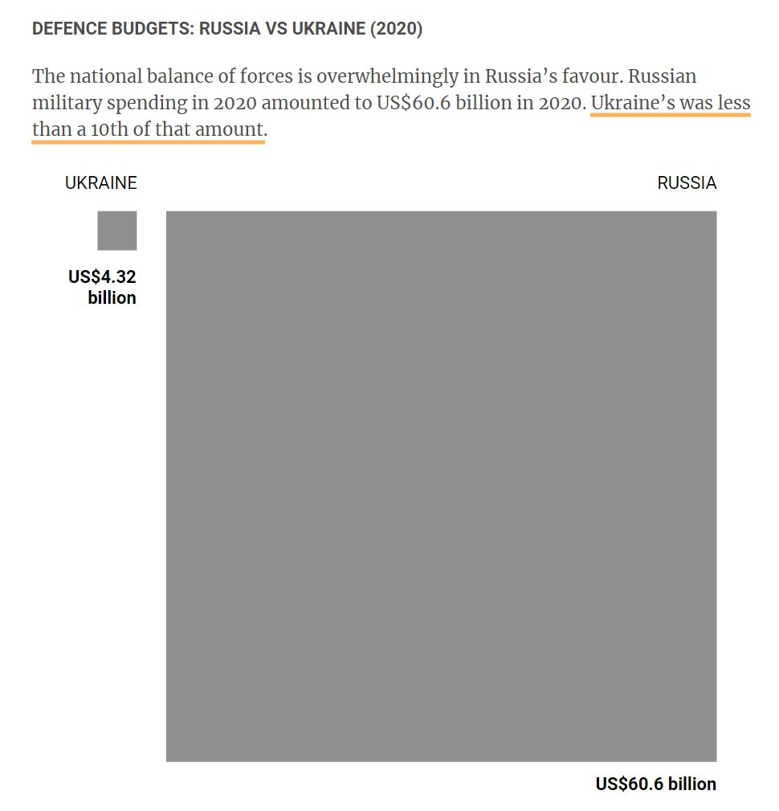
```
]

.pull-right-2[
.can-edit.key-c15-russia[
- Edit me to include the main issue(s)
]

<div class="src" style="margin-top:14px;">Source: shared by Cédric Scherer in <a href="https://x.com/CedScherer/status/1498593405408059394" target="_blank">this post</a>; the outlet that made the original chart is unclear.</div>
]

]

.panel[.panel-name[White House Growth]

.pull-left-2[
```{r terrible_whitehouse, out.height='330px', fig.alt="A bar chart by the White House of America's economic growth in the 21st century"}
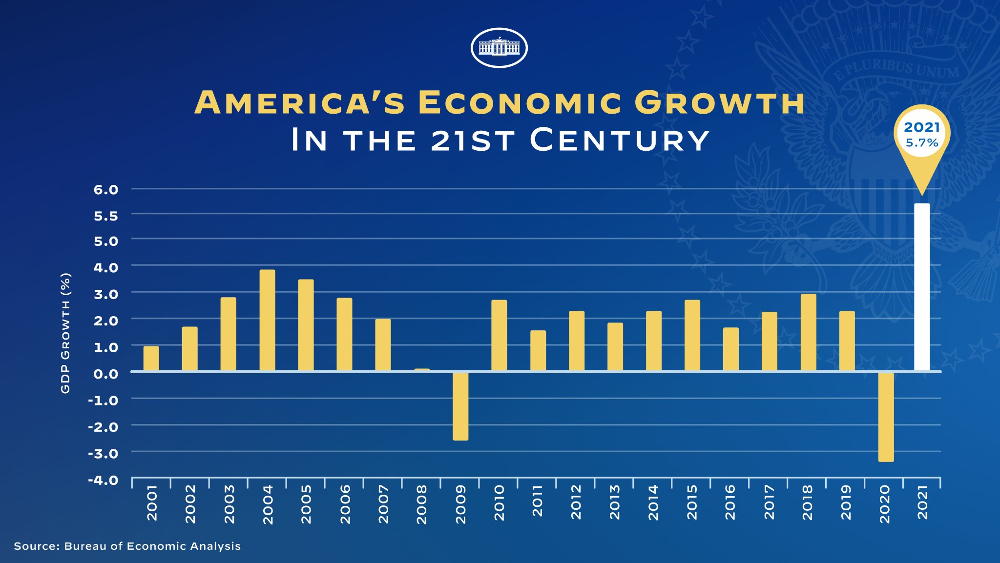
```
]

.pull-right-2[
.can-edit.key-c15-whitehouse[
- Edit me to include the main issue(s)
]

<div class="src" style="margin-top:14px;">Source: posted by the White House in <a href="https://x.com/WhiteHouse/status/1486709480351952901" target="_blank">this post</a>. The chart was later corrected.</div>
]

]

.panel[.panel-name[Fox News]

.pull-left-2[
```{r terrible_fox, out.width='100%', fig.alt="A bar chart by Fox News of the share of Americans who identify as Christians, 2009 and 2019"}
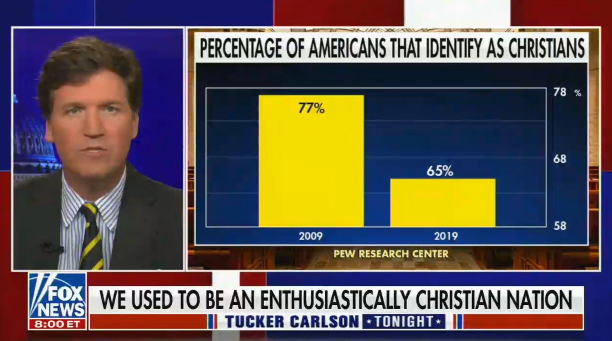
```
]

.pull-right-2[
.can-edit.key-c15-fox[
- Edit me to include the main issue(s)
]

<div class="src" style="margin-top:14px;">Source: shown in <a href="https://video.foxnews.com/v/6274513508001" target="_blank">this Fox News clip</a>.</div>
]

]

.panel[.panel-name[Answer]

<details class="answer-gate">
<summary>Show the answer</summary>
<div class="tbl-sm" style="margin-top:10px;">
<table>
<thead><tr><th>Chart</th><th>Main issue</th></tr></thead>
<tbody>
<tr><td>Russia's Defense Budget</td><td>Each square's side is proportional to the budget, but we read area. The budgets differ by a factor of `r formatC(60.6 / 4.32, format = "f", digits = 1)`, so Russia's square looks about `r round((60.6 / 4.32)^2)` times larger.</td></tr>
<tr><td>White House Growth</td><td>The y-axis steps by 1 up to 5% and then by 0.5, so the 2021 bar (5.7%) reaches where about 6.4% would sit on an even scale. The 2020 contraction right before it also gives the rebound context the chart leaves out.</td></tr>
<tr><td>Fox News</td><td>The y-axis starts at 58, and its labels sit on the right side. 77% to 65% is a 12-percentage-point drop, a `r formatC(100 * 12 / 77, format = "f", digits = 1)`% decline, but the bars (19 vs. 7 units above 58) show a `r formatC(100 * 12 / 19, format = "f", digits = 0)`% drop. Bars should start at 0.</td></tr>
</tbody>
</table>
</div>
</details>

]

.panel[.panel-name[Discussion]

.can-edit.key-c15-terrible-discussion[
- Edit me to include any notes/discussion
]

]

]

???

Seven minutes: five on the timer, two to collect answers. What to get from the room. Russia: the squares encode the values by area, so the reader compares areas, and we judge area poorly; a 14 times larger budget looks like a much larger gap. White House: the 2021 bar is the only white bar and carries a pin, while the 2020 contraction right before it gets no comment, so the 2021 rebound is presented without its context. Fox: the y-axis starts at 58 (its labels are on the right side), so 77 vs. 65 looks like a fall of more than half; 12 percentage points is a 15.6% decline; the bars should start at 0. We come back to the axis problem with the lie factor.

---

# What Should Graphs Do?

<div class="gp">
<div class="gp-grid">
<div class="gp-list">
<div class="gp-row" data-from="1"><div class="gp-hl" data-from="1" data-to="2"></div><span class="gp-n">1</span><span class="gp-t"><b>Show the data.</b></span></div>
<div class="gp-row" data-from="2"><div class="gp-hl" data-from="2" data-to="3"></div><span class="gp-n">2</span><span class="gp-t">Lead the viewer to think about the <b>substance</b> rather than something else.</span></div>
<div class="gp-row" data-from="3"><div class="gp-hl" data-from="3" data-to="4"></div><span class="gp-n">3</span><span class="gp-t">Avoid <b>distorting</b> what the data have to say.</span></div>
<div class="gp-row" data-from="4"><div class="gp-hl" data-from="4" data-to="5"></div><span class="gp-n">4</span><span class="gp-t">Present <b>many numbers in a small space</b>.</span></div>
<div class="gp-row" data-from="5"><div class="gp-hl" data-from="5" data-to="6"></div><span class="gp-n">5</span><span class="gp-t">Make <b>large datasets coherent</b>.</span></div>
<div class="gp-row" data-from="6"><div class="gp-hl" data-from="6" data-to="7"></div><span class="gp-n">6</span><span class="gp-t">Encourage the eye to <b>compare</b> different pieces of data.</span></div>
<div class="gp-row" data-from="7"><div class="gp-hl" data-from="7" data-to="8"></div><span class="gp-n">7</span><span class="gp-t">Reveal the data at <b>several levels of detail</b>, from a broad overview to the fine structure.</span></div>
<div class="gp-row" data-from="8"><div class="gp-hl" data-from="8" data-to="9"></div><span class="gp-n">8</span><span class="gp-t">Serve a <b>clear purpose</b>: description, exploration, tabulation, or decoration.</span></div>
<div class="gp-row" data-from="9"><div class="gp-hl" data-from="9" data-to="10"></div><span class="gp-n">9</span><span class="gp-t">Be closely <b>integrated with the statistical and verbal descriptions</b> of the data.</span></div>
</div>
<div>
<div class="sc-caps gp-caps">
<div class="sc-cap on" data-step="0"><b>Tufte lists nine things that graphs should do.</b> Press Step to go through them one at a time. Each step shows a less effective chart next to a better one, made from real data.<div class="gp-next">The slides after this one go deeper into the first three.</div></div>
<div class="sc-cap" data-step="1"><b>1. Show the data.</b> A summary alone can hide what the data look like. Anscombe's Set 2 is a curve, not a line.</div>
<div class="sc-cap" data-step="2"><b>2. Think about the substance.</b> The reader should think about the numbers, not the colors or the effects. Russia and Ukraine defense budgets, 2020.</div>
<div class="sc-cap" data-step="3"><b>3. Avoid distortion.</b> Bar lengths should match the numbers. Same two values as the Fox News chart.</div>
<div class="sc-cap" data-step="4"><b>4. Many numbers in a small space.</b> The same space can hold the 3 means (triangles, labeled with their values) and all `r 2 * nrow(peng_all)` measurements.</div>
<div class="sc-cap" data-step="5"><b>5. Make large datasets coherent.</b> On a map, the 48 murder rates of 1976 form a regional pattern: `r n_south_top10` of the 10 highest are in the South (Census region). Color shows the pattern, not exact values.</div>
<div class="sc-cap" data-step="6"><b>6. Encourage comparison.</b> Values to be compared belong on a common scale.</div>
<div class="sc-cap" data-step="7"><b>7. Several levels of detail.</b> The overview and the detail in one graph.</div>
<div class="sc-cap" data-step="8"><b>8. Serve a clear purpose.</b> Description, exploration, tabulation, or decoration. Same numbers, two purposes.</div>
<div class="sc-cap" data-step="9"><b>9. Integrate with the statistics and the text.</b> The title and labels say what the graph shows.</div>
</div>
<div class="sc-bar"><button type="button" class="sc-btn sc-back">Back</button><button type="button" class="sc-btn sc-primary sc-step">Step</button><button type="button" class="sc-btn sc-play">Play</button><button type="button" class="sc-btn sc-reset">Reset</button><span class="sc-spds"><button type="button" class="sc-spd" data-spd="0.5">0.5x</button><button type="button" class="sc-spd on" data-spd="1">1x</button><button type="button" class="sc-spd" data-spd="2">2x</button></span><span class="sc-count">0 / 9</span></div>
</div>
</div>
</div>
<script>
(function () {
  function buildAll() {
    document.querySelectorAll('.gp').forEach(function (root) {
      window.isaStepper(root, { n: 9, dwell: [2500, 7000, 7000, 7000, 6000, 6000, 6000, 6000, 6000, 0] });
    });
  }
  buildAll();
  if (window.slideshow) { if (!window.gpHooked) { window.gpHooked = true; window.slideshow.on('afterShowSlide', buildAll); } }
})();
</script>

<div class="src" style="margin-top:10px;">Source: Tufte, E. R. (2001). <i>The Visual Display of Quantitative Information</i> (2nd ed.). Cheshire, CT: Graphics Press, p. 13.</div>

???

Three minutes, Step by Step. Principles not reached yet are greyed out; the current one is highlighted and explained on the right. Principles 1 to 3 get their own slides next (titles start with the principle). Principles 4, 6, 7, and 9 point to examples the students will see today; 5 and 8 have no example in this deck. Ask which of the three terrible charts broke principle 3.

---

# Show the Data: Anscombe's Quartet

**In a seminal paper, Anscombe wrote:**

> **Few of us escape being indoctrinated with these notions:**
>  - numerical **calculations are exact, but graphs are rough**;
>  - for any particular kind of **statistical data there is just one set of calculations constituting a correct statistical analysis**;
>  - performing **intricate calculations is virtuous**, whereas **actually looking at the data is cheating**.

He then argued that

> a computer should **make both calculations and graphs**. Both sorts of output should be studied; each will contribute to understanding.

<div class="src" style="margin-top:12px;">Source: Anscombe, F. J. (1973). Graphs in Statistical Analysis. <i>The American Statistician</i>, 27(1), 17-21 (<a href="https://www.sjsu.edu/faculty/gerstman/StatPrimer/anscombe1973.pdf" target="_blank">PDF</a>).</div>

???

One minute. Read the three notions aloud; the next slide tests the first one.

---

# Show the Data: Anscombe's Statistics

.panelset[

.panel[.panel-name[Summary statistics]

<div class="qbar" style="margin-top:8px; font-size:15px;"><b>Question.</b> Anscombe built four datasets of eleven (x, y) points each. Their summaries are below. Are these four datasets alike?</div>

<div class="tbl-sm" style="margin-top:12px;">
`r tbl(quartet_stats, align = c("l", rep("r", 5)))`
</div>

]

.panel[.panel-name[The 44 points]

<div class="tbl-sm" style="margin-top:8px;">
`r tbl(quartet_raw, align = rep("r", 8))`
</div>

]

]

???

Two minutes. Take a show of hands on the question before anyone opens the second tab. Means, standard deviations, and correlations agree to two decimals in every set. The raw tab is there if someone wants to see the 44 numbers; do not read them out.

---

# Show the Data: Anscombe's Scatterplots

```{r anscombe_plot, fig.height=3.6, fig.width=8, out.width='88%', fig.alt="Anscombe's four datasets as scatterplots with their fitted lines"}
ggplot2::ggplot(quartet, ggplot2::aes(x, y)) +
  ggplot2::geom_point(size = 1.8) +
  ggplot2::geom_smooth(method = lm, se = FALSE, formula = y ~ x, color = miamired, linewidth = 0.7) +
  ggplot2::facet_wrap(~set, nrow = 1) +
  ggplot2::scale_x_continuous(breaks = seq(0, 20, 5), limits = c(0, 20)) +
  ggplot2::scale_y_continuous(breaks = seq(0, 15, 5), limits = c(0, 15))
```

<div class="lesson"><b class="r">The four datasets have the same summary statistics but different patterns.</b> Set 1 is a noisy line, Set 2 is a curve, Set 3 is a line with one outlier, and in Set 4 one point sets the slope. The fitted red line is the same in all four.</div>

???

Two minutes. Ask the room to describe each panel before you read the box.

---

# Show the Data: The Datasaurus

```{r datasaurus, out.width='68%', fig.alt="An animation of datasets with identical summary statistics, including a dinosaur"}
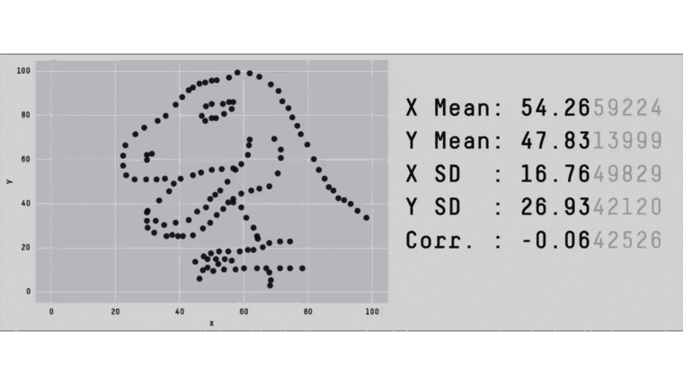
```

<div class="src">Source: Matejka, J. and Fitzmaurice, G. (2017). Same Stats, Different Graphs: Generating Datasets with Varied Appearance and Identical Statistics through Simulated Annealing. <i>Proceedings of the 2017 CHI Conference on Human Factors in Computing Systems</i> (<a href="https://www.research.autodesk.com/publications/same-stats-different-graphs/" target="_blank">project page</a>).</div>

???

Two minutes. Every frame has the same means, standard deviations, and correlation to two decimals.

---

# Substance: Playfair's Cities

`r countdown(minutes = 5, seconds = 0, top = 0, font_size = "2em")`

.panelset[

.panel[.panel-name[Task]

<div class="qbar" style="margin-top:6px; font-size:15px;"><b>Task.</b> In 5 minutes, <b>sketch</b> a better (non-bubble) chart than this one by William Playfair, which shows the populations of 22 European cities at the end of the 1700s.</div>

```{r playfair_bubble, fig.height=2.0}
playfair |> ggplot2::ggplot(ggplot2::aes(x = rank, y = position, size = population)) +
  ggplot2::geom_point(shape = 21, fill = 'white') +
  ggplot2::scale_size_area(max_size = 18) +
  ggplot2::geom_text(ggplot2::aes(label = paste0(city, '\n', scales::comma(population, accuracy = 1), ' K'), size = 10),
                     nudge_y = 0.4) +
  ggplot2::labs(caption = 'Source: Chart made by Fadel M. Megahed based on data from http://www.stat.uiowa.edu/~luke/data/Playfair  ') +
  ggplot2::theme_void(base_size = 8) + ggplot2::theme(legend.position = 'none')
```

]

.panel[.panel-name[Your Solution]

**Sketch your solution on paper.** If you prefer software, the code below downloads the data and saves it as a CSV file. It is optional.

```{r playfair_download, eval=FALSE, echo=TRUE, hl.size="72%"}
playfair = read.table("http://www.stat.uiowa.edu/~luke/data/Playfair") |>
  tibble::rownames_to_column(var = "city") |> # row names become a city column
  tibble::as_tibble() |>
  dplyr::arrange(dplyr::desc(population)) # largest city first

readr::write_csv(x = playfair, file = "playfair_data.csv")
```

**Be ready to share your sketch with the class.**

]

.panel[.panel-name[My Solution]

<details class="answer-gate">
<summary>Show my solution</summary>
<div style="margin:6px 0 2px 0;">In my opinion, a <strong>dot chart works better</strong> than the bubble chart. Population is encoded by <strong>position</strong>; area can stay as a second encoding.</div>
```{r playfair_dot, fig.height=3.0, fig.width=7.5, out.width='70%'}
playfair |> dplyr::mutate(city = forcats::as_factor(city),
                          area = pi * (diameter / 2) ^ 2) |>
  ggplot2::ggplot(ggplot2::aes(x = population, y = stats::reorder(city, population), size = area)) +
  ggplot2::geom_point() + ggplot2::scale_size_area() +
  ggplot2::geom_text(ggplot2::aes(label = scales::comma(population)), size = 2.6, hjust = 0, nudge_x = 25, show.legend = FALSE) +
  ggplot2::scale_x_continuous(labels = scales::comma, expand = ggplot2::expansion(mult = c(0.03, 0.1))) +
  ggplot2::labs(x = 'Population (thousands)', y = 'City', caption = 'Source: Chart made by Fadel M. Megahed based on data from http://www.stat.uiowa.edu/~luke/data/Playfair ') +
  ggplot2::theme_bw(base_size = 9)
```
</details>

]

.panel[.panel-name[Discussion]

.can-edit.key-c15-playfair[
- Edit me to include any notes/discussion
]

]

]

???

Eight minutes: five to sketch, three to share. Ask for two or three sketches before opening My Solution. Check the data before correcting a sketch: London (1,100K) is the largest city, ahead of Constantinople (900K). Point: in the bubble chart, the ranking of the 22 cities is hard to read because we compare circle areas; in the dot chart the same ranking is a position on one common axis.

---

# Avoid Distortion: A Chart from Tufte's Book

```{r integrity1, out.width='68%', fig.alt='A distorted bar chart with a non-zero baseline and pictures that pull attention from the values'}
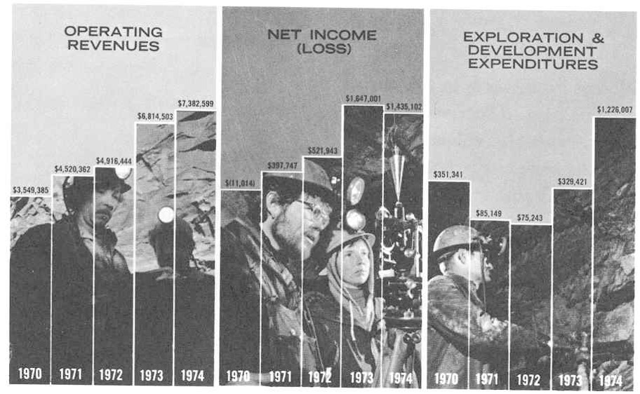
```

<div class="src">Source: Tufte, E. R. (2001). <i>The Visual Display of Quantitative Information</i> (2nd ed.). Graphics Press, p. 54.</div>

???

One minute. Ask what the pictures add to the values.

---

# Avoid Distortion: A Fox Business Chart

```{r integrity2, out.width='88%', fig.alt='A Fox Business bar chart of the top tax rate with a y-axis starting at 34 percent, next to a redrawn chart starting at zero'}
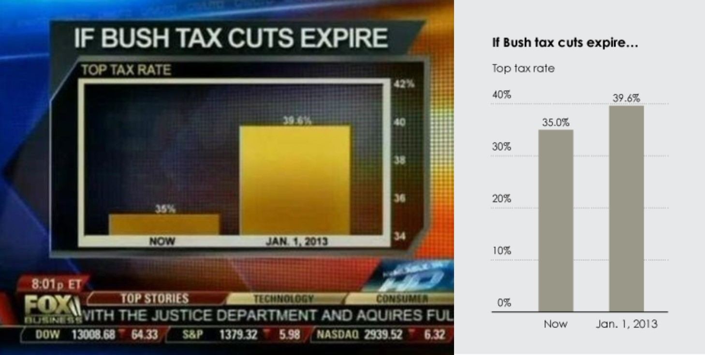
```

<div class="src">Source: Yau, N. (2012). <a href="https://flowingdata.com/2012/08/06/fox-news-continues-charting-excellence/" target="_blank">Fox News continues charting excellence</a>. FlowingData.</div>

???

One minute. Left: the original chart, whose y-axis starts at 34%. Right: the same two numbers with the axis starting at 0.

---

# Avoid Distortion: The Lie Factor

```{r lie_factor, out.width='72%', fig.alt='The lie factor formula above a chart of fuel economy standards from 1978 to 1985'}
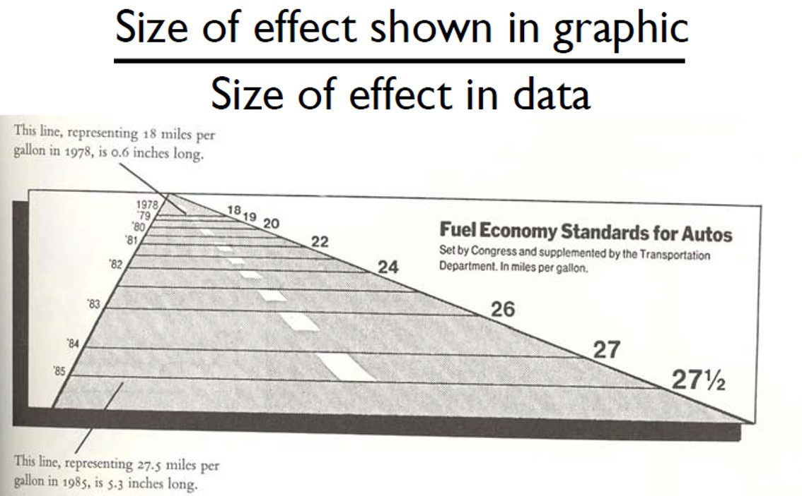
```

<div class="src">Source: Tufte, E. R. (2001). <i>The Visual Display of Quantitative Information</i> (2nd ed.). Graphics Press, p. 57.</div>

???

One minute. Read the formula. The two annotations on the chart give every number we need for the next slide.

---

# Avoid Distortion: Calculating the Lie Factor

<div class="qbar" style="font-size:15px;"><b>Both "effects" are a percent change:</b> (new value &minus; old value) / old value. Both sets of numbers are printed on Tufte's figure.</div>

<div class="steprow"><div class="eq"><span class="lab">Effect in the data</span><span>18 mpg in 1978 to 27.5 mpg in 1985:</span><span class="frac"><span class="ft">27.5 &minus; 18</span><span class="fb">18</span></span><span>=</span><span class="res">`r formatC(lf_tufte$dchg, format = "f", digits = 2)` (`r pct(lf_tufte$dchg)`)</span></div></div>

--

<div class="steprow"><div class="eq"><span class="lab">Effect in the graphic</span><span>a line 0.6 inches long to a line 5.3 inches long:</span><span class="frac"><span class="ft">5.3 &minus; 0.6</span><span class="fb">0.6</span></span><span>=</span><span class="res">`r formatC(lf_tufte$gchg, format = "f", digits = 2)` (`r pct(lf_tufte$gchg)`)</span></div></div>

--

<div class="steprow red"><div class="eq"><span class="lab">Lie factor</span><span class="frac"><span class="ft">effect in the graphic</span><span class="fb">effect in the data</span></span><span>=</span><span class="frac"><span class="ft">`r formatC(lf_tufte$gchg, format = "f", digits = 2)`</span><span class="fb">`r formatC(lf_tufte$dchg, format = "f", digits = 2)`</span></span><span>=</span><span class="res" style="color:#c3142d;">`r formatC(lf_tufte$lf, format = "f", digits = 1)`</span></div></div>

<div class="lesson"><b class="r">A lie factor of 1 means the graphic is honest.</b> Tufte treats values above 1.05 or below 0.95 as substantial distortion. This chart shows the change about 15 times larger than it was.</div>

<div class="src" style="margin-top:8px;">Source: Tufte, E. R. (2001). <i>The Visual Display of Quantitative Information</i> (2nd ed.). Graphics Press, p. 57.</div>

???

Three minutes. Click once per row and let the room do the arithmetic before each click. Row 1: a 53% rise in the standard. Row 2: the line grows by 783%. Row 3: 783 / 53 is about 14.8.

---

# Avoid Distortion: A Summary

<div class="tg">
<div class="card"><div class="ch">Label clearly</div><div class="cb">Clear, detailed, and thorough labeling, with appropriate scales.</div></div>
<div class="card"><div class="ch">Keep the lie factor near 1</div><div class="cb">The size of the effect in the graphic should be directly proportional to the numbers it represents.</div></div>
<div class="card"><div class="ch">Show data variation</div><div class="cb">Variation in the graphic should come from the data, not from the design.</div></div>
</div>

<div class="src" style="margin-top:12px;">Based on Tufte, E. R. (2001). <i>The Visual Display of Quantitative Information</i> (2nd ed.). Graphics Press, ch. 2.</div>

???

One minute.

---

class: inverse, center, middle

# Part 2: Theory of Data Graphics

---

# The Data-Ink Ratio

**Data-ink** is the non-erasable ink used to present the data. If the data-ink were removed, the graphic would lose its content.

<div class="steprow red" style="margin-top:18px;"><div class="eq"><span class="lab">Data-ink ratio</span><span>=</span><span class="frac"><span class="ft">data-ink</span><span class="fb">total ink used to print the graphic</span></span></div></div>

<div class="steprow"><div class="eq"><span class="lab"></span><span>=</span><span>the proportion of a graphic's ink devoted to the non-redundant display of data information</span></div></div>

<div class="steprow"><div class="eq"><span class="lab"></span><span>=</span><span>1 &minus; the proportion of a graphic that can be erased without losing data information</span></div></div>

<div class="src" style="margin-top:14px;">Source: Tufte, E. R. (2001). <i>The Visual Display of Quantitative Information</i> (2nd ed.). Graphics Press, ch. 4.</div>

???

Two minutes. The three lines say the same thing three ways; the last line is the one students can apply: what could I erase without losing any data?

---

# The Data-Ink Ratio

**Data-ink** is the non-erasable ink used to present the data. If the data-ink were removed, the graphic would lose its content.

```{r data_ink1, out.width='62%', fig.alt='Data ink example'}
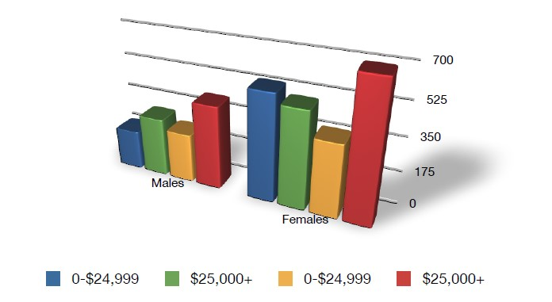
```

<div class="src">Source: adapted from Hanspeter Pfister, lecture notes for CS 171, Harvard University. <a href="http://cs171.org/" target="_blank">cs171.org</a></div>

---
count: false

# The Data-Ink Ratio

**Data-ink** is the non-erasable ink used to present the data. If the data-ink were removed, the graphic would lose its content.

```{r data_ink2, out.width='62%', fig.alt='Data ink example, continued'}
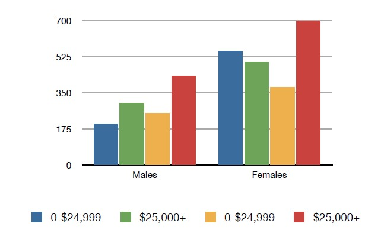
```

<div class="src">Source: adapted from Hanspeter Pfister, lecture notes for CS 171, Harvard University. <a href="http://cs171.org/" target="_blank">cs171.org</a></div>

???

One minute for the two slides.

```{r chartjunk_slides, results='asis'}
# the six tbray.org steps, one slide each (local copies in figures/data_ink/)
for (i in 1:6) {
  cat("\n---\n")
  if (i > 1) cat("count: false\n")
  cat("\n# Focus on Data: Avoid Chartjunk\n\n")
  cat("**Chartjunk is the extraneous visual elements that distract from the message.**\n\n")
  cat(sprintf("\n\n",
              knitr::image_uri(sprintf("../../figures/data_ink/di%d.png", i)), i))
  cat(sprintf("<div class=\"src\">Source: Tim Bray, <a href=\"http://www.tbray.org/ongoing/data-ink/di%d\" target=\"_blank\">The Data-Ink Ratio Example</a> (step %d of 6).</div>\n", i, i))
  if (i == 1) cat("\n???\n\nFour minutes for the six steps. On each step ask: what was removed, and did we lose any data?\n")
}
```

---

# Other Design Considerations

<div style="display:grid; grid-template-columns:minmax(0,1.15fr) minmax(0,1fr); gap:16px; margin-top:10px;">
<div class="card"><div class="ch gray">Subjective principles (Pat Hanrahan)</div><div class="cb" style="font-size:15px; line-height:1.7;">
<div><b>Aesthetics:</b> attractive things are perceived as more useful than unattractive ones.</div>
<div><b>Style:</b> communicates brand, process, and who the designer is.</div>
<div><b>Playfulness:</b> encourages experimentation and exploration.</div>
<div><b>Vividness:</b> can make a visualization more memorable.</div>
</div></div>
<div class="card"><div class="ch">Is chartjunk always bad?</div><div class="cb" style="font-size:15px; line-height:1.7;">
Bateman et al. (2010) compared embellished charts with plain ones. People described the embellished charts <b>no less accurately</b>, and <b>remembered them significantly better</b> after two to three weeks.
<div style="margin-top:6px; color:#585E60;">Maximizing the data-ink ratio is a guideline, not a law. Decoration that does not distort the data can help a chart be remembered.</div>
</div></div>
</div>

<div class="src" style="margin-top:12px;">Sources: Pfister, CS 171 lecture notes, based on comments by Pat Hanrahan (2007), discussed at <a href="https://www.perceptualedge.com/blog/?p=199" target="_blank">perceptualedge.com/blog/?p=199</a>. Bateman, S., et al. (2010). <a href="https://vis.csail.mit.edu/classes/6.859/readings/pdfs/Bateman-UsefulJunk.pdf" target="_blank">Useful junk? The effects of visual embellishment on comprehension and memorability of charts</a>. <i>CHI 2010</i>, <a href="https://doi.org/10.1145/1753326.1753716" target="_blank">doi:10.1145/1753326.1753716</a>.</div>

???

Two minutes. The right card is the counterpoint to the chartjunk sequence and is the "skim if curious" reading. Distortion (Part 1) is never acceptable; decoration is a judgment call.

---

class: inverse, center, middle

# Part 3: Data Types and Visual Encoding

---

# Stevens (1946): Scales of Measurement

```{r stevens1, out.extra='style="display:block; height:462px; width:auto; margin:-14px auto 0 auto;"', fig.alt='First page of S. S. Stevens, On the Theory of Scales of Measurement, Science, 1946'}
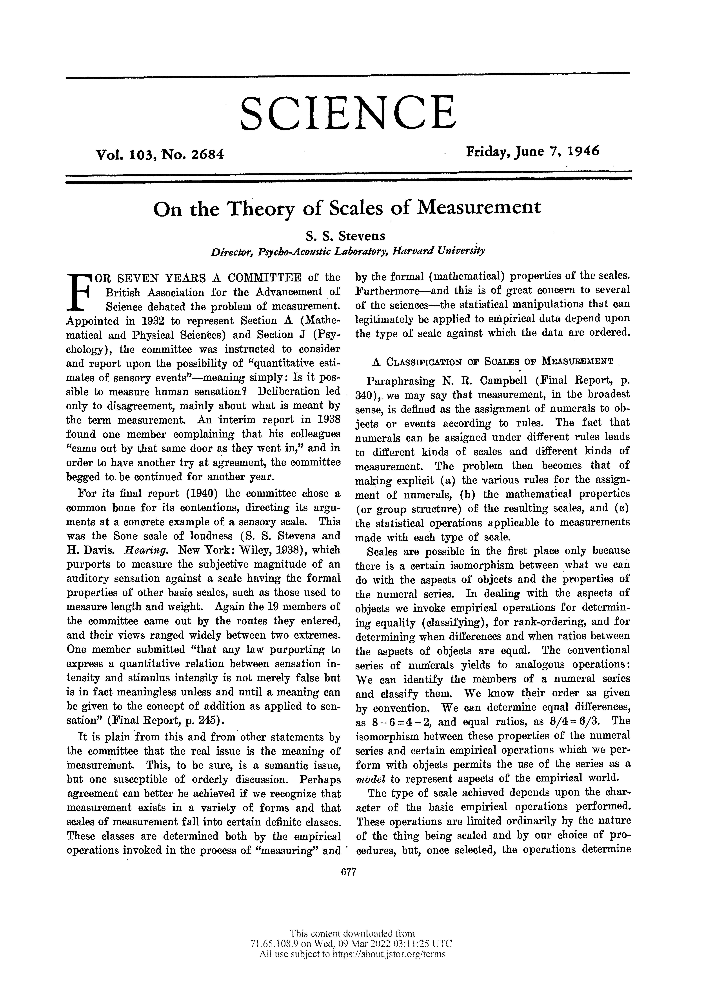
```

<div class="src">Source: Stevens, S. S. (1946). On the Theory of Scales of Measurement. <i>Science</i>, 103(2684), 677-680.</div>

???

Thirty seconds. The four scales on the next slide come from this paper.

---

# Data Types (from S. Stevens, Theory of Scales)

```{r stevens2, out.width='85%', fig.alt='Nominal, ordinal, interval and ratio data types'}
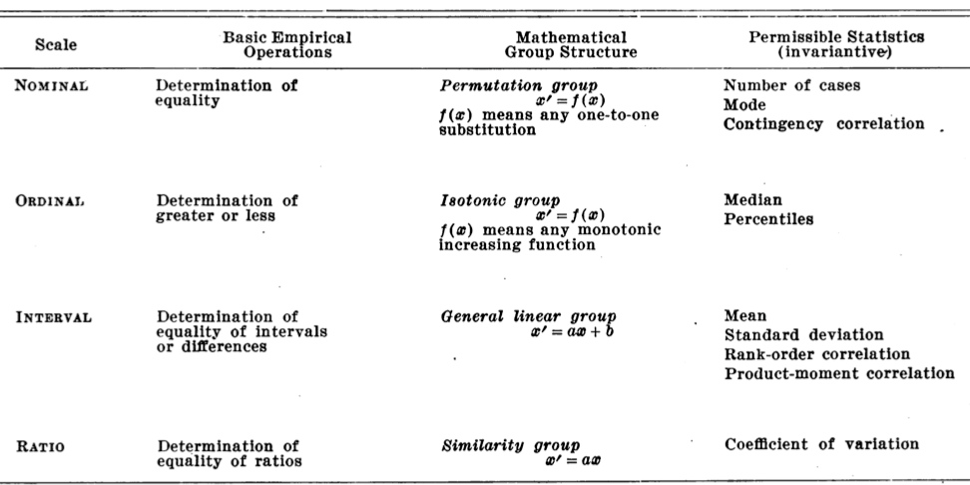
```

---

# Data Types: Explained

.pull-left-2[
<div style="display:grid; gap:12px; margin-top:6px;">
<div class="card"><div class="ch gray">Nominal</div><div class="cb" style="font-size:16px;">Values are = or &ne; to other values.<br><span style="color:#585E60;">Apples, bananas, oranges, etc.</span></div></div>
<div class="card"><div class="ch gray">Ordinal</div><div class="cb" style="font-size:16px;">Values obey a &lt; relationship.<br><span style="color:#585E60;">Small, medium, and large.</span></div></div>
<div class="card"><div class="ch">Quantitative</div><div class="cb" style="font-size:16px;">We can do math on them.<br><span style="color:#585E60;">50 inches, 53 inches, etc.</span></div></div>
</div>
]

.pull-right-2[
```{r datatypes, out.width='70%', fig.alt='Examples of nominal, ordinal and quantitative data'}
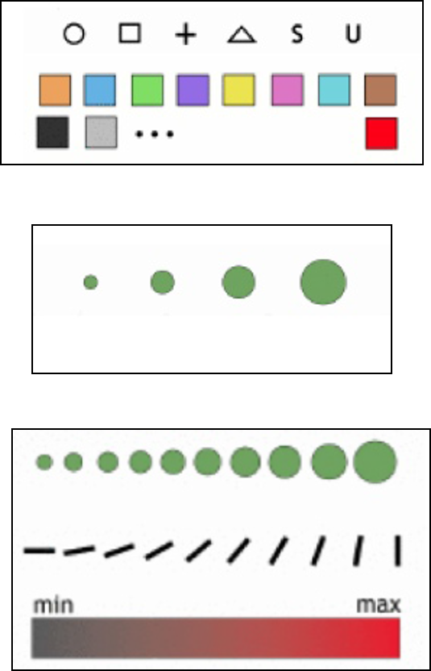
```
]

???

Two minutes for this slide and the previous one.

---

# Quantitative Data: Interval or Ratio?

<div style="display:grid; grid-template-columns:1fr 1fr; gap:16px; margin-top:14px;">
<div class="card"><div class="ch gray">Interval: the location of zero is arbitrary</div><div class="cb" style="font-size:15.5px; line-height:1.6;">
<div>Dates (Jan 19), locations (latitude, longitude), temperature in &deg;F.</div>
<div>Only <b>differences</b> (intervals) can be compared.</div>
<div style="margin-top:10px; padding:8px 10px; background:#f3f4f6; border-radius:6px;"><b>Test:</b> is 40&deg;F twice as warm as 20&deg;F? <b>No.</b> 0&deg;F is not "no temperature", so the ratio means nothing. The difference of 20&deg;F does mean something.</div>
</div></div>
<div class="card"><div class="ch">Ratio: zero is fixed</div><div class="cb" style="font-size:15.5px; line-height:1.6;">
<div>Measurements: length, weight, cost, counts.</div>
<div>The origin is meaningful, so <b>ratios, proportions, and differences</b> can all be computed.</div>
<div style="margin-top:10px; padding:8px 10px; background:#fdf2f2; border-radius:6px;"><b>Test:</b> is $40 twice as much as $20? <b>Yes.</b> $0 means no money, so "twice as much" is meaningful.</div>
</div></div>
</div>

<div class="lesson"><b class="r">Why it matters for charts:</b> a bar's length shows a value as a distance from zero. That works for ratio data. For interval data, a bar from zero has no meaning, so we use positions (dots, lines) instead.</div>

???

Two minutes. The test question is the takeaway: if "twice as much" makes sense, the variable is on a ratio scale. The last box links back to the lie factor: bars need a zero baseline because their length is the encoding.

---

# Data Terminology

`r countdown(minutes = 2, seconds = 0, top = 0, font_size = "2em")`

.panelset[

.panel[.panel-name[Task]

<div class="qbar" style="margin-top:6px; font-size:15px;"><b>Task.</b> In 2 minutes, identify the data type (nominal, ordinal, interval, or ratio) of each column.</div>

<div class="tbl-sm">
`r tbl(shipping_data)`
</div>

]

.panel[.panel-name[Your Answer]

.can-edit.key-c15-datatypes[
- Order ID: ________________
- Order Date / Ship Date: ________________
- Order Priority: ________________
- Product Container: ________________
- Product Cost: ________________
]

]

.panel[.panel-name[Answer]

<details class="answer-gate">
<summary>Show the answer</summary>
<div class="tbl-sm" style="margin-top:10px;">
<table>
<thead><tr><th>Column</th><th>Type</th><th>Why</th></tr></thead>
<tbody>
<tr><td>Order ID</td><td>Nominal</td><td>A label. Order 6 is not "more" than order 3, and averaging IDs means nothing.</td></tr>
<tr><td>Order Date, Ship Date</td><td>Interval</td><td>The difference (days to ship) is meaningful; a ratio of two dates is not. "Quantitative" is also accepted.</td></tr>
<tr><td>Order Priority</td><td>Ordinal</td><td>Urgent, high, medium, low has an order, but the gaps between levels are not equal amounts.</td></tr>
<tr><td>Product Container</td><td>Nominal or ordinal</td><td>Small, medium, large, and jumbo box have an order, so ordinal can be argued. A wrap bag has no place in that order, so with it in the column, nominal is the safer answer.</td></tr>
<tr><td>Product Cost</td><td>Ratio</td><td>$0 means no cost, so $40 is twice $20.</td></tr>
</tbody>
</table>
</div>
</details>

]

.panel[.panel-name[Discussion]

.can-edit.key-c15-datatypes-discussion[
- Edit me to include any notes/discussion
]

]

]

???

Four minutes: two on the timer, two on the answer. Product Container is the one worth arguing about: accept nominal or ordinal. Small, medium, large, and jumbo box are ordinal on their own; with the wrap bag included, nominal is the safer answer. For the dates, "quantitative" is accepted. The point is that the type comes from what the values mean, not from how they are stored (Order ID is a number but nominal).

---

# Data vs. Conceptual Models

<div style="display:flex; gap:12px; align-items:stretch; margin-top:18px;">
<div class="card" style="flex:1;"><div class="ch gray">1 &nbsp; Data model</div><div class="cb" style="font-size:16px; line-height:1.7;">32.5, 54.0, &minus;17.3, ...<div style="color:#585E60; font-size:14px;">Numbers in a column.</div></div></div>
<div style="align-self:center; color:#c3142d; font-size:24px; font-weight:700;">&rarr;</div>
<div class="card" style="flex:1;"><div class="ch gray">2 &nbsp; Conceptual model</div><div class="cb" style="font-size:16px; line-height:1.7;">Temperature<div style="color:#585E60; font-size:14px;">What the numbers mean.</div></div></div>
<div style="align-self:center; color:#c3142d; font-size:24px; font-weight:700;">&rarr;</div>
<div class="card" style="flex:1.4;"><div class="ch">3 &nbsp; Data type we choose</div><div class="cb" style="font-size:15.5px; line-height:1.7;">
<div>Continuous to x significant digits: <b>quantitative</b></div>
<div>Hot, warm, cold: <b>ordinal</b></div>
<div>Burned vs. not burned: <b>nominal</b></div>
</div></div>
</div>

<div class="lesson" style="margin-top:18px;"><b class="r">The same column can become different data types,</b> depending on the question we ask. The type we choose decides which visual encodings fit.</div>

???

One minute.

---

# Image Model: Visual (Encoding) Variables

```{r bertin, out.width='70%', fig.alt="Bertin's visual variables"}
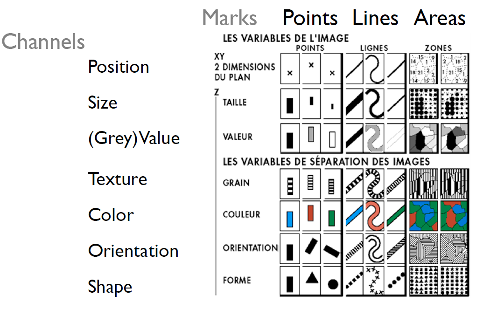
```

<div class="src">Source: Bertin, J. (1967). <i>Sémiologie graphique</i>. Paris: Gauthier-Villars.</div>

???

One minute.

---

# Mapping to Data Types

```{r mapping_data_types, out.width='57%', fig.alt='Which visual variables suit nominal, ordinal and quantitative data'}
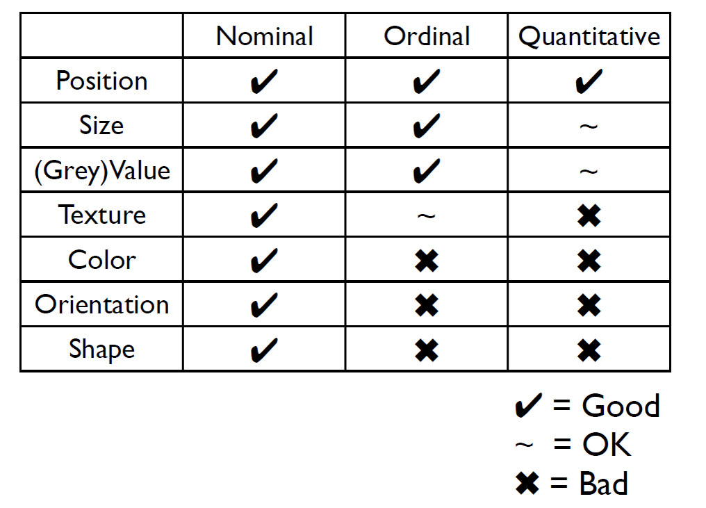
```

<div class="src">Source: adapted from Hanspeter Pfister, lecture notes for CS 171, Harvard University. <a href="http://cs171.org/" target="_blank">cs171.org</a></div>

???

Two minutes. Read one row from each data type.

---

# Visual Channels and Their Precision

```{r franconeri, out.width='60%', fig.alt='Visual channels ranked by the precision of the comparisons they support'}
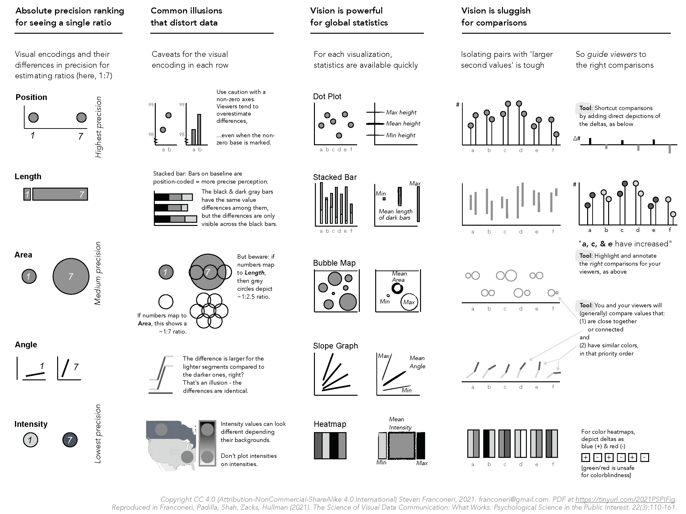
```

<div class="src" style="margin-top:2px;">Source: Franconeri, S. L., et al. (2021). <a href="https://doi.org/10.1177/15291006211051956" target="_blank">The Science of Visual Data Communication: What Works</a>. <i>Psychological Science in the Public Interest</i>, 22(3), 110-161.</div>

???

Two minutes. Read the left column top to bottom: we perceive position more accurately than the other channels; length next, then area and angle, and intensity gives the least precise comparisons. Tie it back: Russia's squares used area, Playfair's bubbles used area, and the dot chart used position.

---

class: inverse, center, middle

# Part 4: Color Should Be Used Sparingly

---

# Simultaneous Contrast Affects Perception

```{r sc, out.width='85%', fig.alt='The same gray looks lighter or darker depending on the surrounding color'}
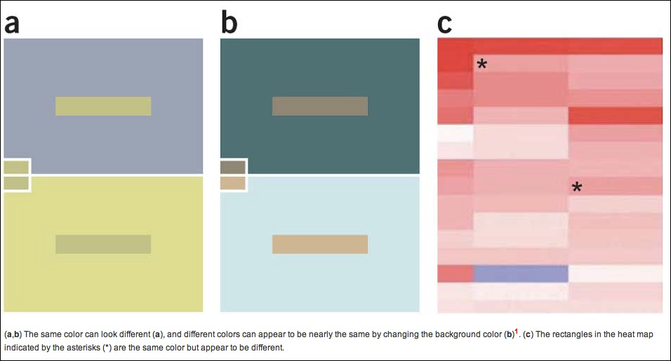
```

<div class="src">Source: adapted from Hanspeter Pfister, lecture notes for CS 171, Harvard University. <a href="http://cs171.org/" target="_blank">cs171.org</a></div>

???

Two minutes.

---

# Color Vision Deficiency

```{r cvd_data, include=FALSE}
pal_rg = c(Adelie = "#D7191C", Chinstrap = "#1A9641", Gentoo = "#A6611A")
pal_oi = c(Adelie = "#E69F00", Chinstrap = "#56B4E9", Gentoo = "#009E73")

peng = datasets::penguins |>
  dplyr::filter(!is.na(bill_len), !is.na(flipper_len))

cvd = tidyr::expand_grid(
  palette = factor(c("Red / green palette", "Okabe-Ito palette"), levels = c("Red / green palette", "Okabe-Ito palette")),
  vision = factor(c("Typical color vision", "Simulated deuteranopia"), levels = c("Typical color vision", "Simulated deuteranopia"))) |>
  dplyr::cross_join(peng) |>
  dplyr::mutate(col = ifelse(palette == "Red / green palette", pal_rg[as.character(species)], pal_oi[as.character(species)]),
                col = ifelse(vision == "Simulated deuteranopia", colorspace::deutan(col), col))

cvd_lab = cvd |>
  dplyr::group_by(palette, vision, species, col) |>
  dplyr::summarise(bill_len = mean(bill_len), flipper_len = mean(flipper_len), .groups = "drop") |>
  dplyr::mutate(flipper_len = flipper_len + c(Adelie = -14, Chinstrap = 14, Gentoo = 13)[as.character(species)])
```

.pull-left-2[
```{r cvd_plot, fig.height=4.4, fig.width=6.4, out.width='100%', fig.alt='Penguin bill length vs flipper length by species, in a red/green palette and the Okabe-Ito palette, each under typical vision and simulated deuteranopia'}
ggplot2::ggplot(cvd, ggplot2::aes(bill_len, flipper_len)) +
  ggplot2::geom_point(ggplot2::aes(color = col), size = 1.1, alpha = 0.85) +
  ggplot2::geom_label(data = cvd_lab, ggplot2::aes(label = species, color = col), size = 2.8, fontface = "bold", label.size = 0.3) +
  ggplot2::scale_color_identity() +
  ggplot2::facet_grid(palette ~ vision) +
  ggplot2::labs(x = "Bill length (mm)", y = "Flipper length (mm)") +
  ggplot2::theme_bw(base_size = 10)
```
]

.pull-right-2[
<div style="font-size:15px; line-height:1.55;">
<div class="lesson" style="margin-top:4px;">"About 1 in 12 men have color vision deficiency." <span style="color:#585E60;">(<a href="https://www.nei.nih.gov/learn-about-eye-health/eye-conditions-and-diseases/color-blindness" target="_blank">National Eye Institute</a>)</span></div>

<div style="margin-top:10px;"><b>Top row:</b> under simulated deuteranopia, the red / green palette turns all three species into similar olive browns.</div>

<div style="margin-top:8px;"><b>Bottom row:</b> the Okabe-Ito palette keeps the three species apart.</div>

<div style="margin-top:8px;"><b>How to accommodate it:</b> use color sparingly, and use color-blind-safe palettes (e.g., <a href="https://colorbrewer2.org/" target="_blank">ColorBrewer</a> with "colorblind safe" checked).</div>

<div style="margin-top:8px; color:#585E60; font-size:13.5px;">Not color blind? <a href="https://enchroma.com/pages/test" target="_blank">This test</a> gives a feel for it.</div>
</div>
]

<div class="src" style="clear:both; padding-top:4px;">Data: <code>datasets::penguins</code> (Palmer Station LTER). Simulation: <code>colorspace::deutan()</code>.</div>

???

Three minutes. Deuteranopia (reduced green sensitivity) is the most common type. Cover the left column of the figure and ask the room to name the species in the top-right panel without the labels. The fix costs nothing: a different palette.

---

# Color Brewer: Color Scales and Their Selection

```{r brewer, out.width='100%', fig.alt='Sequential, diverging and qualitative color schemes'}
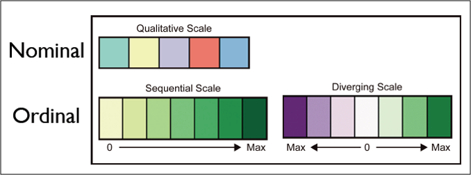
```

<div class="lesson" style="margin-top:2px; font-size:14px;"><b class="r">Pick a palette:</b> <a href="https://colorbrewer2.org/" target="_blank">colorbrewer2.org</a> lets you choose the number of classes and the scheme type, and filter for colorblind-safe palettes.</div>

<div class="src" style="margin-top:6px;">Source: Brewer, C. A. (1999). Color Use Guidelines for Data Representation. <i>Proceedings of the Section on Statistical Graphics</i>, American Statistical Association.</div>

???

Two minutes. Sequential for ordered values from low to high, diverging when there is a meaningful midpoint, qualitative for nominal categories. This matches the data types from Part 3.

---

class: inverse, center, middle

# Recap

---

# Summary of Main Points

By now, you should be able to do the following:

- **Explain** Tufte's principles of graphical excellence: show the data, keep the focus on substance, and avoid distortion (Anscombe, Playfair, the data-ink ratio).

- **Select** visual encodings based on data types: nominal, ordinal, interval, or ratio, with position as the channel we perceive most accurately.

- **Apply** color sparingly, choose sequential, diverging, or qualitative scales to match the data, and use palettes that work for color-blind readers.

- **Identify** and critique misleading visualizations, including with the lie factor.

???

Two minutes. One bullet per objective.

---

# Before Next Class

<div style="display:grid; grid-template-columns:1fr 1fr; gap:16px; margin-top:16px;">
<div class="card">
  <div class="ch">Suggested</div>
  <div class="cb" style="font-size:14.5px; line-height:1.6;">
    <div><a href="https://nightingaledvs.com/the-lie-factor-and-the-baseline-paradox/" target="_blank"><b>The Lie Factor and the Baseline Paradox</b></a> (de Boer, 2021, Nightingale).</div>
    <div style="color:#585E60;">Note what the author means by "baseline", and when the lie factor can mislead for time series and ratio data.</div>
    <div style="margin-top:10px;">Wilke, <i>Fundamentals of Data Visualization</i>: <a href="https://clauswilke.com/dataviz/color-basics.html" target="_blank"><b>ch. 4, Color scales</b></a> and <a href="https://clauswilke.com/dataviz/color-pitfalls.html" target="_blank"><b>ch. 19, Common pitfalls of color use</b></a>.</div>
    <div style="color:#585E60;">Free online. Chapter 19 includes designing for color-vision deficiency.</div>
  </div>
</div>
<div class="card">
  <div class="ch gray">Skim if curious</div>
  <div class="cb" style="font-size:14.5px; line-height:1.6;">
    <div><a href="https://vis.csail.mit.edu/classes/6.859/readings/pdfs/Bateman-UsefulJunk.pdf" target="_blank"><b>Useful junk? The effects of visual embellishment on comprehension and memorability of charts</b></a> (Bateman et al., CHI 2010).</div>
    <div style="color:#585E60;">The experiment behind the "Is chartjunk always bad?" card. The paper uses "ratio" differently from how we used it today.</div>
  </div>
</div>
</div>

<div class="lesson" style="margin-top:18px;"><b class="r">Monday, Oct 19:</b> we apply today's principles in code with ggplot2.</div>

<script>
(function () {
  // Password gate for the answer boxes (class answer-gate). The password is fall2026; case and spaces are ignored.
  // Light gate only: the password is stored as a 32-bit FNV-1a hash so it is not readable in
  // the page source, but anyone determined can open the box from DevTools. sessionStorage
  // remembers an unlock for the rest of the browser session, so one password opens every box.
  var HASH = "806d8122";
  var KEY = "isa401_gate_15";
  function fnv(str) {
    var x = 0x811c9dc5;
    for (var i = 0; i !== str.length; i = i + 1) { x ^= str.charCodeAt(i); x = Math.imul(x, 16777619) >>> 0; }
    return ("0000000" + x.toString(16)).slice(-8);
  }
  function unlocked() { try { return sessionStorage.getItem(KEY) === "1"; } catch (e) { return false; } }
  function remember() { try { sessionStorage.setItem(KEY, "1"); } catch (e) {} }

  function arm(d) {
    if (d.getAttribute("data-gated")) { return; }
    d.setAttribute("data-gated", "1");
    var prompt = null;
    d.addEventListener("toggle", function () {
      if (!d.open) { return; }   // closing (including our own d.open = false below) needs nothing
      if (unlocked()) { if (prompt) { prompt.remove(); prompt = null; } return; }
      d.open = false;
      if (prompt) { prompt.querySelector("input").focus(); return; }
      prompt = document.createElement("div");
      prompt.setAttribute("style", "display:flex; align-items:center; gap:8px; margin:6px 0 0 0; font-size:13px;");
      prompt.innerHTML = "<span style='color:#585E60;'>Password</span>" +
        "<input type='password' autocomplete='off' style='font-family:Source Code Pro, monospace; font-size:13px; padding:4px 8px; border:1px solid #d1d5db; border-radius:6px; width:140px;'>" +
        "<button type='button' style='background:#c3142d; color:#fff; border:0; border-radius:6px; padding:5px 14px; font-weight:700; font-size:13px; cursor:pointer;'>Unlock</button>" +
        "<span class='gate-msg' style='color:#c3142d;'></span>";
      d.parentNode.insertBefore(prompt, d.nextSibling);
      var input = prompt.querySelector("input");
      var msg = prompt.querySelector(".gate-msg");
      // keep remark's keyboard shortcuts (f, p, digits) from firing while typing: same
      // pause/resume pattern xaringanExtra uses for its editable fields
      ["keydown", "keypress", "keyup"].forEach(function (t) { input.addEventListener(t, function (e) { e.stopPropagation(); }); });
      input.addEventListener("focus", function () { if (window.slideshow) { window.slideshow.pause(); } });
      input.addEventListener("blur", function () { if (window.slideshow) { window.slideshow.resume(); } });
      function tryIt() {
        if (fnv(input.value.toLowerCase().split(" ").join("")) === HASH) { remember(); prompt.remove(); prompt = null; d.open = true; }
        else { msg.textContent = "Not it."; input.select(); }
      }
      prompt.querySelector("button").addEventListener("click", tryIt);
      input.addEventListener("keydown", function (e) { if (e.key === "Enter") { tryIt(); } });
      input.focus();
    });
  }
  function armAll() { document.querySelectorAll("details.answer-gate").forEach(arm); }
  armAll();
  if (window.slideshow) { if (!window.answerGateHooked) { window.answerGateHooked = true; window.slideshow.on("afterShowSlide", armAll); } }
})();
</script>

???

One minute. No assignment today.
