```{r setup, include=FALSE}
knitr::opts_chunk$set(cache = FALSE,
                      echo = FALSE,
                      warning = FALSE,
                      message = FALSE,
                      progress = FALSE,
                      verbose = FALSE,
                      dev = 'png',
                      fig.height = 3,
                      dpi = 300,
                      fig.align = 'center')

options(htmltools.dir.version = FALSE, width = 52)

miamired = '#C3142D'

if(require(pacman)==FALSE) install.packages("pacman")
if(require(devtools)==FALSE) install.packages("devtools")
if(require(countdown)==FALSE) devtools::install_github("gadenbuie/countdown")
if(require(xaringanExtra)==FALSE) devtools::install_github("gadenbuie/xaringanExtra")

pacman::p_load(tidyverse, magrittr, lubridate, janitor, # data analysis pkgs
               viridis, patchwork, plotrix, # pie and bar figures
               fontawesome, xaringanExtra, countdown) # for slides

ggplot2::theme_set(ggplot2::theme_bw(base_size = 12))

# Code styling shared by all ISA 401 decks: hl_r() + knitr source hook (see style_files/hl_r.R)
source("../../style_files/hl_r.R")
```

```{r xaringan-themer, include=FALSE, warning=FALSE}
if(require(xaringanthemer) == FALSE) install.packages("xaringanthemer")
library(xaringanthemer)

style_mono_accent(base_color = "#84d6d3",
                  base_font_size = "20px")

xaringanExtra::use_xaringan_extra(c("tile_view", "animate_css", "tachyons", "panelset", "broadcast", "share_again", "search", "fit_screen", "editable"))

xaringanExtra::use_clipboard(button_text = paste0(fontawesome::fa("clipboard", fill = "#dedede", height = "0.9em"), " Copy"), success_text = paste0(fontawesome::fa("check", fill = "#b9ca4a", height = "0.9em"), " Copied"))
```

```{r data_deck, include=FALSE}
# ---- game QR codes: use the game's own images when they exist, else the copies in this folder ----
qr_path = function(s) {
  p = file.path("../../games/pie-on-trial/images", paste0("qr_", s, ".png"))
  if (file.exists(p)) p else paste0("qr_", s, ".png")
}
stopifnot(file.exists(qr_path("A")), file.exists(qr_path("B")))

# ---- the three datasets: same values as the Pie on Trial game (each sums to 100) ----
data1 <- data.frame( name=letters[1:5], value=c(16,18,20,22,24) ) # rising
data2 <- data.frame( name=letters[1:5], value=c(20,19,21,20,20) ) # flat
data3 <- data.frame( name=letters[1:5], value=c(23,22,20,18,17) ) # falling
stopifnot(sum(data1$value) == 100, sum(data2$value) == 100, sum(data3$value) == 100)

# ---- "even worse" figures: one small file each, placed in cards on one slide ----
worse = c(24,22,20,18,16)
stopifnot(sum(worse) == 100)

worse_3d = file.path(tempdir(), "worse_3d.png")
grDevices::png(worse_3d, width = 900, height = 720, res = 110)
graphics::par(mar = c(0, 0, 0, 0))
plotrix::pie3D(worse, col = viridis::viridis(length(worse)), labels = worse, labelcex = 1.1)
grDevices::dev.off()

worse_exp = file.path(tempdir(), "worse_exploded.png")
grDevices::png(worse_exp, width = 900, height = 720, res = 110)
graphics::par(mar = c(0, 0, 0, 0))
plotrix::pie3D(worse, col = viridis::viridis(length(worse)), labels = worse, labelcex = 1.1, explode = 0.2)
grDevices::dev.off()

worse_leg = file.path(tempdir(), "worse_legend.png")
legend_pie = data.frame(name = letters[1:5], value = worse) |>
  ggplot2::ggplot(ggplot2::aes(x = "", y = value, fill = name)) +
  ggplot2::geom_bar(stat = "identity", width = 1, color = "white") +
  ggplot2::coord_polar("y", start = 0) +
  viridis::scale_fill_viridis(discrete = TRUE, direction = -1) +
  ggplot2::theme_void(base_size = 12)
ggplot2::ggsave(worse_leg, legend_pie, width = 3, height = 2.4, dpi = 300)

for (f in c(worse_3d, worse_exp, worse_leg)) {
  magick::image_read(f) |> magick::image_trim() |> magick::image_border("white", "16x16") |> magick::image_write(f, format = "png")
}

fox_slices = c(70, 63, 60)   # the values printed on the Fox chart
fox_sum = sum(fox_slices)
stopifnot(fox_sum == 193)

# ---- scatter plot: U.S. vs Ohio median wage (BLS OEWS May 2025, the Class 19 lab file) ----
oews = readr::read_csv("../../data/oews_2025_business_occupations.csv", show_col_types = FALSE) |>
  dplyr::rename(occupation = Occupation, us_median = `U.S. Median ($)`, ohio_median = `Ohio Median ($)`) |>
  dplyr::mutate(ohio_above = ohio_median > us_median)
oews_n = nrow(oews)
oews_below = sum(oews$ohio_median < oews$us_median)
oews_r = round(cor(oews$us_median, oews$ohio_median), 2)
stopifnot(oews_n == 23, oews_below == 21, oews_r == 0.95,
          sort(oews$occupation[oews$ohio_above]) == c("Logisticians", "Operations Research Analysts"))
```

<style>
/* shared cards */
.card { border:1px solid #d1d5db; border-radius:8px; overflow:hidden; box-shadow:0 1px 3px rgba(0,0,0,0.1); background:#ffffff; }
.card .ch { background:#c3142d; color:#fff; font-weight:700; font-size:14.5px; padding:7px 12px; }
.card .ch.gray { background:#585E60; }
.card .cb { padding:9px 12px; font-size:13.5px; line-height:1.45; }
.lesson { margin-top:12px; border:1px solid #d1d5db; border-left:6px solid #c3142d; border-radius:8px; padding:9px 16px; background:#ffffff; box-shadow:0 1px 3px rgba(0,0,0,0.1); font-size:14.5px; line-height:1.5; }
.lesson b.r { color:#c3142d; }
.qbar { border:1px solid #d1d5db; border-left:6px solid #c3142d; border-radius:8px; padding:5px 14px; background:#ffffff; box-shadow:0 1px 3px rgba(0,0,0,0.1); font-size:14px; line-height:1.4; margin:0 0 6px 0; }
.qbar b { color:#c3142d; }
.src { font-size:11.5px; color:#585E60; line-height:1.4; }
.src a { color:#c3142d !important; }
.xaringanextra-clipboard-button { display:none; }
.rcode .xaringanextra-clipboard-button { display:block !important; }
.tbl-sm table { font-size:13px !important; line-height:1.3 !important; }
.tbl-sm table td, .tbl-sm table th { padding:4px 10px !important; }
/* game join QR codes */
.qr-pair { display:grid; grid-template-columns:1fr 1fr; gap:12px; margin-top:4px; }
.qr-box { text-align:center; border:1px solid #e5e7eb; border-radius:8px; padding:8px 6px 6px 6px; background:#ffffff; }
.qr-box .sec { font-weight:700; font-size:15px; color:#1b1b1b; }
.qr-box .sec span { font-weight:400; color:#585E60; font-size:13px; }
.qr-box img { display:block; width:180px; height:180px; margin:6px auto 4px auto; image-rendering:pixelated; }
.qr-box .url { font-size:12.5px; white-space:nowrap; }
.qr-box .url a { color:#1b1b1b; text-decoration:underline; text-decoration-color:#9ca3af; }
.gd-row { margin-bottom:7px; }
/* deck 20: answers and the "even worse" cards */
.worse4 { display:grid; grid-template-columns:repeat(4, minmax(0,1fr)); gap:10px; margin-top:6px; }
.worse4 img { display:block; width:100%; height:165px; object-fit:contain; background:#ffffff; }
.worse4 .cb { padding:6px 8px; font-size:13px; line-height:1.35; }
.q5l { font-size:15px; line-height:1.45; margin:9px 0; }
.divlink a { color:#ffffff !important; text-decoration:underline; }
</style>

# Before We Start

<div style="display:grid; grid-template-columns:1fr 1fr; gap:14px; margin-top:12px;">
<div class="card">
  <div class="ch">1 &nbsp; Join today's Zoom</div>
  <div class="cb" style="font-size:15px; line-height:1.55;">Use the Zoom link in the <a href="https://miamioh.instructure.com/courses/258169/modules/981092" target="_blank"><b>Week 0 Module</b></a> on Canvas. <b>Mute</b> your mic and <b>turn off</b> your video.<br><br><span style="color:#585E60;">There is no R today. Keep your phone handy for a short game.</span></div>
</div>
<div class="card">
  <div class="ch gray">2 &nbsp; Today's plan</div>
  <div class="cb" style="font-size:15px; line-height:1.6;"><b>Part 1.</b> A look back at your map.<br><b>Part 2.</b> Charts for comparing data.<br><b>Part 3.</b> A short phone game, then charts for proportions.<br><b>Part 4.</b> Charts for distributions and correlations.</div>
</div>
</div>

???

One minute, while people walk in. The slides and the game take about an hour. Nothing later depends on Part 1.

---

# Where We Are

<div style="display:flex; justify-content:center; margin-top:18px;"><div style="border:2px solid #1b1b1b; border-radius:10px; padding:10px 40px; font-size:22px; font-weight:700; background:#ffffff;">ISA 401</div></div>
<div style="display:flex; justify-content:center; color:#585E60; font-size:20px; line-height:1; margin:6px 0;">&darr;</div>
<div style="display:grid; grid-template-columns:repeat(3, minmax(0,1fr)); gap:14px;">
<div class="card" style="opacity:0.75;"><div class="ch gray">Phase I</div><div class="cb" style="font-size:16px; line-height:1.55;"><b>Data Acquisition &amp; Transformation</b><br><span style="color:#585E60;">Aug 24 to Oct 12 (ends with Exam 01)</span></div></div>
<div class="card" style="border:2px solid #c3142d;"><div class="ch">Phase II &nbsp;(we are here)</div><div class="cb" style="font-size:16px; line-height:1.55;"><b>Data Visualization &amp; Communication</b><br><span style="color:#585E60;">Oct 14 to Nov 16 (ends with Exam 02)</span></div></div>
<div class="card" style="opacity:0.75;"><div class="ch gray">Phase III</div><div class="cb" style="font-size:16px; line-height:1.55;"><b>Exploratory Data Mining &amp; Project Synthesis</b><br><span style="color:#585E60;">Nov 18 to Dec 2</span></div></div>
</div>

<div class="lesson" style="margin-top:22px;"><b class="r">You have the principles, the grammar, and three tools.</b> Today is about the choice in front of all of them: which chart fits the question?</div>

<div class="src" style="margin-top:8px;">Phase names and dates from the course schedule on <a href="https://miamioh.instructure.com/courses/258169" target="_blank">Canvas</a>.</div>

???

Thirty seconds. Classes 15 and 16 gave the principles and the grammar; Classes 17 to 19 were Tableau, Power BI, and AI map tools.

---

# Part 1: Look Back at Your Map

<div style="display:grid; grid-template-columns:1fr 1fr; gap:16px; margin-top:12px;">
<div class="card">
  <div class="ch">How to get back in</div>
  <div class="cb" style="font-size:15.5px; line-height:1.6;">
  <div><b>1.</b> Open your section's page: <a href="https://isa401-map-gallery.vercel.app/?section=A" target="_blank"><b>Section A</b></a> or <a href="https://isa401-map-gallery.vercel.app/?section=B" target="_blank"><b>Section B</b></a>.</div>
  <div style="margin-top:8px;"><b>2.</b> On the computer and browser you used in Class 19, your results open by themselves.</div>
  <div style="margin-top:8px;"><b>3.</b> Anywhere else, enter your six-character personal code. Please do not join again with your name.</div>
  <div style="margin-top:8px; color:#585E60;">Lost your code? Email me and I will send it.</div>
  </div>
</div>
<div class="card">
  <div class="ch gray">What you will find</div>
  <div class="cb" style="font-size:15.5px; line-height:1.6;">
  <div>Your map and how it did in the matchups.</div>
  <div style="margin-top:8px;">What voters said made it better, and the kinds of ideas classmates would borrow from it.</div>
  <div style="margin-top:8px;">The maps that beat yours most often, with their pins and final prompts.</div>
  </div>
</div>
</div>

<div class="lesson"><b class="r">While you look:</b> what did the map that beat yours do that yours did not?</div>

???

Two minutes; the rest can be after class. The reveal already happened in class, so this is only a pointer back. These pages show each student their own record, not the class results.

Before class, Section A needs one step: open https://isa401-map-gallery.vercel.app/host?section=A&run=1 with the admin key and press Results. It points the section back to run 1, where its maps are. Section B is already there. Personal codes are in the Map Gallery export, in the code column.

---

# Learning Objectives

By the end of today, you should be able to:

1. **Identify** strengths & weaknesses of basic charts.

2. **Use** appropriate charts based on objective.

3. **Test** how accurately you read a chart, using your own answers in today's game.

4. **Avoid** 3D graphs (unless VR changes their utility).

???

Thirty seconds. Objective 3 is worded to avoid spoiling the game; the Summary at the end gives the plain version.

---

# A Catalog of Commonly Used Graph Types

<iframe style="width:100%; height:400px; border:0;" src="https://datastudio.google.com/embed/reporting/eb2fea55-8eeb-440f-9c56-e8278266a368/page/vZWQB" frameborder="0" allowfullscreen></iframe>

???

One and a half minutes. The PolicyViz Data Visualization Catalog. Filter by Graph Type to show how long the menu is, then move on: the next slide is how to choose from it.

---

# Chart Suggestions

```{r chart_chooser, echo=FALSE, out.width='62%', fig.alt='Andrew Abela chart chooser: chart types grouped under comparison, relationship, distribution and composition'}
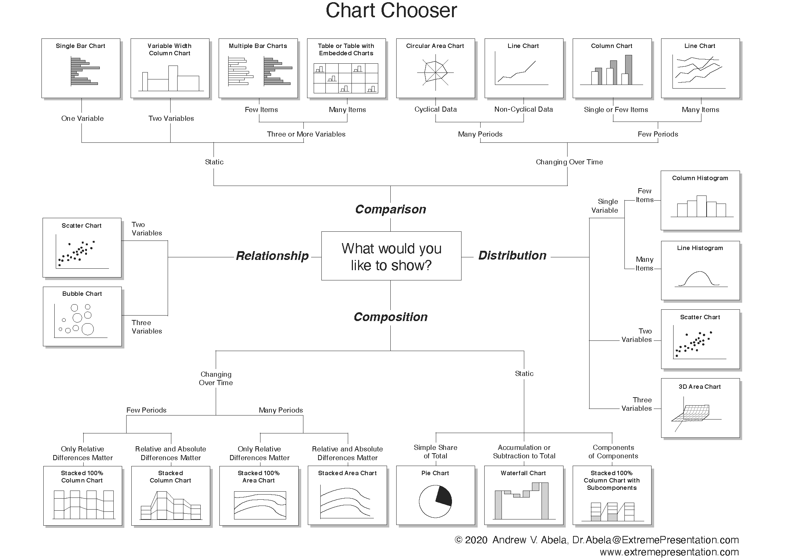
```

<div class="src" style="margin-top:4px;"><b>Source:</b> <a href="https://extremepresentation.typepad.com/blog/2006/09/choosing_a_good.html" target="_blank">Chart Chooser</a>, created by Andrew Abela in 2006 and last updated on Sept 06, 2020.</div>

???

One and a half minutes. Start at the center with the question: comparison, relationship, distribution, or composition. Today's parts follow those branches.

---

class: center, inverse, middle

# Part 2: Charts Used for Comparing Data

## (Unit of Analysis is Based on a Nominal Categorical Variable)

???

No time of its own. Part 2 runs about 24 minutes. For dot charts, recall Playfair's cities from Class 16, which they built one layer at a time.

---

# A Literal Bar Chart

`r countdown(minutes = 4, seconds = 0, top = 0, font_size = "2em")`

.panelset[

.panel[.panel-name[Activity]

.pull-left[

```{r literal_bar_chart, echo=FALSE, out.width='62%', fig.alt='Twelve glasses of beer, one per country, filled to different levels and sorted from the Czech Republic to China'}
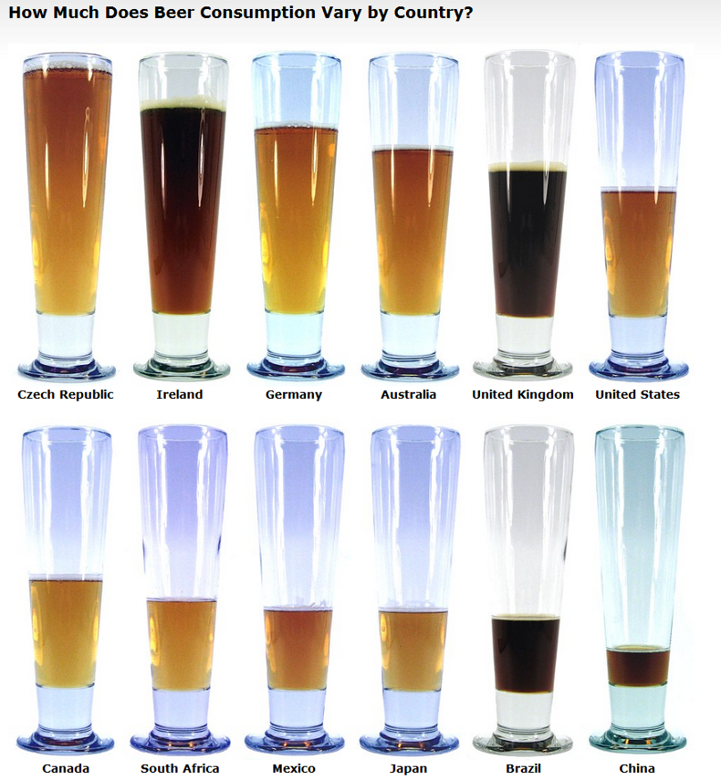
```

]

.pull-right[

<div class="q5">
<div class="qbar"><b>Task.</b> Answer the following questions:</div>
<div class="q5l"><b>(1)</b> How many variables do we have in this graph?</div>
<div class="q5l"><b>(2)</b> How many observations?</div>
<div class="q5l"><b>(3)</b> Please discuss the type of variables in the graph (i.e., nominal, ordinal, etc.).</div>
<div class="q5l"><b>(4)</b> How is the data encoded in the graph?</div>
<div class="q5l"><b>(5)</b> Any other comments/observations?</div>
</div>

]

<div class="src" style="clear:both; padding-top:4px;"><b>Source:</b> The image is from <a href="https://snippets.com/how-much-does-beer-consumption-vary-by-country.htm" target="_blank">How Much Does Beer Consumption Vary by Country?</a>, and the data seems to be based on a 2004 report from the Kirin Holdings Company.</div>

]

.panel[.panel-name[Your Answer]

.can-edit.key-c20-beer[
- Q1: ________________
- Q2: ________________
- Q3: ________________
- Q4: ________________
- Q5: ________________
]

]

.panel[.panel-name[Discussion]

.can-edit.key-c20-beer-discussion[
- Edit me to include any notes/discussion
]

]

]

???

Five minutes: four on the timer, one on the answer. Q5 connects to chartjunk and Bateman's "useful junk" from Class 15: the glasses are what make it memorable.

**Answers.**

- **Q1. Two variables:** country and beer consumption.
- **Q2. 12 observations:** one glass per country.
- **Q3.** Country is nominal. Consumption is ratio: zero means no beer, and one country can drink twice as much as another.
- **Q4.** Consumption is the level of beer in the glass, so it works as a bar: length from the bottom of the glass. Country is the label under each glass.
- **Q5.** No axis, unit, or year, so we can only compare levels, not read a value. The beer's color and the glass add ink but no data. The tapered glass means height and volume do not grow together. Two rows break the common baseline. In its favor: sorted, and hard to forget.

---

# Two Bar Charts

`r countdown(minutes = 5, seconds = 0, top = 0, font_size = "2em")`

.panelset[

.panel[.panel-name[Activity]

<div class="qbar"><b>Task.</b> Identify <b>3-4 differences that make the graph on the right better</b>, and suggest <b>how you can further improve the graph on the right</b>.</div>

.pull-left[

```{r investment_bar1, echo=FALSE, out.width='100%', fig.alt='Vertical bars in alphabetical order on a gray background with slanted labels'}
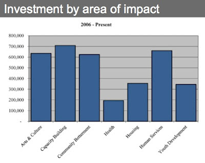
```

]

.pull-right[

```{r investment_bar2, echo=FALSE, out.width='100%', fig.alt='Sorted horizontal bars with dollar labels and a title stating that four areas received most of the investment'}
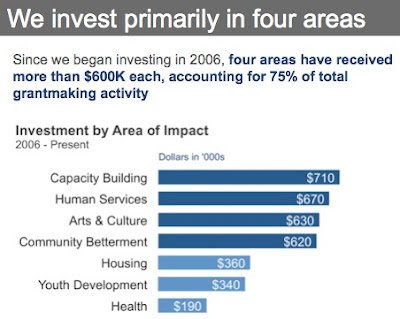
```

]

]

.panel[.panel-name[Your Answer]

.can-edit.key-c20-bars[
- Differences: ________________
- Further improvements: ________________
]

]

.panel[.panel-name[Discussion]

.can-edit.key-c20-bars-discussion[
- Edit me to include any notes/discussion
]

]

]

???

Seven minutes: five on the timer, two on the answer. Check of the 75%: 710 + 670 + 630 + 620 = 2,630 of 3,520 total, which is 74.7%.

**What makes the right graph better.**

- The title states the finding, and the subtitle gives the numbers (over $600K each, 75% of the total).
- Bars are sorted by value, not alphabetically.
- Horizontal bars keep the labels flat and readable.
- Direct labels replace the axis, grid lines, and gray background.
- Darker bars mark the four areas in the title.

**How to improve it further.**

- Replace "2006 - Present" with an end date, since "present" ages.
- Show the total ($3.52M) or each area's share, so the reader can check the 75%.
- Write $710K on the bar and drop "Dollars in '000s".
- Remove the repeated titles: the header, the sentence, and "Investment by Area of Impact" say much the same thing.

---

# Issues with the Interpretation of Bar Charts

```{r interpret1, echo=FALSE, out.width='48%', fig.align='center', fig.alt='The Draw Datapoints on Graph measure, shown in three stages on one graph'}
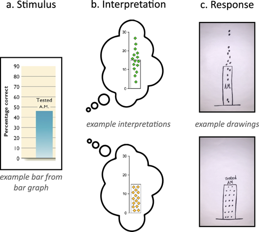
```

.center[.font70[The Draw Datapoints on Graph (DDoG) measure maintains the graph as a consistent reference frame across its three stages.]]

<div class="src"><b>Source:</b> Kerns and Wilmer (2021). <i>Journal of Vision</i>. DOI: <a href="https://doi.org/10.1167/jov.21.12.17" target="_blank">10.1167/jov.21.12.17</a></div>

???

One and a half minutes. People are shown a bar and asked to draw the data behind it. That is how the study finds out what readers think a bar means.

---
count:false

# Issues with the Interpretation of Bar Charts

```{r interpret2, echo=FALSE, out.width='27%', fig.align='center', fig.alt='A mean bar graph and a count bar graph look the same, but the mean bar has data above and below its top while the count bar has all its data inside'}
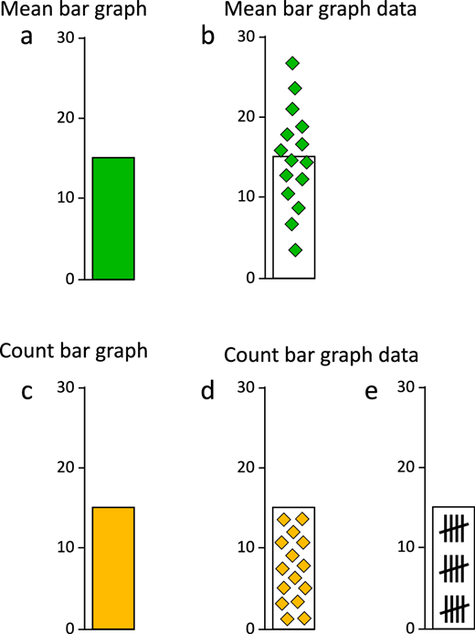
```

.center[.font70[Data distribution differs categorically between mean and count graphs. (a) Mean bar graphs and (c) count bar graphs do not differ in basic appearance, but they do depict categorically different data distributions.]]

<div class="src"><b>Source:</b> Kerns and Wilmer (2021). <i>Journal of Vision</i>. DOI: <a href="https://doi.org/10.1167/jov.21.12.17" target="_blank">10.1167/jov.21.12.17</a></div>

???

One and a half minutes. Same picture, different data. In (b), half the data sits above the top of the bar; in (d) and (e), all of it is inside.

---

# Key Takeaway 1

> .font125[The typically used **bar** chart should not be used to depict the means of a numeric variable across categories.]

???

Thirty seconds. A count bar is fine. A mean bar hides the spread and suggests the data sits inside the bar. Show the points instead: Part 4 comes back to this.

---

# Waterfall Charts

`r countdown(minutes = 4, seconds = 0, top = 0, font_size = "2em")`

.panelset[

.panel[.panel-name[Activity]

<div class="qbar"><b>Task.</b> What are the advantages and disadvantages of each chart? They are using the same exact data. Please try to list 2-4 in each category for each chart.</div>

.pull-left[

```{r bar_income, echo=FALSE, out.width='72%', fig.alt='Paired horizontal bars of 2010 expenses and income with a sentence below explaining the finding'}
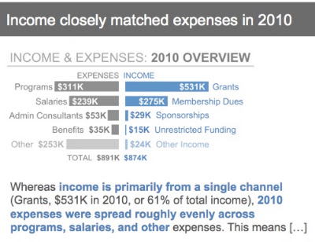
```

]

.pull-right[

```{r waterfall, echo=FALSE, out.width='100%', fig.alt='Waterfall chart: expenses step down in red to about minus 890 thousand, income steps back up in green, ending at minus 16,525'}
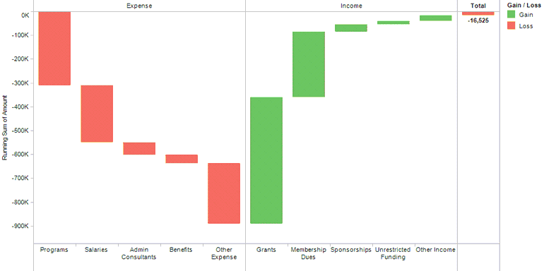
```

]

]

.panel[.panel-name[Your Answer]

.can-edit.key-c20-waterfall[
- Bars, advantages and disadvantages: ________________
- Waterfall, advantages and disadvantages: ________________
]

]

.panel[.panel-name[Discussion]

.can-edit.key-c20-waterfall-discussion[
- Edit me to include any notes/discussion
]

]

]

???

Six minutes: four on the timer, two on the answer. The check: expenses 311 + 239 + 53 + 35 + 253 = 891; income 531 + 275 + 29 + 15 + 24 = 874. If the question is "did we break even, and why?" the waterfall wins; if it is "how much did each line bring in?" the bars win. Power BI, from Class 18, has a built-in waterfall.

**Paired bars.**

- Advantage: every value is printed, so exact reading is easy.
- Advantage: each side shares a baseline, so items within a side compare well.
- Advantage: the sentence tells the reader what to see.
- Disadvantage: the net result is not shown: the reader must subtract $874K from $891K.
- Disadvantage: income and expense items are harder to compare across the center.

**Waterfall.**

- Advantage: it shows how each item moves the running total to the net (-$16,525).
- Advantage: the net result stands out.
- Disadvantage: floating bars have no common baseline, so sizes are harder to compare.
- Disadvantage: only the total has a label, and "running sum" takes explaining.
- Disadvantage: red and green are a poor pair for color-vision deficiency (Class 15).

Image sources: [paired bars](https://2.bp.blogspot.com/-B9n30Ev5kvg/TrLKEc6Nr-I/AAAAAAAADHc/KPhx6mnvsu8/s400/Income+%2526+Expenses+-+AFTER.jpg), [waterfall](https://lh5.ggpht.com/-D9ui-i_gH4A/Trf9zScsXiI/AAAAAAAAWrQ/6kKFFMHH4XE/Storytelling%252520with%252520Data%252520Waterfall_thumb%25255B7%25255D.png?imgmax=800).

---

# 3D Bar Charts are Awful

```{r harvard_penn1, echo=FALSE, out.width='62%', fig.cap = "Adam Grant's Plot of the Penn and Harvard Bar Chart", fig.alt='3D bars for Penn at 30.19 percent and Harvard at 7.41 percent, drawn on a tilted floor'}
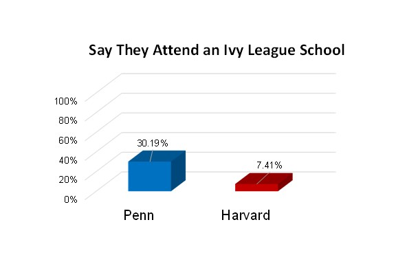
```

<div class="src"><b>Source:</b> <a href="https://twitter.com/AdamMGrant/status/1339925914327638017" target="_blank">Adam Grant's tweet</a>, December 18, 2020.</div>

???

One minute. The tweet's point: Penn students are more likely than Harvard students to mention that they go to an Ivy League school. Ask them to read Penn's bar against the axis without using the printed label.

---
count: false

# 3D Bar Charts are Awful

```{r harvard_penn2, echo=FALSE, fig.cap = 'A remake of the plot with colorblind-friendly colors and a 2D bar representation to avoid distorting the data', fig.height=2.6}

df = tibble::tibble(School = c('Penn', 'Harvard'),
                    Percentage = c(0.3019, 0.0741) )

df %>% ggplot( aes(x = reorder(School, -Percentage), y = Percentage, fill = School) ) +
  geom_bar(stat = 'identity') +
  geom_text( aes( label = scales::percent(Percentage) ), vjust = -0.5 ) +
  scale_y_continuous(labels = scales::percent, limits = c(0, 1),
                     breaks = scales::pretty_breaks(6)) +
  scale_fill_brewer(palette = 'Dark2') +
  theme_bw() +
  theme(legend.position = 'none') +
  labs(x = 'School', y = 'Percentage of Respondents',
       title = 'Say They Attend an Ivy League School')


```

???

Thirty seconds. Same two numbers, nothing to decode.

---
count: false

# 3D Charts are Awful: Even This

```{r chart_exception_1, echo = FALSE, out.width='62%', fig.alt='A 3D bar chart from a charting library, drawn with depth and rotation'}
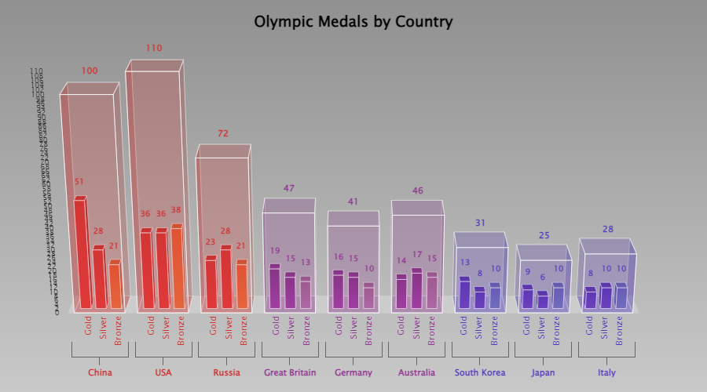
```

<div class="src"><b>Source:</b> See the <a href="https://codepen.io/zingchart/full/ePxQmd/" target="_blank">interactive version of the chart by clicking here</a>.</div>

???

Thirty seconds. Polished, interactive, and still 3D.

---

class: inverse, center, middle

# Part 3: Proportions

???

No time of its own. Part 3 runs about 18 minutes: 5 for the game, then 13 for the slides.

---

# Pie on Trial

<div style="display:grid; grid-template-columns:1fr 1.05fr; gap:16px; margin-top:10px;">
<div class="card"><div class="ch">How to play</div><div class="cb" style="font-size:15px; line-height:1.5;">
<div class="gd-row"><b>1.</b> Scan your section's code. No name and no seat.</div>
<div class="gd-row"><b>2.</b> When the game starts, a chart appears on your phone.</div>
<div class="gd-row"><b>3.</b> Tap the <b>largest</b> slice or bar, or its letter. You have 15 seconds per chart.</div>
<div class="gd-row"><b>4.</b> Six charts, about two minutes.</div>
<div style="color:#585E60; margin-top:10px;">Nothing counts toward your grade. The screen shows only class totals.</div>
</div></div>
<div class="card"><div class="ch gray">Join</div><div class="cb">
<div class="qr-pair">
<div class="qr-box"><div class="sec">Section A <span>(8:30 AM)</span></div><div class="url"><a href="https://isa401-pie-on-trial.vercel.app/?section=A" target="_blank">isa401-pie-on-trial.vercel.app/?section=A</a></div></div>
<div class="qr-box"><div class="sec">Section B <span>(10:05 AM)</span></div><div class="url"><a href="https://isa401-pie-on-trial.vercel.app/?section=B" target="_blank">isa401-pie-on-trial.vercel.app/?section=B</a></div></div>
</div>
</div></div>
</div>

???

Five minutes: about two of play, then the reveal on the host page. Run this before any pie slide: the next slides show the same data.

Host view: https://isa401-pie-on-trial.vercel.app/host?section=A for Section A and https://isa401-pie-on-trial.vercel.app/host?section=B for Section B. Admin key: from Fadel's notes (not in this public deck). Players need no name or seat.

After the reveal, click on to the pie slides: they show the same three datasets, in the same order.

---

# My Favorite Pie Chart

```{r egyptian_pie, echo=FALSE}
library(tidyverse)
data <- data.frame(
  category = c("Sky", "Sunny Side of the Pyramid", "Shady Side of the Pyramid") |> forcats::as_factor(),
  value = c(75, 20, 5)
)

# Plotting the pie chart
ggplot(data, aes(x = "", y = value, fill = category)) +
  geom_bar(stat = "identity", width = 1) +
  coord_polar("y", start = 2.25) +
  theme_void(base_size = 18) +
  labs(title = "The Egyptian Pie Chart", fill = '') +
  scale_fill_manual(values = c("Sky" = "skyblue", "Shady Side of the Pyramid" = "darkgoldenrod4", "Sunny Side of the Pyramid" = "darkgoldenrod1")) +
  theme(plot.title =  element_text(vjust = 0.5, face = "bold"))
```

<div class="src"><b>Note:</b> Humor aside, pie charts are almost always awful!!</div>

???

Thirty seconds. A pyramid in a pie. A laugh before the evidence.

---

# Pie Charts are Awful By Design

```{r pie_charts1, echo=FALSE, fig.width=8, fig.height=2.9, fig.alt='Three pie charts of five slices. All three look almost the same'}
# Plot
plot_pie <- function(data){

ggplot(data, aes(x="name", y=value, fill=name)) +
  geom_bar(width = 1, stat = "identity") +
  coord_polar("y", start=0, direction = -1) +
  scale_fill_viridis(discrete = TRUE,  direction=-1) +
  geom_text(aes(label = name, color = name %in% c("d", "e")), size = 4, position = position_stack(vjust = 0.5)) +
  scale_color_manual(values=c("black", "white")) +
  theme_bw() +
  theme(
    legend.position="none",
    plot.title = element_text(size=14),
    panel.grid = element_blank(),
    axis.text = element_blank()
  ) +
  xlab("") +
  ylab("")

}

a <- plot_pie(data1)
b <- plot_pie(data2)
c <- plot_pie(data3)

a + b + c
```

<div class="lesson" style="margin-top:4px;">The three datasets from the game. Which slice is largest in each pie?</div>

<div class="src" style="margin-top:4px;"><b>Source:</b> The charts are based on the R code provided in <a href="https://www.data-to-viz.com/caveat/pie.html" target="_blank">From-Data-to-Viz: The Issue with Pie Chart</a>. Values changed so that each dataset sums to 100%.</div>

???

One minute. Ask the question once more, then click. Slices start at 12 o'clock and run clockwise from a to e, as they did in the game.

---
count:false
# Pie Charts are Awful By Design

```{r pie_charts2, echo=FALSE, fig.width=8, fig.height=2.9, fig.alt='The same three datasets as bars: rising from a to e, nearly flat, and falling from a to e'}
plot_bar <- function(data){
  ggplot(data, aes(x=name, y=value, fill=name)) +
    geom_bar( stat = "identity") +
    scale_fill_viridis(discrete = TRUE, direction=-1) +
    scale_color_manual(values=c("black", "white")) +
    geom_text( aes( label = paste0(value, '%') ), vjust = -0.5, size = 3 ) +
    theme_bw() +
    theme(
      legend.position="none",
      plot.title = element_text(size=14),
      panel.grid = element_blank(),
    ) +
    ylim(0,25) +
    xlab("") +
    ylab("")
}

# Make 3 barplots
a <- plot_bar(data1)
b <- plot_bar(data2)
c <- plot_bar(data3)

# Put them together with patchwork
a + b + c
```

<div class="lesson" style="margin-top:4px;"><b class="r">Rising, flat, falling.</b> The bars show a pattern the pies hid. Be fair to pies: these values are close on purpose, and pies do better when the differences are large.</div>

???

One minute. Position along a common scale beats angle (Cleveland and McGill, Class 15). Bars also came second in the game, so they had a small practice advantage: say so if a student raises it.

---

# And Often Made Even Worse

<div class="worse4">
<div class="card"><div class="ch gray">3D</div><div class="cb">Tilt makes the front slices look larger.</div></div>
<div class="card"><div class="ch gray">Side legend</div><div class="cb">The eye travels back and forth to find each slice's name.</div></div>
<div class="card"><div class="ch gray">Exploded</div><div class="cb">The gaps add nothing, and the slices are harder to compare.</div></div>
<div class="card"><div class="ch">SUM(%) != 100%</div><div class="cb">Fox's slices sum to <b>`r fox_sum`%</b>.</div></div>
</div>

<div class="lesson" style="margin-top:12px;">The first three pies use the same five values (24, 22, 20, 18, 16). A pie's slices only make sense as parts of one whole, and Fox's cannot be.</div>

<div class="src" style="margin-top:6px;"><b>Image:</b> <a href="https://flowingdata.com/wp-content/uploads/2009/11/Fox-News-pie-chart-620x465.png" target="_blank">Fox News chart via FlowingData</a>.</div>

???

One minute. Go left to right. Fox is the only real chart here; the first three are made for the slide.

---

# Key Takeaway 2

.pull-left[

> .font125[Please do **NOT** use pie charts.]

<details style="font-size:14px; line-height:1.4;">
<summary>If you need any further evidence, please check <i>?pie()</i> in R. Even statistical software are recommending against using pie charts!!</summary>

<b>Note</b>

Pie charts are <b>a very bad way of displaying information</b>. The eye is good at judging linear measures and bad at judging relative areas. A bar chart or dot chart is a preferable way of displaying this type of data.

Cleveland (1985), page 264: <br>“Data that can be shown by pie charts always can be shown by a dot chart. <b>This means that judgements of position along a common scale can be made instead of the less accurate angle judgements</b>.”

This statement is based on the empirical investigations of Cleveland and McGill as well as investigations by perceptual psychologists.

</details>

]

.pull-right[

```{r pie_summary, echo=FALSE, fig.width=5, fig.height=3.4}
data_pie <- data.frame(
  category = c("No", "No, but in gray") |> forcats::as_factor(),
  value = c(85, 15)
)

# Plotting the pumpkin pie chart
ggplot(data_pie, aes(x = "", y = value, fill = category)) +
  geom_bar(stat = "identity", width = 1) +
  coord_polar("y", start = 0) +
  theme_void(base_size = 18) +
  labs(title = "Should you use Pie Charts?", fill = '') +
  scale_fill_manual(values = c("No" = "darkred", "No, but in gray" = "lightgray", "Whipped Cream" = "white")) +
  theme(plot.title =  element_text(vjust = 0.5, face = "bold"))
```

]

???

One minute. Open the details and read the Cleveland line.

---

# Stacked Bar Charts

`r countdown(minutes = 4, seconds = 0, top = 0, font_size = "2em")`

.panelset[

.panel[.panel-name[Activity]

<div class="qbar"><b>Task.</b> When is it best to use the four charts below? They are using the same exact data.</div>

```{r stacked_four, echo=FALSE, out.width='48%', fig.align='center', fig.alt='Four charts of 2003 sales by region: a single 100 percent stacked bar, stacked columns by quarter, sorted bars of share by region, and clustered columns by quarter'}
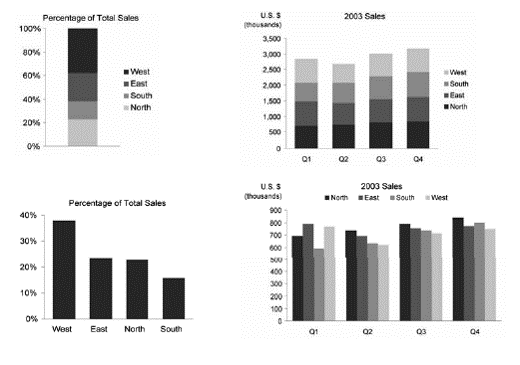
```

]

.panel[.panel-name[Your Answer]

.can-edit.key-c20-stacked[
- Top left: ________________
- Top right: ________________
- Bottom left: ________________
- Bottom right: ________________
]

]

.panel[.panel-name[Discussion]

.can-edit.key-c20-stacked-discussion[
- Edit me to include any notes/discussion
]

]

]

???

Five minutes: four on the timer, one on the answer.

**Answers.**

- **Top left, one 100% stacked bar.** A rough sense of parts of one whole in one period. Weak for comparing regions, since only the bottom segment sits on the baseline.
- **Top right, stacked columns by quarter.** How the total changes across quarters, with the mix as a secondary detail. Only the bottom region and the total are easy to compare.
- **Bottom left, sorted bars of share.** Ranking the regions for the year. The most precise way to compare shares, since all bars sit on one baseline.
- **Bottom right, clustered columns by quarter.** Comparing regions within a quarter, or one region across quarters. Totals are hard to see, and four colors in four clusters take work to read.

---

# A Note on Stacked Bar Charts

```{r stacked_comp, echo=FALSE, out.width='62%', fig.alt='Stacked 100 percent columns of computing device sales by operating system in 2008, 2012 and 2016, in five colors'}
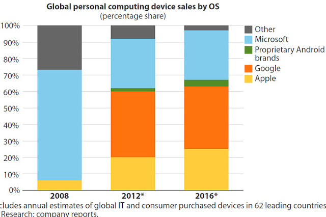
```

<div class="src"><b>Source:</b> <a href="https://www.storytellingwithdata.com/blog/2012/11/to-stack-or-not-to-stack" target="_blank">Storytelling with Data: To Stack or Not to Stack</a></div>

???

One minute. Ask: what happened to Microsoft? Its segment does not sit on the baseline, so it is hard to read.

---
count:false
# A Note on Stacked Bar Charts

```{r stacked_comp1, echo=FALSE, out.width='50%', fig.alt='The same stacked columns in gray with Microsoft in blue, labeled 66, 30 and 30 percent, under a title stating the finding'}
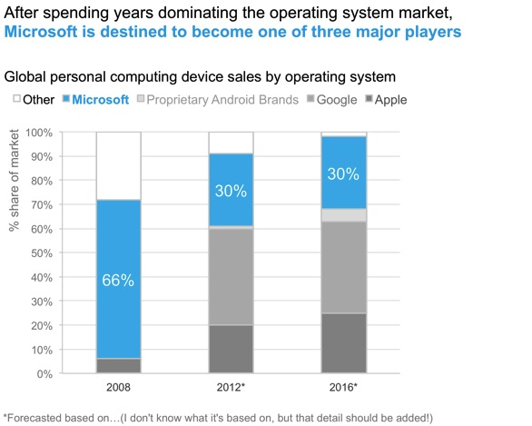
```

<div class="src"><b>Source:</b> <a href="https://www.storytellingwithdata.com/blog/2012/11/to-stack-or-not-to-stack" target="_blank">Storytelling with Data: To Stack or Not to Stack</a></div>

???

One minute. A title that states the finding, one color for the point, and labels on that series only.

---
count:false
# A Note on Stacked Bar Charts

```{r stacked_comp2, echo=FALSE, out.width='50%', fig.alt='The same data as a line chart: Microsoft falls from 66 to 30 percent while Google rises to 38 percent and Apple to 25 percent'}
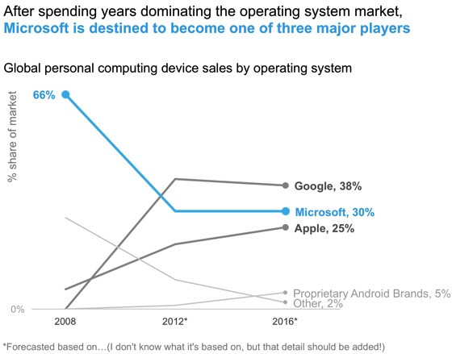
```

<div class="src"><b>Source:</b> <a href="https://www.storytellingwithdata.com/blog/2012/11/to-stack-or-not-to-stack" target="_blank">Storytelling with Data: To Stack or Not to Stack</a></div>

???

One minute. Unstacked, every series has a common baseline, and the crossing of Google and Microsoft shows.

---

class: inverse, center, middle

# Part 4: Distributions and Correlations

???

No time of its own. Part 4 runs about 8 minutes.

---

# Issues with Histograms

```{r histogram_issue, echo=FALSE, out.width='62%', fig.align='center', fig.alt='An animated histogram that fills in over time, showing that a seemingly normal distribution hides a pattern in time'}
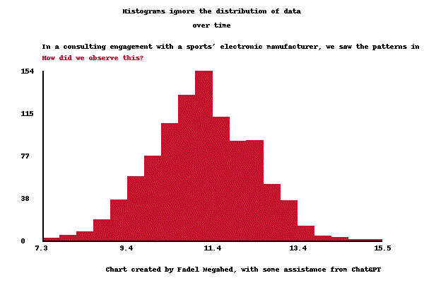
```

<div class="src"><b>Source:</b> In a quality improvement project with a major manufacturer of electronic devices, we discovered an issue in the customer's seemingly 'normal' data.</div>

???

Two minutes. Watch it build twice. The final picture looks normal, but the order in which the data arrives is hidden in a histogram.

---

# Issues with Box Plots

```{r nick_1, echo=FALSE, fig.align='center', out.width='80%', fig.alt='Box plots beside histograms: different distributions can produce the same box plot'}
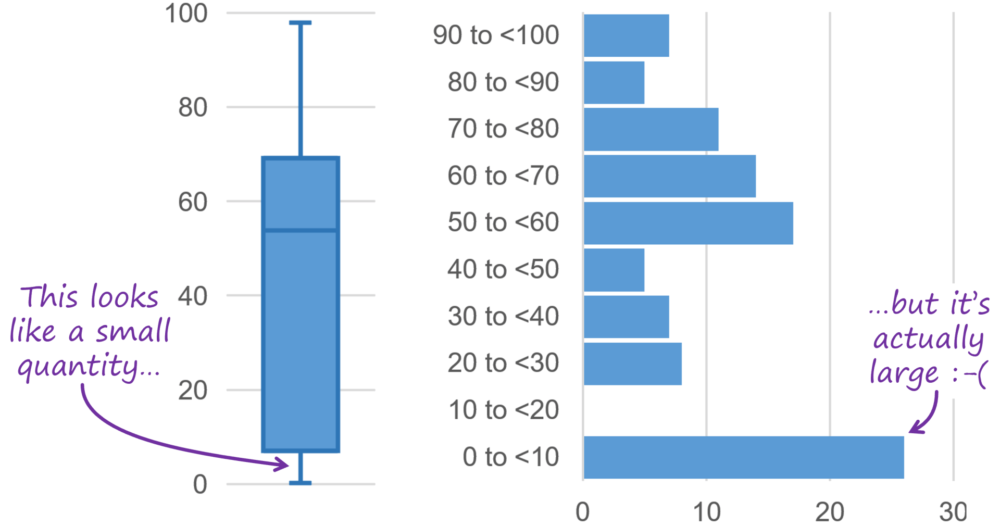
```

<div class="src"><b>Source:</b> <a href="https://nightingaledvs.com/ive-stopped-using-box-plots-should-you/" target="_blank">Nick Desbarats (2021) I've Stopped Using Box Plots. Should You?</a></div>

???

One minute. Same box, different data.

---
count: false

# Issues with Box Plots

```{r nick_2, echo=FALSE, fig.align='center', out.width='62%', fig.alt='Box plots beside strip plots of the same data'}
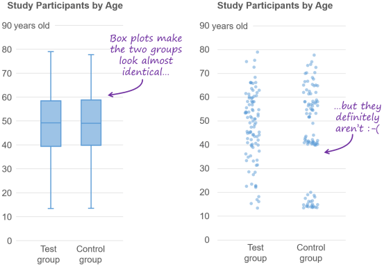
```

<div class="src"><b>Source:</b> <a href="https://nightingaledvs.com/ive-stopped-using-box-plots-should-you/" target="_blank">Nick Desbarats (2021) I've Stopped Using Box Plots. Should You?</a></div>

???

One minute. A strip plot shows every point: the same idea as the mean bar with its points in Part 2.

---

# Additional Issues with Box Plots

```{r albert_rapp, echo=FALSE, out.width='55%', fig.alt='An animation showing data rearranged while its box plot stays the same'}
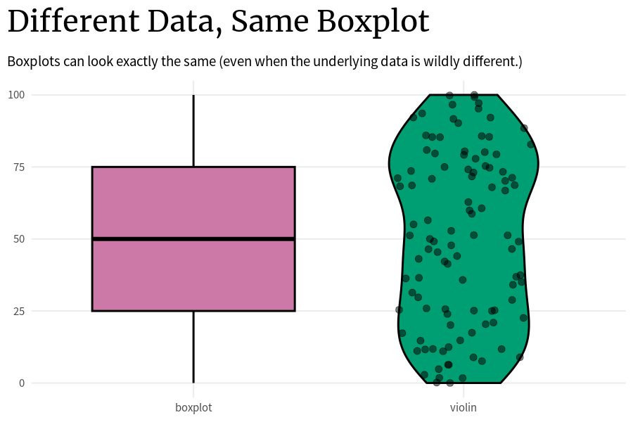
```

<div class="src"><b>Source:</b> <a href="https://www.linkedin.com/posts/dr-albert-rapp-9a5b9b28b_datavisualization-activity-7255217415628746752-YcAG?utm_source=combined_share_message&utm_medium=member_desktop" target="_blank">Albert Rapp (2024) Issues with Box Plots</a></div>

???

One minute.

---

# Key Takeaway 3

> .font125[To capture the variability in a dataset, the use of box plots **may not be** appropriate!!!!]

???

Thirty seconds.

---

# Ohio Pays Less in `r oews_below` of `r oews_n` Occupations

```{r scatter_oews, echo=FALSE, fig.width=8, fig.height=2.75, fig.alt='Scatter plot of U.S. median wage against Ohio median wage for 23 occupations. Most points sit below the equal-pay line; Operations Research Analysts and Logisticians sit above it'}
oews_labels = oews |>
  dplyr::filter(occupation %in% c("Operations Research Analysts", "Logisticians"))

oews |>
  ggplot2::ggplot(ggplot2::aes(x = us_median, y = ohio_median, color = ohio_above)) +
  ggplot2::geom_abline(slope = 1, intercept = 0, linetype = "dashed", color = "#585E60") +
  ggplot2::geom_point(size = 2.2) +
  ggplot2::geom_text(data = oews_labels, ggplot2::aes(label = occupation), size = 3, hjust = 1, nudge_x = -2500, show.legend = FALSE) +
  ggplot2::annotate("text", x = 160000, y = 168000, label = "Ohio = U.S.", size = 3, color = "#585E60", hjust = 1) +
  ggplot2::scale_color_manual(values = c("#585E60", miamired), guide = "none") +
  ggplot2::scale_x_continuous(labels = scales::label_dollar(scale = 1e-3, suffix = "K"), limits = c(50000, 180000), breaks = seq(75000, 175000, 25000)) +
  ggplot2::scale_y_continuous(labels = scales::label_dollar(scale = 1e-3, suffix = "K"), breaks = seq(75000, 175000, 25000)) +
  ggplot2::labs(x = "U.S. median annual wage", y = "Ohio median annual wage")
```

<div class="lesson" style="margin-top:2px; padding:6px 14px;"><b>Scatter plots</b> show the relationship and the exceptions at once. Each dot is an occupation. <b class="r">r = `r oews_r`:</b> occupations that pay more nationally also pay more in Ohio. Below the dashed line, Ohio pays less. These wages are not adjusted for cost of living.</div>

<div class="src" style="margin-top:4px;"><b>Data:</b> BLS Occupational Employment and Wage Statistics, May 2025 (<code>data/oews_2025_business_occupations.csv</code>, from the Class 19 lab).</div>

???

Two minutes. The two red points, Operations Research Analysts and Logisticians, are the exceptions. A scatter plot shows the relationship and the exceptions at once; a correlation alone would give only the 0.95. Correlation is not causation, and with these wages there is no cost-of-living adjustment.

---

class: inverse, center, middle

# Recap

???

No time of its own. The recap runs 2 minutes.

---

# Summary of Main Points

- Identify strengths & weaknesses of basic charts

- Use appropriate charts based on objective

- Avoid using pie charts (never use pie charts)

- Avoid 3D graphs (unless VR changes their utility)

???

One minute. Fadel's four bullets. Bullet 3 is the plain version of the game objective.

---

# Before Next Class

<div class="lesson" style="margin-top:6px;"><b class="r">Wednesday, Nov 4:</b> see the course schedule on <a href="https://miamioh.instructure.com/courses/258169" target="_blank" style="color:#c3142d;">Canvas</a> for the topic.</div>

<div style="display:grid; grid-template-columns:1fr 1fr; gap:16px; margin-top:16px;">
<div class="card">
  <div class="ch">Suggested</div>
  <div class="cb" style="font-size:14.5px; line-height:1.6;">
    <div>Wilke, <i>Fundamentals of Data Visualization</i>: <a href="https://clauswilke.com/dataviz/visualizing-proportions.html" target="_blank"><b>ch. 10, Visualizing proportions</b></a>.</div>
    <div style="color:#585E60;">Free online. When pies, stacked bars, and side-by-side bars each work.</div>
    <div style="margin-top:10px;"><a href="https://www.storytellingwithdata.com/blog/2012/11/to-stack-or-not-to-stack" target="_blank"><b>To Stack or Not to Stack</b></a> (Storytelling with Data, 2012).</div>
    <div style="color:#585E60;">The full post behind today's three stacked charts.</div>
  </div>
</div>
<div class="card">
  <div class="ch gray">Skim if curious</div>
  <div class="cb" style="font-size:14.5px; line-height:1.6;">
    <div>Kerns and Wilmer (2021). <a href="https://doi.org/10.1167/jov.21.12.17" target="_blank"><b>Two graphs walk into a bar</b></a>. <i>Journal of Vision</i>, 21(12), 17.</div>
    <div style="color:#585E60;">The study behind Key Takeaway 1.</div>
    <div style="margin-top:10px;">Desbarats (2021). <a href="https://nightingaledvs.com/ive-stopped-using-box-plots-should-you/" target="_blank"><b>I've Stopped Using Box Plots. Should You?</b></a></div>
    <div style="color:#585E60;">The argument behind Key Takeaway 3.</div>
  </div>
</div>
</div>


???

One minute. The readings are optional. Total for the deck: about an hour.
