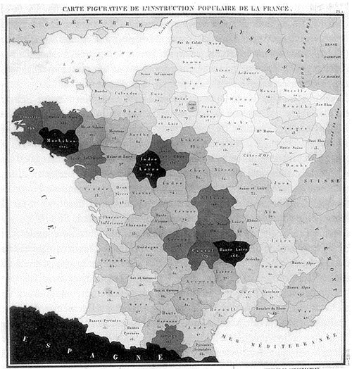
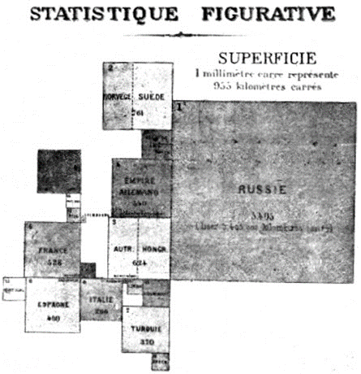
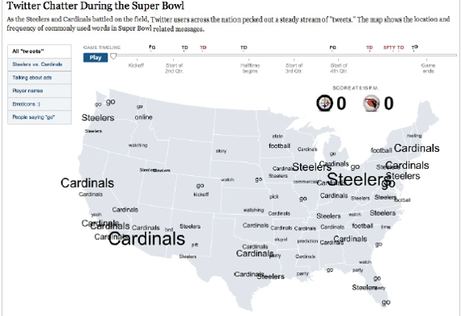
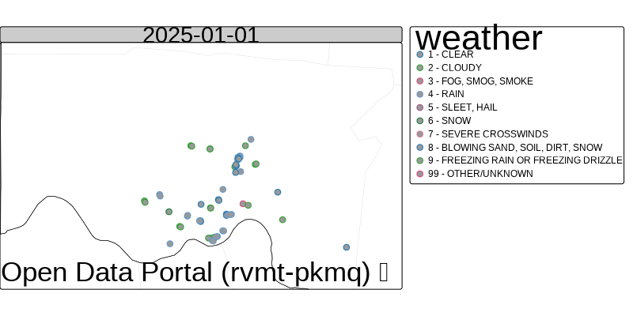
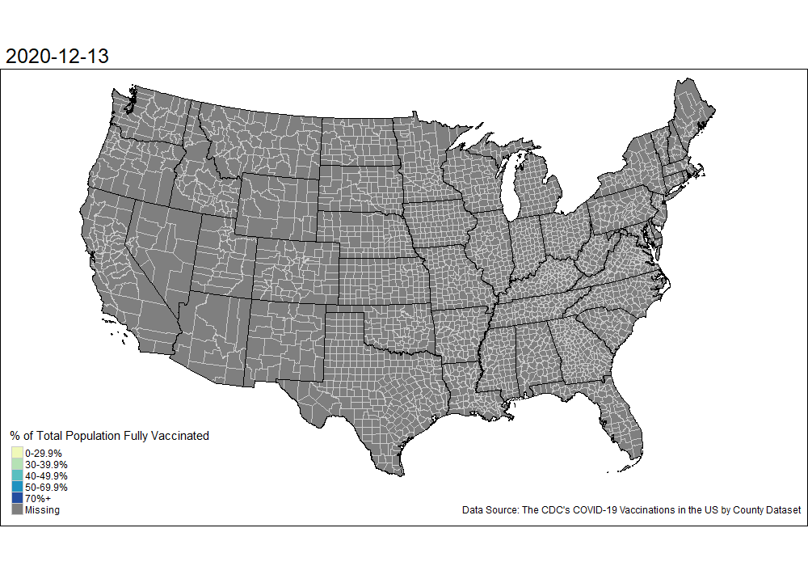

```{r setup, include=FALSE}
knitr::opts_chunk$set(cache = FALSE,
                      echo = FALSE,
                      warning = FALSE,
                      message = FALSE,
                      progress = FALSE,
                      verbose = FALSE,
                      dev = 'png',
                      fig.height = 3,
                      dpi = 300,
                      fig.align = 'center')

options(htmltools.dir.version = FALSE, width = 52)

miamired = '#C3142D'

if(require(pacman)==FALSE) install.packages("pacman")
if(require(devtools)==FALSE) install.packages("devtools")
if(require(countdown)==FALSE) devtools::install_github("gadenbuie/countdown")
if(require(xaringanExtra)==FALSE) devtools::install_github("gadenbuie/xaringanExtra")

pacman::p_load(tidyverse, magrittr, lubridate, janitor, # data analysis pkgs
               tidyquant, scales, patchwork, # time series data and figures
               calendR, gganimate, gifski, # calendar plot and animated chart
               geojsonio, leaflet, # choropleth
               fontawesome, xaringanExtra, countdown) # for slides

ggplot2::theme_set(ggplot2::theme_bw(base_size = 12))

# Code styling shared by all ISA 401 decks: hl_r() + knitr source hook (see style_files/hl_r.R)
source("../../style_files/hl_r.R")
```

```{r xaringan-themer, include=FALSE, warning=FALSE}
if(require(xaringanthemer) == FALSE) install.packages("xaringanthemer")
library(xaringanthemer)

style_mono_accent(base_color = "#84d6d3",
                  base_font_size = "20px")

xaringanExtra::use_xaringan_extra(c("tile_view", "animate_css", "tachyons", "panelset", "broadcast", "share_again", "search", "fit_screen", "editable"))

xaringanExtra::use_clipboard(button_text = paste0(fontawesome::fa("clipboard", fill = "#dedede", height = "0.9em"), " Copy"), success_text = paste0(fontawesome::fa("check", fill = "#b9ca4a", height = "0.9em"), " Copied"))
```

```{r data_deck, include=FALSE}
fig_dir = "../../figures/ts_spatial"
dir.create(fig_dir, showWarnings = FALSE, recursive = TRUE)

# ---- Part 1: the Tableau lab's line chart (statewide daily new cases, ohio_covid.csv) ----
ohio_covid = readr::read_csv("../../data/ohio_covid.csv", show_col_types = FALSE)
ohio_daily = ohio_covid |>
  dplyr::group_by(date) |>
  dplyr::summarise(new_cases = sum(new_cases))
ohio_peak = ohio_daily |> dplyr::slice_max(new_cases, n = 1)
stopifnot(dplyr::n_distinct(ohio_covid$county) == 88, ohio_peak$date == as.Date("2022-01-15"))

# ---- Part 1: Cincinnati crashes by day (the calendar plot) ----
daily_crashes_2025 = readr::read_csv('../../data/cincy_daily_crashes_2025.csv', show_col_types = FALSE)
crash_wday = daily_crashes_2025 |>
  dplyr::mutate(wday = lubridate::wday(date, label = TRUE)) |>
  dplyr::group_by(wday) |>
  dplyr::summarise(mean_n = mean(n))
stopifnot(nrow(daily_crashes_2025) == 365)

# ---- Part 1: the animated bubble chart (Gapminder data, the file used in the Power BI demo) ----
gapminder = readr::read_csv("../../data/gapminder.csv", show_col_types = FALSE)
bubble_gif = file.path(fig_dir, "gapminder_bubbles.gif")
if (!file.exists(bubble_gif)) {
  bubbles = gapminder |>
    ggplot2::ggplot(ggplot2::aes(x = gdpPercap, y = lifeExp, size = pop, color = continent)) +
    ggplot2::geom_point(alpha = 0.75) +
    ggplot2::scale_x_log10(labels = scales::label_dollar()) +
    ggplot2::scale_size(range = c(1.5, 16), guide = "none") +
    # Okabe-Ito hues: Africa (orange) and Oceania (near-black) can no longer be confused
    ggplot2::scale_color_manual(values = c(Africa = "#E69F00", Americas = "#CC79A7", Asia = "#009E73",
                                           Europe = "#0072B2", Oceania = "#1A1A1A")) +
    ggplot2::guides(color = ggplot2::guide_legend(override.aes = list(size = 5, alpha = 1))) +
    ggplot2::labs(title = "Year: {round(frame_time)}", x = "GDP per capita (log scale, inflation-adjusted $)",
                  y = "Life expectancy (years)", color = NULL,
                  caption = "Data: Gapminder (gapminder R package); bubble area = population") +
    ggplot2::theme_bw(base_size = 15) +
    ggplot2::theme(legend.position = "right", plot.title = ggplot2::element_text(face = "bold", color = miamired)) +
    gganimate::transition_time(year) +
    gganimate::ease_aes("linear")
  gganimate::animate(bubbles, nframes = 110, fps = 10, end_pause = 15, width = 1000, height = 520, units = "px", res = 100, device = "png",
                     renderer = gganimate::gifski_renderer(bubble_gif))
}

# ---- Part 2: last night's election maps ----
#   live_frame(): an embedded live map (ABC News allows embedding; the NYT and the Guardian do not). The page is
#     loaded at its own width (iw) and shown through a window: scaled by s, shifted up by `off` px. The frame
#     loads only when its slide is shown (see the script on the last slide).
#   snapshot(): a saved screenshot with a Source line and the time it was taken (the file's time stamp).
as_of = function(f) {
  t = lubridate::with_tz(file.mtime(f), "America/New_York")
  paste0(sub("^0", "", format(t, "%I:%M %p")), " ET, ", format(t, "%b "), as.integer(format(t, "%d")), ", ", format(t, "%Y"))
}
live_frame = function(src, url, label, outlet, title, iw, ih, off, vw, vh, s) {
  paste0('<div style="position:relative; overflow:hidden; width:', round(vw * s), 'px; height:', round(vh * s),
         'px; border:1px solid #e5e7eb; border-radius:4px;"><iframe data-src="', src, '" data-reload="1" title="', title,
         '" scrolling="no" style="position:absolute; left:0; top:', -round(off * s), 'px; width:', iw, 'px; height:', ih,
         'px; max-width:none; max-height:none; border:0; transform:scale(', s, '); transform-origin:0 0;"></iframe></div>',
         '<div class="src" style="margin-top:4px;"><b>Source:</b> <a href="', url, '" target="_blank">', label, '</a>, ', outlet,
         ' (live map; it updates as races are called). ',
         '<button type="button" class="map-reload" title="Reload the live map" ',
         'onclick="var f=this.parentNode.previousElementSibling.querySelector(\'iframe\'); f.setAttribute(\'src\', \'about:blank\'); ',
         'setTimeout(function(){ f.setAttribute(\'src\', f.getAttribute(\'data-src\')); }, 60); event.stopPropagation(); return false;">',
         '&#8635; reload map</button></div>')
}
snapshot = function(file, url, label, outlet, alt, height = "360px", note = "") {
  f = file.path(fig_dir, file)
  paste0('<div style="text-align:center;"></div>',
         '<div class="src" style="margin-top:4px;"><b>Source:</b> <a href="', url, '" target="_blank">', label, '</a>, ', outlet, note, '</div>')
}
snap_img = function(f, alt, height) {
  paste0('')
}
cartogram_png = file.path(fig_dir, "guardian_2026_house_cartogram.png")
shift_png = file.path(fig_dir, "nyt_2026_house_shift.png")   # optional NYT snip; see refresh_election_maps.md
nyt_gift_house = "https://www.nytimes.com/interactive/2026/11/03/us/elections/results-house.html?unlocked_article_code=1.N1E.s7BX.kaG3TDRQxVFD&smid=url-share"
guardian_url = "https://www.theguardian.com/us-news/ng-interactive/2026/nov/03/midterm-elections-full-results-senate-house-governor-races"
```

<style>
/* shared cards */
.card { border:1px solid #d1d5db; border-radius:8px; overflow:hidden; box-shadow:0 1px 3px rgba(0,0,0,0.1); background:#ffffff; }
.card .ch { background:#c3142d; color:#fff; font-weight:700; font-size:14.5px; padding:7px 12px; }
.card .ch.gray { background:#585E60; }
.card .cb { padding:9px 12px; font-size:13.5px; line-height:1.45; }
.lesson { margin-top:12px; border:1px solid #d1d5db; border-left:6px solid #c3142d; border-radius:8px; padding:9px 16px; background:#ffffff; box-shadow:0 1px 3px rgba(0,0,0,0.1); font-size:14.5px; line-height:1.5; }
.lesson b.r { color:#c3142d; }
.qbar { border:1px solid #d1d5db; border-left:6px solid #c3142d; border-radius:8px; padding:5px 14px; background:#ffffff; box-shadow:0 1px 3px rgba(0,0,0,0.1); font-size:14px; line-height:1.4; margin:0 0 6px 0; }
.qbar b { color:#c3142d; }
.src { font-size:11.5px; color:#585E60; line-height:1.4; }
.src a { color:#c3142d !important; }
.xaringanextra-clipboard-button { display:none; }
.rcode .xaringanextra-clipboard-button { display:block !important; }
/* deck 21 */
.q5l { font-size:15px; line-height:1.45; margin:9px 0; }
.live-map { margin:8px 0 10px 0; border:2px dashed #c3142d; border-radius:8px; padding:14px 16px; background:#fff7f8; font-size:18px; text-align:center; }
.live-map a { color:#1b1b1b !important; }
.card .ch.corn { background:#F5C342; color:#1b1b1b; }  /* corn yellow: "it depends" */
.card .ch.blue { background:#4e79a7; }  /* matches the bars in the chart */
.three { display:grid; grid-template-columns:repeat(3, minmax(0,1fr)); gap:12px; margin-top:8px; }
.map-q { font-size:14.5px; line-height:1.45; }
</style>

# Before We Start

<div style="display:grid; grid-template-columns:1fr 1fr; gap:14px; margin-top:12px;">
<div class="card">
  <div class="ch">1 &nbsp; Join today's Zoom</div>
  <div class="cb" style="font-size:15px; line-height:1.55;">Use the Zoom link in the <a href="https://miamioh.instructure.com/courses/258169/modules/981092" target="_blank"><b>Week 0 Module</b></a> on Canvas. <b>Mute</b> your mic and <b>turn off</b> your video.<br><br><span style="color:#585E60;">There is no R to write today. Have Tableau and Power BI open if you want to follow the demos.</span></div>
</div>
<div class="card">
  <div class="ch gray">2 &nbsp; Today's plan</div>
  <div class="cb" style="font-size:15px; line-height:1.6;"><b>Part 1. Time:</b> line charts, calendar plots, and animated charts.<br><b>Part 2. Space:</b> choropleths, cartograms, and symbol maps, with last night's election maps.<br><b>Part 3. Space and time:</b> spatiotemporal maps, then a Tableau demo.</div>
</div>
</div>

???

One minute, while people walk in. This class merges what used to be two lectures, so the time series part is kept to three chart types and is not a time series analysis class.

---

# Learning Objectives

By the end of today, you should be able to:

1. **Choose** a chart for change over time: a line chart, a calendar plot, or an animated chart.

2. **Explain** the different types of spatial plots.

3. **Select** suitable spatial graphs for different scenarios.

4. **Understand** how spatiotemporal plots can help in storytelling (what makes BI special).

???

Thirty seconds. Objectives 2 to 4 are Fadel's from the spatial lecture; objective 1 replaces the time series lecture's two objectives.

---

class: center, inverse, middle

# Part 1: Time

## Charts for Time Series Data

???

No time of its own. Part 1 runs about 25 minutes: line charts (8), calendar plots (6), animated charts (11).

---

# Recall: Our Line Chart in Tableau

```{r ohio_line, fig.width=10, fig.height=3.3, fig.alt='Line chart of Ohio daily new COVID-19 cases from March 2020 to December 2022, with waves in winter 2020, fall 2021, and a peak in January 2022; from March 2022 the line becomes a comb of weekly spikes'}
ohio_daily |>
  ggplot2::ggplot(ggplot2::aes(x = date, y = new_cases)) +
  ggplot2::geom_line(color = "#4e79a7", linewidth = 0.4) +
  ggplot2::scale_x_date(date_breaks = "3 months", date_labels = "%b %y") +
  ggplot2::scale_y_continuous(labels = scales::label_comma()) +
  ggplot2::labs(x = NULL, y = "New cases (all 88 counties)")
```

<div class="lesson" style="margin-top:0; padding:6px 14px;"><b class="r">Time series data:</b> comparable measurements recorded over time. The line joins each day to the next, so the eye reads the shape: waves, and a peak on `r format(ohio_peak$date, "%b %d, %Y")`. From March 2022 the line turns into a comb: Ohio began reporting once a week, so a line chart also shows <b>how the data were collected</b>.</div>

???

Three minutes. Ask who remembers Sheet 2 from the Tableau lab: the same chart. The comb after March 2022 is real: the daily file has zeros on six days of the week and the whole week's cases on Thursdays. Ask what a weekly total would look like (the next slide's bars). Tie to Press Time: there, SUM was wrong because the rows were running totals and a repeated population; here each row is a new count, so summing is right.

---

# Line or Bars? It Depends on the Question

```{r line_vs_bars, fig.width=10, fig.height=2.9, fig.alt='Left: daily line chart of Ohio new cases. Right: the same data as monthly totals in bars'}
ohio_monthly = ohio_daily |>
  dplyr::mutate(month = lubridate::floor_date(date, "month")) |>
  dplyr::group_by(month) |>
  dplyr::summarise(new_cases = sum(new_cases))

p_line = ohio_daily |>
  ggplot2::ggplot(ggplot2::aes(x = date, y = new_cases)) +
  ggplot2::geom_line(color = miamired, linewidth = 0.3) +
  ggplot2::scale_y_continuous(labels = scales::label_comma()) +
  ggplot2::labs(x = NULL, y = "New cases", title = "Daily: a line (shape, trend, peaks)")

p_bar = ohio_monthly |>
  ggplot2::ggplot(ggplot2::aes(x = month, y = new_cases)) +
  ggplot2::geom_col(fill = "#4e79a7") +
  ggplot2::scale_y_continuous(labels = scales::label_comma()) +
  ggplot2::labs(x = NULL, y = NULL, title = "Monthly totals: bars (each period's amount)")

(p_line | p_bar) & ggplot2::theme_bw(base_size = 12) & ggplot2::theme(plot.title = ggplot2::element_text(size = 12, face = "bold"))
```

<div class="three">
<div class="card"><div class="ch">Use a line when</div><div class="cb">there are many, evenly spaced time points and the <b>shape</b> is the message: trend, seasonality, peaks.</div></div>
<div class="card"><div class="ch corn">It is possible to use bars when</div><div class="cb">there are a few periods and each period's <b>total</b> is the message, like cases per month or sales per quarter.</div></div>
<div class="card"><div class="ch blue">Use bars when only two points</div><div class="cb">a line suggests a path you never measured. Two bars (2024 vs 2026) compare the amounts honestly.</div></div>
</div>

???

Two and a half minutes. The lab asked for "a line chart (as well as a time-based bar chart)": this is that pair. The third card is a common exam trap: with only two years of an endowment, use bars.

---

# What to Look for in a Line Chart

```{r seasonal1, fig.width=9, fig.height=2.9, fig.alt='Monthly U.S. retail sales at clothing stores, one line per year from 2015 to 2019, with the same December peak each year'}
retail_sales = tq_get(x = 'RSCCASN', from = '1992-01-01', get = 'economic.data')

retail_sales$month = month(retail_sales$date, label = T)
retail_sales$year = year(retail_sales$date) |> as.character()

retail_sales |>
  filter(year >= 2015 & year <=2019) |>
  ggplot(aes(x = month, y = price, color = year, group = year)) +
  geom_line() +
  geom_point() +
  scale_y_continuous(breaks = pretty_breaks(n=8), labels = comma, limits = c(0, 35000)) +
  labs(x = 'Month', y = 'Retail Sales' ) +
  theme_bw(base_size = 11) + theme(legend.position = 'right')
```

<div class="three">
<div class="card"><div class="ch">Trend</div><div class="cb">An increasing or decreasing pattern over time.</div></div>
<div class="card"><div class="ch">Seasonality</div><div class="cb">REGULAR patterns that repeat at a constant frequency: here, every December.</div></div>
<div class="card"><div class="ch">Cycle</div><div class="cb">Somewhat irregular rises and falls of unknown duration, like recessions.</div></div>
</div>

<div class="src" style="margin-top:4px;"><b>Data:</b> U.S. Census Bureau, Retail Sales: Clothing and Clothing Accessory Stores [RSCCASN], retrieved from <a href="https://fred.stlouisfed.org/series/RSCCASN" target="_blank">FRED</a> on `r format(Sys.Date(), '%B %d, %Y')` with <code>tidyquant::tq_get()</code>. One line per year makes the seasonal pattern easy to compare.</div>

???

Two minutes. This is the only "components" slide. Putting month on the x-axis and one line per year turns seasonality into lines that lie on top of each other. A pattern that repeats at a fixed frequency is seasonal; a one-off spike is not.

---

# Key Takeaway 1

> .font125[A **line chart** is the default for a time series: time on the x-axis, and lines that connect moments which really are connected. With only a few periods, **bars** are often clearer.]

???

Thirty seconds.

---

# Calendar Plots

```{r calendR, fig.height=4.55, fig.width=9.5, fig.alt='Calendar of 2025 with each day shaded by the number of crashes in Cincinnati, from light yellow for few to Miami red for many'}
cal = calendR::calendR(title = NULL,
              year = 2025,
              special.days = daily_crashes_2025$n,
              orientation = "landscape",
              day.size = 2.6,
              months.size = 8,
              weeknames.size = 3.6,
              margin = 0,
              text.size = 8,
              title.size = 10,
              gradient = TRUE,
              low.col = "#FFFFED",
              special.col = miamired,
              legend.pos = 'right',
              legend.title = '# Crashes') +
  theme(plot.title = element_text(face = 'bold', color =  miamired),
        legend.title = element_text(face = 'bold', size = 9),
        legend.text = element_text(size = 7),
        plot.caption = element_text(size = 7)) +
  labs(caption = 'Created by: Fadel Megahed | Data source: City of Cincy Open Data Portal (rvmt-pkmq)')

cal
```

???

Three minutes. A calendar plot is a heat map laid out like a calendar: each cell is a day, shaded by a value. Ask: what do you see? Weekends are lighter (about `r round(crash_wday$mean_n[crash_wday$wday == "Fri"])` crashes on an average Friday vs. `r round(crash_wday$mean_n[crash_wday$wday == "Sun"])` on a Sunday). The lightest day of the year was Monday, Jan 6, 2025 (10 crashes), the day of the January winter storm when schools and many offices closed. Christmas Day had 18. The darkest cluster is late October (90 on Oct 29). A line chart of the same 365 numbers would show the wiggles but not which weekday or date each one is.

---

# Bonus: A Calendar Plot in Power BI

Let us use `r fontawesome::fa('r-project')` inside Power BI to create the previous chart based on [cincy_daily_crashes_2025.csv](https://raw.githubusercontent.com/fmegahed/isa401/main/data/cincy_daily_crashes_2025.csv).

<div style="display:grid; grid-template-columns:1fr 1fr; gap:16px; margin-top:14px;">
<div class="card"><div class="ch">Steps</div><div class="cb" style="font-size:15px; line-height:1.6;">
<div><b>1.</b> Get Data &rarr; Text/CSV &rarr; the file above.</div>
<div style="margin-top:6px;"><b>2.</b> Insert an <b>R script visual</b> and drag <code>date</code> and <code>n</code> into it.</div>
<div style="margin-top:6px;"><b>3.</b> Paste the <code>calendR::calendR()</code> call from the previous slide, using <code>dataset$n</code>.</div>
</div></div>
<div class="card"><div class="ch gray">Why it matters</div><div class="cb" style="font-size:15px; line-height:1.6;">Power BI has no calendar plot of its own. An R visual lets a dashboard use any chart R can draw, refreshed with the report's data.<br><br><span style="color:#585E60;">Power BI Desktop needs R installed on the same computer for this to work.</span></div></div>
</div>

???

Three minutes, or skip if short on time. The R visual hands the selected fields to R as a data frame called dataset.

---

# Hans Rosling: The Best Stats You Have Seen

.panelset[

.panel[.panel-name[Activity]

> While watching this video, please answer the questions in the next tab!!

<center>
<div style="max-width:600px"><div style="position:relative;height:0;padding-bottom:56.25%"><iframe src="https://embed.ted.com/talks/lang/en/hans_rosling_the_best_stats_you_ve_ever_seen" width="600" height="350" style="position:absolute;left:0;top:0;width:100%;height:100%" frameborder="0" scrolling="no" allowfullscreen></iframe></div></div>
</center>
]

.panel[.panel-name[Your Solution]

- .can-edit.key-c21-rosling-a[What data is represented in this visualization? Be specific. ____]

- .can-edit.key-c21-rosling-b[How is each data type visually encoded? ___________]

- .can-edit.key-c21-rosling-c[Do you think the encodings are appropriate? _________]

]
]

???

Five minutes. Play from about 3:30 to 7:00, where the bubbles start moving. Answers: country (one bubble each, nominal), region/continent (color, nominal), fertility rate or income (x, numeric), life expectancy or child survival (y, numeric), population (bubble area, numeric), and year (motion).

---

# So What is the Motion Bubble Chart?

> Motion charts are essentially **animated bubble charts**. A bubble chart shows data using the .bold[x-axis], .bold[y-axis], and the .bold[size] and .bold[color] of the bubble. A motion chart displays .red[.bold[changes over time by showing movement within the two-dimensional space and changes in the size and color of the bubbles]]. -- [Juice Analytics](https://www.juiceanalytics.com/writing/better-know-visualization-motion-charts)

**Encoding mechanisms:**

- .bold[x-axis] is typically used to encode a **numeric variable**
- .bold[y-axis] is also used to encode a **numeric variable**
- .bold[area] is used to encode a **numeric/ordinal variable**
- .bold[color] is typically used to encode a **nominal variable**
- .bold[motion/animation] is typically used to encode **time**

???

One and a half minutes. Six variables at once (five encodings, plus one bubble per country): this is why the next class (high-dimensional data) starts from here.

---

# An Animated Bubble Chart

<div style="display:grid; grid-template-columns:minmax(0,1.8fr) minmax(0,1fr); gap:16px; align-items:start; margin-top:4px;">
<div></div>
<div>
<div class="card"><div class="ch">Read it like Rosling</div><div class="cb" style="font-size:14.5px; line-height:1.6;">
<div><b>each bubble:</b> a country</div>
<div><b>x:</b> GDP per capita (log scale)</div>
<div><b>y:</b> life expectancy</div>
<div><b>area:</b> population</div>
<div><b>color:</b> continent</div>
<div><b>motion:</b> year, 1952 to 2007</div>
</div></div>
<div class="lesson"><b class="r">Watch one bubble, then the crowd.</b> Most countries move up and to the right. Which ones fall back, and when?</div>
</div>
</div>

???

Two minutes. Let it loop twice. Things to spot: China and India (the two big bubbles) climbing; several African countries dropping in life expectancy in the 1990s (HIV/AIDS); Cambodia's dip in the late 1970s. The animation tells the story, but ask: can you say how much Japan's life expectancy changed between 1977 and 1987? No: animation is weak for exact comparisons.

---

# Live Demo: Creating Bubble Charts in Power BI

Let us use Power BI to create a similar chart to the one created by Hans Rosling. We will be using the [gapminder.csv](https://raw.githubusercontent.com/fmegahed/isa401/main/data/gapminder.csv).

<iframe data-src="https://www.gapminder.org/tools/?embedded=true#$chart-type=bubbles&url=v2" title="Gapminder bubble chart" style="width: 100%; height: 400px; margin: 0 0 0 0; border: 1px solid grey;" allowfullscreen></iframe>

<script>
(function () {
  // A frame on a hidden slide loads at 0x0 and some (Gapminder) never redraw, so load each one when its slide shows.
  if (window.__isa401LazyFrames) { return; }
  window.__isa401LazyFrames = true;
  // Live maps (data-reload) also load afresh each time their slide comes back: newest results, and no stuck blank map.
  function loadVisible() {
    var frames = document.querySelectorAll("iframe[data-src]");
    for (var k = 0; k < frames.length; k++) {
      var f = frames[k], shown = f.closest(".remark-visible") !== null;
      if (!shown) { if (f.getAttribute("src") && f.getAttribute("data-reload")) { f.setAttribute("data-away", "1"); } continue; }
      if (!f.getAttribute("src")) { f.setAttribute("src", f.getAttribute("data-src")); }
      else if (f.getAttribute("data-away")) {
        f.removeAttribute("data-away"); f.setAttribute("src", "about:blank");
        (function (g) { setTimeout(function () { g.setAttribute("src", g.getAttribute("data-src")); }, 60); })(f);
      }
    }
  }
  if (window.slideshow) { window.slideshow.on("afterShowSlide", function () { setTimeout(loadVisible, 60); }); }
  setInterval(loadVisible, 700);
  loadVisible();
})();
</script>

???

Five minutes. In Power BI: a scatter chart with gdpPercap on X (log scale in the format pane), lifeExp on Y, pop on Size, continent on Legend, country on Values, and year on the Play Axis.

---

# Key Takeaway 2

> .font125[**Animation** encodes time as time. It is great for telling a story to an audience, but weak for precise comparisons: viewers remember the motion, not the values. Pair it with a static chart when the numbers matter.]

???

Thirty seconds.

---

class: center, inverse, middle

# Part 2: Space

## Spatial Plots, with Last Night's Election Maps

???

No time of its own. Part 2 runs about 20 minutes. The election maps were captured on election night or the morning after; the time stamp is under each one.

---

# Choropleth Maps

Maps where areas are **shaded, colored, or patterned** relative to a data attribute value.

```{r dupin, fig.cap="Charles Dupin's Illiteracy in France Choropleth, created in 1826", out.height='40%', out.width='40%'}

```

???

One minute. Sheet 1 of the Tableau lab, cases by county, was a choropleth too.

---
count: false

# Choropleth Maps

Maps where areas are **shaded, colored, or patterned** relative to a data attribute value.


```{r leaflet, cache=TRUE, fig.align='center', fig.cap='Population Density in U.S.'}
states <- geojsonio::geojson_read("https://rstudio.github.io/leaflet/json/us-states.geojson", what = "sp")

bins <- c(0, 10, 20, 50, 100, 200, 500, 1000, Inf)
pal <- colorBin("YlOrRd", domain = states$density, bins = bins)

labels <- sprintf(
  "<strong>%s</strong><br/>%g people / mi<sup>2</sup>",
  states$name, states$density
) |> lapply(htmltools::HTML)

leaflet(states, width = '100%', height = 400) %>%
  setView(-96, 37.8, 4) %>%
  addProviderTiles("MapBox", options = providerTileOptions(
    id = "mapbox.light",
    accessToken = Sys.getenv('MAPBOX_ACCESS_TOKEN'))) %>%
  addPolygons(
    fillColor = ~pal(density),
    weight = 2,
    opacity = 1,
    color = "white",
    dashArray = "3",
    fillOpacity = 0.7,
    highlightOptions = highlightOptions(
      weight = 5,
      color = "#666",
      dashArray = "",
      fillOpacity = 0.7,
      bringToFront = TRUE),
    label = labels,
    labelOptions = labelOptions(
      style = list("font-weight" = "normal", padding = "3px 8px"),
      textsize = "15px",
      direction = "auto")) %>%
  addLegend(pal = pal, values = ~density, opacity = 0.7, title = NULL,
    position = "bottomright")
```

???

One and a half minutes. Hover over the states. The color scheme is sequential (light to dark) because density is one quantity that goes from low to high.

---

# Last Night: A Choropleth of House Districts

<div style="display:grid; grid-template-columns:auto minmax(0,1fr); gap:18px; align-items:start; margin-top:4px;">
<div>`r live_frame("https://abcnews.com/Elections/2026-us-house-election-results-live-map/", "https://abcnews.com/Elections/2026-us-house-election-results-live-map/", "2026 US House Election Results: Live Map", "ABC News", "ABC News live map of the 2026 U.S. House results by district", iw = 1100, ih = 1400, off = 470, vw = 740, vh = 640, s = 0.64)`</div>
<div>
<div class="lesson" style="margin-top:0;"><b class="r">Every district elects one member, but not every district gets the same ink.</b> Large rural districts fill most of the map; dense city districts are specks.</div>
<div class="lesson"><b class="r">Compare the colors with the seat count</b> above the map. Who looks like they are winning? Who is?</div>
</div>
</div>

???

Two minutes. Ask: if you only looked at the colors, who would you say is winning the House? Then read the seat count. Land does not vote: a choropleth gives each area ink in proportion to its land, not its people. This motivates cartograms in two slides.

---

# Ohio Last Night: What Does Color Mean?

<div style="display:grid; grid-template-columns:auto minmax(0,1fr); gap:18px; align-items:start; margin-top:4px;">
<div>`r live_frame("https://abcnews.com/widgets/generalstateresults?chamber=governor&source=story&stateAbbrev=oh&type=general&year=2026", "https://abcnews.com/widgets/generalstateresults?chamber=governor&source=story&stateAbbrev=oh&type=general&year=2026", "Ohio Governor Results", "ABC News", "ABC News live map of Ohio's 88 counties colored by the candidate ahead in the 2026 governor's race", iw = 600, ih = 1100, off = 0, vw = 600, vh = 590, s = 0.68)`</div>
<div style="display:grid; gap:10px;">
<div class="card"><div class="ch">Nominal (this map)</div><div class="cb">Distinct hues for categories with no order: the party or candidate in the lead.</div></div>
<div class="card"><div class="ch gray">Sequential</div><div class="cb">Light to dark for one quantity: turnout, population density, cases per 100K.</div></div>
<div class="card"><div class="ch gray">Diverging</div><div class="cb">Two hues that meet at a meaningful middle: a <b style="white-space:nowrap;">50-50</b> race. Shade would show the size of the lead.</div></div>
</div>
</div>

???

Two and a half minutes. Butler County is southwest, just north of Hamilton (Cincinnati). Ask which scheme this map uses: one hue per leading party, so nominal. Ask what a diverging version would add: shading by the size of the lead, centered on a tie, so a 51-49 county looks different from an 80-20 one. A common mistake: using many distinct hues (a nominal scheme) for a percentage, which hides the order. The map is live; if it is slow, click the Source link.

---

# Cartograms

A cartogram is a map in which **areas are scaled and distorted relative to a data
attribute value**

```{r cart1, fig.cap='The First Cartogram – Emile Levasseur, 1868', out.height='40%', out.width='40%'}

```

???

One minute. Levasseur sized each European country by its area, so the map is close to normal; the idea is that area can encode anything.

---
count: false

# Cartograms

A cartogram is a map in which **areas are scaled and distorted relative to a data attribute value**

<div style="display:grid; grid-template-columns:minmax(0,1.55fr) minmax(0,1fr); gap:18px; align-items:start; margin-top:-4px;">
<div>`r snap_img(cartogram_png, "Cartogram of the 2026 U.S. House results from the Guardian: every district is the same size, grouped into state shapes, colored by the party that won or leads", "450px")`</div>
<div>
<div class="lesson" style="margin-top:0;"><b class="r">Every district gets the same ink.</b> Compare it with the ABC district map: same races, but here area encodes seats, not land.</div>
<div class="src" style="margin-top:10px;"><b>Source:</b> <a href="`r guardian_url`" target="_blank">US midterm elections 2026: live results</a>, The Guardian; cartogram by The Downballot. Snapshot taken `r as_of(cartogram_png)`, while votes were still being counted.</div>
</div>
</div>

???

Two minutes. One equal square per district: area now encodes seats, not land. Put this next to the district map from two slides back: the same results, a very different first impression. The cost: the shapes of the states are gone, so readers need labels.

---

# Proportional Symbols Map

<div style="display:grid; grid-template-columns:minmax(0,2.3fr) minmax(0,1fr); gap:18px; align-items:center;">
<div>
`r if (file.exists(shift_png)) snap_img(shift_png, "Map of arrows showing how far and in which direction each area shifted from 2024 to 2026", "470px") else snap_img("../../figures/prop1.png", "Proportional symbol map of the 2004 presidential election: circles sized by votes, colored by the winning candidate", "470px")`
<div class="src" style="margin-top:4px;">`r if (file.exists(shift_png)) paste0('<b>Source:</b> <a href="', nyt_gift_house, '" target="_blank">U.S. House Election Results 2026 (shift from 2024)</a>, The New York Times. Snapshot taken ', as_of(shift_png), '.') else '<b>Source:</b> The New York Times, coverage of the 2004 presidential election (Bush vs. Kerry).'`</div>
</div>
<div class="lesson" style="margin-top:0;"><b class="r">The land stays put; a symbol carries the data.</b> The symbol's size (or an arrow's length) is the amount, and its color or direction is the category.</div>
</div>

???

Two minutes. In the shift map, each arrow is a symbol: its direction is toward the party that gained, and its length is how much. Symbol maps avoid the land-area problem without distorting the map, but symbols can overlap in dense areas.

---
count: false

# Proportional Symbols Map

```{r prop2, fig.cap="The NYT's U.S. Coverage of 2009 Super Bowl", out.height='63%', out.width='63%'}

```

???

One minute. Circles sized by the number of fans; color shows which team they backed.

---

# Key Takeaway 3

> .font125[Pick the map by what **area** should mean. In a **choropleth**, area is land and color is the data. In a **cartogram**, area is the data. In a **symbol map**, the land stays put and the symbol's size is the data.]

???

Thirty seconds. Last night's maps make the point: same results, three first impressions.

---

class: inverse, center, middle

# Part 3: Space and Time

## Spatiotemporal Maps

???

No time of its own. Part 3 runs about 12 minutes, including the demo.

---

# Spatiotemporal Maps

```{r spatiotemporal1, fig.cap='A visualization of car crashes in the Cincinnati metro area'}

```

???

One and a half minutes. The same crashes as the calendar plot, now placed on the map and played over time. Where they happen and when, at once.

---
count: false
# Spatiotemporal Maps

```{r spatiotemporal2, out.height='70%', out.width='70%', fig.cap='COVID vaccination rates per county as reported by the CDC'}

```

???

One minute. An animated choropleth: each frame is a choropleth, and the animation is time.

---

# Exploring the Cincy Crashes Dataset

Let us use Tableau to explore the [cincy_2025_crashes.csv](https://raw.githubusercontent.com/fmegahed/isa401/main/data/cincy_2025_crashes.csv), where we will create the following:

- A calculated field titled `unique_count`

- A plot of the total number of unique crashes per day

- A table of number of unique crashes by week day

- An animated symbols map

???

Ten minutes. unique_count is COUNTD([Instanceid]): one crash has a row per person involved, so a plain count overcounts. For the animated map: latitude and longitude on the map, date on Pages, and the Pages control to play it.

---

class: inverse, center, middle

# Recap

???

No time of its own. The recap runs 2 minutes.

---

# Summary of Main Points

- Use a line chart for a time series, bars for a few periods, a calendar plot for daily patterns, and animation to tell a story over time

- Explain the different types of spatial plots

- Select suitable spatial graphs for different scenarios

- Understand how spatiotemporal plots can help in storytelling (what makes BI special)

???

One minute.

---

# Before Next Class

<div class="lesson" style="margin-top:6px;"><b class="r">Monday, Nov 9:</b> we start with <b>Race Call</b>, a phone game on today's charts, so bring your phone. Then Visualizing High-Dimensional Data, picking up from the motion bubble chart (six variables at once).</div>

<div style="display:grid; grid-template-columns:1fr 1fr; gap:16px; margin-top:16px;">
<div class="card">
  <div class="ch">Suggested</div>
  <div class="cb" style="font-size:14.5px; line-height:1.6;">
    <div>Wilke, <i>Fundamentals of Data Visualization</i>: <a href="https://clauswilke.com/dataviz/time-series.html" target="_blank"><b>ch. 13, Visualizing time series</b></a>.</div>
    <div style="color:#585E60;">Free online. Lines, points, and when to connect them.</div>
    <div style="margin-top:10px;">Wilke: <a href="https://clauswilke.com/dataviz/geospatial-data.html" target="_blank"><b>ch. 15, Visualizing geospatial data</b></a>.</div>
    <div style="color:#585E60;">Projections, choropleths, and cartograms.</div>
  </div>
</div>
<div class="card">
  <div class="ch gray">Skim if curious</div>
  <div class="cb" style="font-size:14.5px; line-height:1.6;">
    <div>Rosling (2006). <a href="https://www.ted.com/talks/hans_rosling_the_best_stats_you_ve_ever_seen" target="_blank"><b>The best stats you've ever seen</b></a>. TED.</div>
    <div style="color:#585E60;">The whole talk, not just the part we watched.</div>
    <div style="margin-top:10px;"><a href="https://www.gapminder.org/tools/" target="_blank"><b>Gapminder Tools</b></a>.</div>
    <div style="color:#585E60;">Play with the bubble chart: change the axes, pick a country, and press play.</div>
  </div>
</div>
</div>

???

One minute. The readings are optional. Total for the deck: about 65 minutes. Race Call moved to the start of Class 22.
