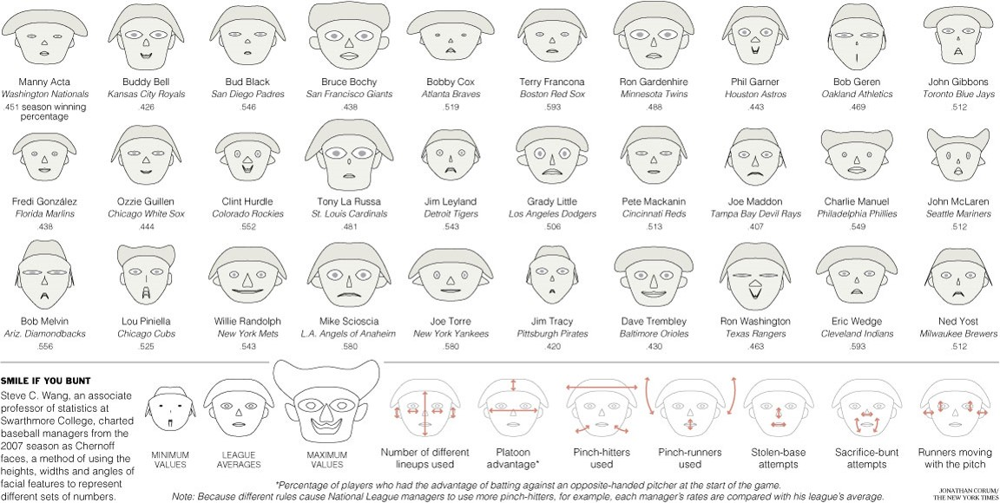

```{r setup, include=FALSE}
knitr::opts_chunk$set(cache = FALSE,
                      echo = FALSE,
                      warning = FALSE,
                      message = FALSE,
                      progress = FALSE,
                      verbose = FALSE,
                      dev = 'png',
                      fig.height = 3,
                      dpi = 300,
                      fig.align = 'center')

options(htmltools.dir.version = FALSE, width = 52)

miamired = '#C3142D'

if(require(pacman)==FALSE) install.packages("pacman")
if(require(devtools)==FALSE) install.packages("devtools")
if(require(countdown)==FALSE) devtools::install_github("gadenbuie/countdown")
if(require(xaringanExtra)==FALSE) devtools::install_github("gadenbuie/xaringanExtra")

pacman::p_load(tidyverse, magrittr, janitor, # data analysis pkgs
               DT, # for nicely printed output
               GGally, DataExplorer, ggradar, # for the sample charts (drawn here; built in Power BI in class)
               fontawesome, xaringanExtra, countdown) # for slides

ggplot2::theme_set(ggplot2::theme_bw(base_size = 12))
```

```{r xaringan-themer, include=FALSE, warning=FALSE}
if(require(xaringanthemer) == FALSE) install.packages("xaringanthemer")
library(xaringanthemer)

style_mono_accent(base_color = "#84d6d3",
                  base_font_size = "20px")

xaringanExtra::use_xaringan_extra(c("tile_view", "animate_css", "tachyons", "panelset", "broadcast", "share_again", "search", "fit_screen", "editable"))
```

```{r data_deck, include=FALSE}
# ---- Race Call QR codes: use the game's own images when they exist, else the copies in this folder ----
qr_path = function(s) {
  p = file.path("../../games/race-call/images", paste0("qr_", s, ".png"))
  if (file.exists(p)) p else paste0("qr_", s, ".png")
}

# ---- the sample datasets (the same files used in Power BI) ----
shipping_data = readr::read_csv("../../data/shipping_data.csv", show_col_types = FALSE)
mpg_2023_large = readr::read_csv("../../data/mpg_2023_large.csv", show_col_types = FALSE)
mpg_2023_sample = readr::read_csv("../../data/mpg_2023_sample.csv", show_col_types = FALSE)
stopifnot(nrow(mpg_2023_large) == 11, nrow(mpg_2023_sample) == 9)

bubble_gif = "../../figures/ts_spatial/gapminder_bubbles.gif"   # drawn for Class 21

# ---- Check-in 2: read the time axis. Real median household income in Ohio (FRED series MEHOINUSOHA672N, U.S. Census
#      Bureau, 2025 dollars; downloaded Nov 5, 2026). Five years, 4, 4, 2 and 3 years apart, drawn at equal spacing. ----
ohio_income = readr::read_csv("../../data/ohio_median_household_income_fred.csv", show_col_types = FALSE) |>
  dplyr::transmute(year = lubridate::year(observation_date), income = MEHOINUSOHA672N) |>
  dplyr::filter(year >= 2012)
income_years = c(2012, 2016, 2020, 2022, 2025)
income_pick = ohio_income |> dplyr::filter(year %in% income_years)
stopifnot(nrow(income_pick) == 5, max(ohio_income$year) == 2025)
inc = setNames(income_pick$income, income_pick$year)
per_year_before = round((inc[["2020"]] - inc[["2012"]]) / 8, -1)   # 2012 to 2020: 8 years
per_year_after = round((inc[["2025"]] - inc[["2020"]]) / 5, -1)    # 2020 to 2025: 5 years
stopifnot(per_year_after > per_year_before, inc[["2020"]] - inc[["2012"]] > inc[["2025"]] - inc[["2020"]])

# ---- Check-in: is the data right? Made-up daily online orders for two regions. On July 1 the Midwest
#      stores moved to a weekly upload: each Sunday row holds the whole week and the other six days are 0.
#      The same thing happened to Ohio's COVID file in March 2022 (Class 21's line chart). ----
set.seed(2211)
order_days = seq(as.Date("2026-04-01"), as.Date("2026-09-27"), by = "day")   # ends on a Sunday
daily_orders = function(level) {
  weekend = lubridate::wday(order_days) %in% c(1, 7)
  round(level * ifelse(weekend, 1.2, 1) * exp(rnorm(length(order_days), 0, 0.1)))
}
switch_day = as.Date("2026-07-01")
orders = tibble::tibble(date = order_days, East = daily_orders(420), true_mw = daily_orders(300)) |>
  dplyr::mutate(week_end = date + (8 - lubridate::wday(date)) %% 7)            # the Sunday that closes each week
mw_weekly = orders |> dplyr::filter(date >= switch_day) |>
  dplyr::group_by(week_end) |> dplyr::summarise(wk = sum(true_mw), days = dplyr::n())
orders = orders |> dplyr::left_join(mw_weekly, by = "week_end") |>
  dplyr::mutate(Midwest = dplyr::case_when(date < switch_day ~ true_mw, date == week_end ~ wk, TRUE ~ 0))
wk_before = orders |> dplyr::filter(date < switch_day) |> dplyr::group_by(week_end) |>
  dplyr::filter(dplyr::n() == 7) |> dplyr::summarise(t = sum(Midwest))
wk_after = mw_weekly |> dplyr::filter(days == 7)
stopifnot(all(orders$Midwest[orders$date >= switch_day & orders$date != orders$week_end] == 0),
          sum(orders$Midwest) == sum(orders$true_mw),
          abs(mean(wk_after$wk) / mean(wk_before$t) - 1) < 0.06)
mw_week_before = round(mean(wk_before$t), -1); mw_week_after = round(mean(wk_after$wk), -1)

# ---- the two questions to ask: one tiny sketch each ----
gray9 = "#9ca3af"
sketch = function(p) {
  f = tempfile(fileext = ".png")
  p = p + ggplot2::theme_void() +
    ggplot2::theme(axis.line = ggplot2::element_line(color = gray9, linewidth = 0.4), plot.margin = ggplot2::margin(6, 6, 6, 6))
  ggplot2::ggsave(f, p, width = 2.4, height = 1.35, dpi = 200, bg = "white")
  knitr::image_uri(f)
}
set.seed(22)
comb = c(round(rnorm(28, 10, 1.5)), rep(c(0, 0, 0, 0, 0, 0, 70), 4))
sk_comb = sketch(
  ggplot2::ggplot(tibble::tibble(d = seq_along(comb), y = comb, late = d > 28), ggplot2::aes(d, y, color = late, group = 1)) +
    ggplot2::geom_line(linewidth = 0.7) +
    ggplot2::scale_color_manual(values = c(`TRUE` = miamired, `FALSE` = gray9), guide = "none"))
running = cumsum(round(rnorm(14, 10, 2)))
sk_twice = sketch(
  ggplot2::ggplot(tibble::tibble(what = factor(c("summed rows", "real total"), levels = c("summed rows", "real total")),
                                 y = c(sum(running), max(running))), ggplot2::aes(what, y, fill = what)) +
    ggplot2::geom_col(width = 0.55) +
    ggplot2::geom_text(ggplot2::aes(label = what), vjust = -0.4, size = 2.6, color = "#1b1b1b") +
    ggplot2::scale_fill_manual(values = c(`summed rows` = miamired, `real total` = gray9), guide = "none") +
    ggplot2::scale_y_continuous(expand = ggplot2::expansion(mult = c(0, 0.25))))
```

<style>
/* shared cards */
.card { border:1px solid #d1d5db; border-radius:8px; overflow:hidden; box-shadow:0 1px 3px rgba(0,0,0,0.1); background:#ffffff; }
.card .ch { background:#c3142d; color:#fff; font-weight:700; font-size:14.5px; padding:7px 12px; }
.card .ch.gray { background:#585E60; }
.card .cb { padding:9px 12px; font-size:13.5px; line-height:1.45; }
.lesson { margin-top:12px; border:1px solid #d1d5db; border-left:6px solid #c3142d; border-radius:8px; padding:9px 16px; background:#ffffff; box-shadow:0 1px 3px rgba(0,0,0,0.1); font-size:14.5px; line-height:1.5; }
.lesson b.r { color:#c3142d; }
.src { font-size:11.5px; color:#585E60; line-height:1.4; }
.src a { color:#c3142d !important; }
/* game join QR codes */
.qr-pair { display:grid; grid-template-columns:1fr 1fr; gap:12px; margin-top:4px; }
.qr-box { text-align:center; border:1px solid #e5e7eb; border-radius:8px; padding:8px 6px 6px 6px; background:#ffffff; }
.qr-box .sec { font-weight:700; font-size:15px; color:#1b1b1b; }
.qr-box .sec span { font-weight:400; color:#585E60; font-size:13px; }
.qr-box img { display:block; width:180px; height:180px; margin:6px auto 4px auto; image-rendering:pixelated; }
.qr-box .url { font-size:12.5px; white-space:nowrap; }
.qr-box .url a { color:#1b1b1b; text-decoration:underline; text-decoration-color:#9ca3af; }
.gd-row { margin-bottom:7px; }
/* deck 22: a sample chart on the left, how to read it on the right */
.pbi { display:grid; grid-template-columns:minmax(0,1.75fr) minmax(0,1fr); gap:16px; align-items:start; margin-top:6px; }
.pbi .card .cb { font-size:14.5px; line-height:1.55; }
.pbi .card .cb div { margin-bottom:6px; }
.enc div { margin-bottom:3px; }
/* check-in: does the data look right? */
.qbar { border:1px solid #d1d5db; border-left:6px solid #c3142d; border-radius:8px; padding:6px 14px; background:#ffffff; box-shadow:0 1px 3px rgba(0,0,0,0.1); font-size:15px; line-height:1.45; margin:10px 0 0 0; }
.qbar b { color:#c3142d; }
.ai-says { font-style:italic; font-size:15px; line-height:1.55; }
.three { display:grid; grid-template-columns:repeat(3, minmax(0,1fr)); gap:12px; margin-top:10px; }
.three .cb { font-size:14.5px; line-height:1.5; }
.twoq { display:grid; grid-template-columns:1fr 1fr; gap:14px; margin-top:10px; }
.twoq .ch { font-size:15px; }
.twoq .cb { display:grid; grid-template-columns:210px minmax(0,1fr); gap:12px; align-items:center; font-size:14.5px; line-height:1.5; }
.twoq img { display:block; width:210px; }
.twoq .seen { color:#585E60; margin-top:6px; font-size:13.5px; }
details.answer-gate summary { cursor:pointer; color:#c3142d; font-weight:700; font-size:15px; }
</style>

# Before We Start

<div style="display:grid; grid-template-columns:1fr 1fr; gap:14px; margin-top:12px;">
<div class="card">
  <div class="ch">1 &nbsp; Join today's Zoom, and get your phone out</div>
  <div class="cb" style="font-size:15px; line-height:1.55;">Use the Zoom link in the <a href="https://miamioh.instructure.com/courses/258169/modules/981092" target="_blank"><b>Week 0 Module</b></a> on Canvas. <b>Mute</b> your mic and <b>turn off</b> your video.<br><br>We start with a phone game on last class's charts. <span style="color:#585E60;">There is no R to write today: have Power BI open to follow the demos.</span></div>
</div>
<div class="card">
  <div class="ch gray">2 &nbsp; Today's plan</div>
  <div class="cb" style="font-size:15px; line-height:1.6;"><b>Part 1.</b> <b>Race Call</b>: time, space, and space-time charts, on your phone. Then two check-ins that evaluate an AI-like reading of a chart, and the Exam 02 review.<br><b>Part 2.</b> What makes data high-dimensional?<br><b>Part 3.</b> Charts for it: small multiples and radar charts built in Power BI, and how to read parallel coordinates.<br><b>Part 4.</b> Other charts: heat maps, treemaps, and Chernoff faces.</div>
</div>
</div>

???

One minute, while people walk in. Race Call was planned for the end of Class 21 and moved here. It reviews Classes 20 and 21, so it doubles as the recap of last class.

---

# Race Call

<div style="display:grid; grid-template-columns:1fr 1.05fr; gap:16px; margin-top:10px;">
<div class="card"><div class="ch">How to play</div><div class="cb" style="font-size:15px; line-height:1.5;">
<div class="gd-row"><b>1.</b> Scan your section's code, then enter your first name, last initial and seat.</div>
<div class="gd-row"><b>2.</b> You are an analyst on the election-night chart desk. There are 13 races, and each one is a chart from the last two classes: a line, a calendar, an animation, or a map.</div>
<div class="gd-row"><b>3.</b> Make your projection on your phone before the polls close. Faster right projections earn more points.</div>
<div class="gd-row"><b>4.</b> The projector shows what the room projected, then the actual winner and why.</div>
<div style="color:#585E60; margin-top:10px;">Points count for nothing. Nothing counts toward your grade.</div>
</div></div>
<div class="card"><div class="ch gray">Join</div><div class="cb">
<div class="qr-pair">
<div class="qr-box"><div class="sec">Section A <span>(8:30 AM)</span></div><div class="url"><a href="https://isa401-race-call.vercel.app/?section=A" target="_blank">isa401-race-call.vercel.app/?section=A</a></div></div>
<div class="qr-box"><div class="sec">Section B <span>(10:05 AM)</span></div><div class="url"><a href="https://isa401-race-call.vercel.app/?section=B" target="_blank">isa401-race-call.vercel.app/?section=B</a></div></div>
</div>
</div></div>
</div>

???

About 20 minutes: 13 races at 20 to 30 seconds of polling each, plus reveals and three short breaks (after races 3, 8 and 11). Short on time: press E (twice before the last race) to jump to the final. Host view: https://isa401-race-call.vercel.app/host?section=A for Section A and https://isa401-race-call.vercel.app/host?section=B for Section B; press X X to reset before each section. Admin key: from Fadel's notes (not in this public deck). The run sheet (22_race_call_run_sheet.pdf, kept out of the repo) has the keys and the answer key. Race 8's answer (the animation: each frame is a year) leads into today, since the motion bubble chart showed six variables at once.

---

# Check-In: An Evaluation of an AI-Like Output

`r countdown(minutes = 2, seconds = 0, top = 0, font_size = "2em")`

.panelset[

.panel[.panel-name[Task]

<div style="display:grid; grid-template-columns:minmax(0,1.55fr) minmax(0,1fr); gap:16px; align-items:start;">
<div>

```{r checkin_chart, fig.width=7, fig.height=3.9, fig.alt='Line chart of daily online orders from April to September 2026: the East region wiggles around 450 a day; the Midwest wiggles around 320 a day until the end of June, then drops to zero on most days with a tall spike once a week'}
orders |>
  tidyr::pivot_longer(c(East, Midwest), names_to = "region", values_to = "n") |>
  ggplot2::ggplot(ggplot2::aes(x = date, y = n, color = region)) +
  ggplot2::geom_line(linewidth = 0.5) +
  ggplot2::scale_color_manual(values = c(East = "#4e79a7", Midwest = "#f28e2b")) +
  ggplot2::scale_x_date(date_breaks = "1 month", date_labels = "%b") +
  ggplot2::scale_y_continuous(labels = scales::label_comma()) +
  ggplot2::labs(x = NULL, y = "Orders per day", color = NULL, title = "Daily Online Orders by Region",
                subtitle = "April to September 2026") +
  ggplot2::theme_bw(base_size = 13) +
  ggplot2::theme(plot.title = ggplot2::element_text(face = "bold"), legend.position = "top")
```

</div>
<div>
<div class="card"><div class="ch gray">Suppose an AI assistant summarized it like this</div><div class="cb ai-says">"East orders are steady. Midwest orders became far more volatile after June, with sharp spikes every week. The weekend promotions there seem to be working, but demand in the Midwest has become unstable."</div></div>
<div class="qbar"><b>Task.</b> In 2 minutes: the summary describes the chart. What did it miss about the <b>data itself</b>?</div>
</div>
</div>

]

.panel[.panel-name[Your Answer]

.can-edit.key-c22-checkin[
- What the AI missed: ________________

- What you would check before sharing this chart: ________________
]

]

.panel[.panel-name[Answer]

<details class="answer-gate">
<summary>Show the answer</summary>
<div class="three">
<div class="card"><div class="ch">What the AI missed: the zeros</div><div class="cb">From July, the Midwest shows 0 orders six days a week and a whole week's worth every Sunday. The stores did not stop selling on Mondays.</div></div>
<div class="card"><div class="ch gray">A likely cause</div><div class="cb">The Midwest started uploading its orders once a week, so each Sunday row holds seven days. Weekly totals did not change: about `r scales::comma(mw_week_before)` orders a week before July and `r scales::comma(mw_week_after)` after.</div></div>
<div class="card"><div class="ch gray">Why it matters</div><div class="cb">"Volatile demand" and "promotions are working" are both wrong. Compare weekly totals instead of daily values. <b>Seen it before:</b> Ohio's COVID line turned into the same comb in March 2022, when the state began reporting once a week.</div></div>
</div>
</details>

]

.panel[.panel-name[Two Questions to Ask]

<div class="twoq">
<div class="card"><div class="ch">1 &nbsp; Does the pattern follow the business, or the reporting schedule?</div><div class="cb"><div>Zeros on most days and a spike on one day mean the data <b>arrive</b> once a week, not that the business changed.<div class="seen">Seen in: Ohio's COVID cases (Class 21) and today's Midwest orders.</div></div></div></div>
<div class="card"><div class="ch">2 &nbsp; What is one row, and could it be counted twice?</div><div class="cb"><div>If each row is a running total, or repeats a value like population, adding up the rows counts the same thing again and again.<div class="seen">Seen in: Press Time (running totals and a repeated population) and the Cincinnati crashes (one row per person, not per crash).</div></div></div></div>
</div>

<div class="lesson"><b class="r">An AI describes the chart it is given.</b> Your job is to ask whether the data could be wrong. When a pattern looks too sudden, too regular, or too big, ask how the data were collected before you trust the story.</div>

]
]

???

About 6 minutes: 2 to answer, 2 for the answer, 2 for the two questions. The data are made up for this check-in, and the summary is written for it, in the style of an AI reading (it is not a recorded ChatGPT answer). Point back to Class 21's "Recall: Our Line Chart in Tableau" slide: Ohio's daily file has zeros on six days of the week and the whole week's cases on Thursdays from March 2022, and the line became a comb. Here the Midwest's comb starts on July 1 and the spikes are on Sundays; the weekly totals are flat (`r scales::comma(mw_week_before)` vs `r scales::comma(mw_week_after)` a week). The second question ties back to Press Time (summing running totals and a population repeated on every row) and to Class 13's crash file (one row per person). Both ideas are ones the class has already met. A closing point, if there is time: when this exact chart was given to ChatGPT on Nov 4, 2026 (asked only to describe it), it did flag the problem: "Midwest orders average around 300 until July, when they abruptly alternate between zero and spikes exceeding 2,000, suggesting a significant anomaly or change in order reporting." AI readings are sometimes right and sometimes not, and checking is how you tell which. Answer password: the same one as the other decks.

---

# Check-In: Another Evaluation

`r countdown(minutes = 1, seconds = 0, top = 0, font_size = "2em")`

.panelset[

.panel[.panel-name[Task]

<div style="display:grid; grid-template-columns:minmax(0,1.55fr) minmax(0,1fr); gap:16px; align-items:start;">
<div>

```{r income_task, fig.width=7, fig.height=3.9, fig.alt='Line chart of real median household income in Ohio for 2012, 2016, 2020, 2022 and 2025, with the five years drawn the same distance apart: the line climbs steeply from 2012 to 2016, more slowly to 2020, dips slightly to 2022, then climbs steeply to 2025'}
income_pick |>
  ggplot2::ggplot(ggplot2::aes(x = factor(year), y = income, group = 1)) +
  ggplot2::geom_line(color = miamired, linewidth = 1.1) +
  ggplot2::geom_point(color = miamired, size = 2.6) +
  ggplot2::geom_label(ggplot2::aes(label = scales::dollar(income)), vjust = -0.5, size = 3.4, linewidth = 0, label.padding = ggplot2::unit(0.12, "lines")) +
  ggplot2::scale_y_continuous(labels = scales::label_dollar(), limits = c(50000, 90000)) +
  ggplot2::labs(x = NULL, y = "Median household income", title = "Real Median Household Income in Ohio",
                subtitle = "In 2025 dollars") +
  ggplot2::theme_bw(base_size = 13) +
  ggplot2::theme(plot.title = ggplot2::element_text(face = "bold"))
```

</div>
<div>
<div class="qbar"><b>Task.</b> In 1 minute, from the chart: did Ohio's household income grow <b>faster before 2020 or after 2020</b>?</div>
<div class="src" style="margin-top:12px;">Source: U.S. Census Bureau, via <a href="https://fred.stlouisfed.org/series/MEHOINUSOHA672N" target="_blank">FRED (MEHOINUSOHA672N)</a>. Real data.</div>
</div>
</div>

]

.panel[.panel-name[Your Answer]

.can-edit.key-c22-timeaxis[
- Faster before 2020 or after 2020: ________________

- How you can tell: ________________
]

]

.panel[.panel-name[Answer]

<details class="answer-gate">
<summary>Show the answer</summary>
<div style="display:grid; grid-template-columns:minmax(0,1.4fr) minmax(0,1fr); gap:16px; align-items:start; margin-top:8px;">
<div>

```{r income_answer, fig.width=6.4, fig.height=3.4, fig.alt='The same income data on a real time axis, every year from 2012 to 2025: the five years from the task are red points, and the gaps between them are visibly uneven'}
ohio_income |>
  ggplot2::ggplot(ggplot2::aes(x = year, y = income)) +
  ggplot2::geom_line(color = "#9ca3af", linewidth = 0.8) +
  ggplot2::geom_point(data = income_pick, color = miamired, size = 2.6) +
  ggplot2::scale_x_continuous(breaks = income_years, minor_breaks = 2012:2025) +
  ggplot2::scale_y_continuous(labels = scales::label_dollar(), limits = c(50000, 90000)) +
  ggplot2::labs(x = NULL, y = "Median household income", title = "Same data, real time axis (every year in gray)") +
  ggplot2::theme_bw(base_size = 13) +
  ggplot2::theme(plot.title = ggplot2::element_text(face = "bold", size = 12.5))
```

</div>
<div>
<div class="card"><div class="ch">After 2020, per year</div><div class="cb">The years are 4, 4, 2 and 3 apart, but the task chart drew every step the same width. 2012 to 2020: about <b>`r scales::dollar(per_year_before)` a year</b> (8 years). 2020 to 2025: about <b>`r scales::dollar(per_year_after)` a year</b> (5 years).</div></div>
<div class="card" style="margin-top:10px;"><div class="ch gray">ChatGPT got this one right</div><div class="cb">Asked the same question (Nov 5, 2026), it divided by the real gaps: "Income grew faster after 2020, increasing approximately $2,188 annually, compared with $1,768 annually from 2012 to 2020."</div></div>
</div>
</div>
<div class="lesson"><b class="r">Read the axis labels, not just the slopes.</b> When years are skipped but drawn the same distance apart, every slope is bent. Put time on a real time axis, or say clearly that the gaps differ.</div>
</details>

]
]

???

About 4 minutes: 1 to answer, 3 for the answer. Real data: FRED series MEHOINUSOHA672N (real median household income in Ohio, U.S. Census Bureau, in 2025 dollars). The five years are 2012, 2016, 2020, 2022 and 2025, drawn as categories so each step has the same width. Most people answer "before 2020" because the two left steps add up to more (+$14,140) than the two right steps (+$10,940). Per year it is the reverse: about $1,770 a year from 2012 to 2020 and about $2,190 a year from 2020 to 2025. Point back to Class 21's line-or-bars slide: a line suits "many, evenly spaced time points", and these are neither. ChatGPT (Instant) answered this rate question correctly on Nov 5, 2026; asked only to "describe the trend", it said income "generally increased from $60,070 in 2012 to $85,150 in 2025, with a slight decline between 2020 and 2022 before rising sharply", which is true but never mentions the uneven gaps. Contrast with the previous check-in: there the AI reading missed the problem; here it caught one that people miss. Answer password: the same one as the other decks.

---

# Exam 02 Review

<div style="display:grid; grid-template-columns:minmax(0,1.5fr) minmax(0,1fr); gap:18px; align-items:start; margin-top:8px;">
<div><a href="https://isa401-review.vercel.app/#/exam02" target="_blank"></a></div>
<div class="card"><div class="ch">Practice for Exam 02</div><div class="cb" style="font-size:15.5px; line-height:1.55;">
<div><b>Open:</b> <a href="https://isa401-review.vercel.app/#/exam02" target="_blank"><b>isa401-review.vercel.app/#/exam02</b></a></div>
<div style="margin-top:10px;">Ungraded and no sign-in. Your progress is saved in your browser.</div>
<div style="margin-top:10px;">Start with <b>Answering a Check the AI Question</b>.</div>
<div style="margin-top:10px;">Each unit opens with a short narrated recap, then questions like today's check-ins: a chart, an AI's answer about it, and your judgment.</div>
</div></div>
</div>

<div class="lesson" style="margin-top:14px;"><b class="r">Exam 02 structure and details:</b> see the <a href="https://miamioh.instructure.com/courses/258169/discussion_topics/2356587" target="_blank"><b>Canvas announcement</b></a>.</div>

???

Two minutes. Open the site and click into one unit to show the recap and one question. The Canvas announcement has the exam's structure, time and rules.

---

# Learning Objectives

By the end of today, you should be able to:

1. **Describe** what high-dimensional data is.

2. **Give examples** of charts used for high-dimensional data.

3. **Construct** these charts in Power BI.

???

Thirty seconds.

---

class: center, inverse, middle

# Part 2: High-Dimensional Data

???

No time of its own. Part 2 runs about 10 minutes.

---

# What Is High-Dimensional Data?

`r countdown(minutes = 3, seconds = 0, top = 0, font_size = "2em")`

.panelset[

.panel[.panel-name[Activity]

> In 3 minutes, define the terms in the next tab in the context of this table.

.font70[
```{r shipping_data, out.height='500px'}
DT::datatable(shipping_data, rownames = FALSE, options = list(pageLength = 7, dom = 'tip'))
```
]
]

.panel[.panel-name[Your Solution]

.can-edit.key-c22-terms[

**Data Types:** .font70[(Edit below)]

- Multivariate data: ________________

- Big Data: ________________

- Tall Data: ________________

- Wide Data: ________________

- High Dimensional Data: ________________

]
]
]

???

Five minutes with the debrief. Multivariate: more than one variable recorded per row (here, every order has a date, priority, container, cost and ship date). Big data: too large or too fast for the usual tools; this table is not. Tall: many rows and few columns. Wide: many columns relative to rows. High-dimensional: many variables (dimensions) per observation, so many that x, y and color run out. This table is multivariate but not high-dimensional.

---

# Taxonomy

**Based on the number of attributes:**

- 1: Univariate
- 2: Bivariate
- 3: Trivariate
- 4+: Multivariate


**Things to Think about:**

- .can-edit.key-c22-tax-a[What is the problem with visualizing multivariate (especially when there are more than 6 to 7 dimensions) data? ______________]


- .can-edit.key-c22-tax-b[Any ideas about what to do? ______________]

???

Three minutes. The problem: a screen has two spatial dimensions, and each extra variable needs another channel (color, size, shape, motion), which gets harder to read with every one added. Ideas to collect: use more channels (next slide), repeat a small chart (small multiples), give each variable its own axis (parallel coordinates, radar charts), or turn values into color (heat maps).

---

# Recall: Six Variables in One Chart

<div style="display:grid; grid-template-columns:minmax(0,1.8fr) minmax(0,1fr); gap:16px; align-items:start; margin-top:4px;">
<div></div>
<div>
<div class="card"><div class="ch">One answer: more channels</div><div class="cb enc" style="font-size:14.5px; line-height:1.6;">
<div><b>each bubble:</b> a country</div>
<div><b>x:</b> GDP per capita</div>
<div><b>y:</b> life expectancy</div>
<div><b>area:</b> population</div>
<div><b>color:</b> continent</div>
<div><b>motion:</b> year</div>
</div></div>
<div class="lesson"><b class="r">That is about the limit.</b> A seventh variable has no channel left that the eye can read. The rest of today's charts find other ways to show many variables at once.</div>
</div>
</div>

???

One and a half minutes. The chart from last class (we built it in Power BI with the Play Axis). Count the variables with the class: the five channels, plus the country itself (one bubble, one mark, per country). Ask: what would you do with a seventh variable, say fertility rate? Shape is possible but hard to read on moving bubbles. That is the problem the rest of today solves.

---

class: center, inverse, middle

# Part 3: Examples of High-Dimensional Charts

## Built in Power BI

???

No time of its own. Part 3 runs about 25 minutes: two Power BI demos (small multiples, radar charts) and parallel coordinates read from a picture.

---

# Small Multiples

> Illustrations of postage-stamp size are indexed by category or a label, sequenced over time like the frames of a movie, or ordered by a quantitative variable not used in the single image itself -- [Tufte, E.R.: Envisioning Information, Graphics Press, 1990](https://www.amazon.com/exec/obidos/tg/detail/-/0961392118/)

<div style="text-align:center;"></div>

???

Two minutes. The same small chart, repeated once per category, on the same axes. The eye compares panels instead of decoding colors. Race 13 of Race Call asked when small multiples beat an animation: when the dates have to be compared side by side.

---

# Small Multiples in Power BI

Let us use Power BI to create a similar chart to the one below. We will be using the [mpg_2023_large.csv](https://raw.githubusercontent.com/fmegahed/isa401/main/data/mpg_2023_large.csv).

<div class="pbi">
<div>

```{r small_multiples, fig.width=8, fig.height=4.3, fig.alt='Five small box plots, one per measure (combined MPG, displacement, cylinders, air pollution score, combined CO2), each split by manufacturer'}
plot_boxplot(data = mpg_2023_large, by = 'Manufacturer',
             theme_config = theme_bw(), nrow = 2L, ncol = 3L)
```

</div>
<div class="card"><div class="ch">How to read it</div><div class="cb">
<div>One small chart <b>per measure</b>, each split by manufacturer.</div>
<div>Each panel keeps <b>its own scale</b>: CO2 is in the hundreds, cylinders are 4 to 8.</div>
<div>Compare <b>across</b> panels: the brands with the most CO2 also have the lowest MPG.</div>
<div style="color:#585E60;">Power BI has no built-in box plot, so we will show each manufacturer's average instead.</div>
</div></div>
</div>

???

Eight minutes. Suggested route in Power BI (check before class): Get Data, Text/CSV; in Transform data, select the five measure columns and Unpivot Columns (Attribute, Value); a clustered bar chart with Manufacturer on the Y-axis, Average of Value on the X-axis, and Attribute in Small multiples. Power BI has no built-in box plot, so averages stand in for the boxes. Point out the shared axis problem: if every panel uses one scale, CO2 flattens the rest, which is why the sample gives each panel its own.

---

# Parallel Coordinates

```{r ggparcoord, fig.width=10, fig.height=4.7, out.width='100%', fig.alt='Parallel coordinates plot of nine 2023 vehicles across five measures; each vehicle is a line, and lines that are high on MPG are low on displacement, cylinders and CO2'}
ggparcoord(data = mpg_2023_sample, columns = 2:ncol(mpg_2023_sample),
           showPoints = T, groupColumn = 1) +
  scale_color_brewer(palette = 'Paired') +
  geom_line(linewidth = 1.5) +
  geom_point(size = 4) +
  theme_bw(base_size = 12) +
  theme(legend.position = 'right') +
  guides(color = guide_legend(ncol = 1, title = NULL)) +
  labs(x = 'Factor', y = 'Scaled Value',
       title = 'Some Factors Impacting the Combined MPG for 2023 Vehicles',
       caption = 'Data source: https://www.fueleconomy.gov/feg/download.shtml')
```

???

Four minutes, explained from the picture; no build today. The data: mpg_2023_sample.csv (https://raw.githubusercontent.com/fmegahed/isa401/main/data/mpg_2023_sample.csv), nine 2023 vehicles. Each vertical axis is one measure and each line is one car. The axes are rescaled ("Scaled Value") so MPG and CO2 can share one height. Lines that cross between two axes mean a negative relationship (high MPG, low displacement); lines that run parallel mean a positive one. If asked how to make it: Power BI has no built-in parallel coordinates visual (Get more visuals has third-party ones), and an unpivoted line chart does not rescale the axes, so CO2 flattens everything else.

---

# Radar Charts

> Charts show how individual things perform across multiple measures

```{r radar_chart, out.height=420}
knitr::include_graphics('https://images.squarespace-cdn.com/content/v1/52f42657e4b0b3416ff6b831/1633047594333-7OEOYF4YZU4TMI2VMJSR/A_Night_Under_The_Stars___Jordan_Vincent.png?format=1000w')
```

???

Two minutes. The same idea as parallel coordinates, with the axes bent into a circle.

---

# Radar Charts in Power BI

Let us add the [Radar Chart App](https://appsource.microsoft.com/en-us/marketplace/apps?product=power-bi-visuals&page=1&src=office&search=radar) to our Power BI and use it to visualize the [mpg_2023_sample.csv](https://raw.githubusercontent.com/fmegahed/isa401/main/data/mpg_2023_sample.csv).

<div class="pbi">
<div>

```{r ggradar, fig.width=8, fig.height=4.6, fig.alt='Radar chart of four 2023 vehicles across five measures, each rescaled from 0 to 1; each vehicle is a polygon'}
mpg_radar = mpg_2023_sample |>
  dplyr::mutate(dplyr::across(-Model, scales::rescale)) |>
  tail(4)

ggradar::ggradar(mpg_radar, base.size = 10, grid.label.size = 4, axis.label.size = 3.6,
                 group.point.size = 3, group.line.width = 1, legend.text.size = 9,
                 legend.position = 'right')
```

</div>
<div class="card"><div class="ch">How to read it</div><div class="cb">
<div>One <b>spoke</b> per measure, rescaled from 0 to 1; one <b>polygon</b> per car.</div>
<div>Bigger is not always better: a long <b>CO2</b> spoke is bad, a long <b>MPG</b> spoke is good.</div>
<div>Past 3 or 4 polygons, the shapes pile up. Then use <b>small multiples</b>: one radar per car.</div>
</div></div>
</div>

???

Six minutes. In Power BI: in the Visualizations pane, Get more visuals, search "Radar Chart" (Microsoft's is free), and add it. Rescale first so each measure runs 0 to 1 (as in the sample), or the largest measure dominates the spokes. Only the last four cars are shown on purpose.

---

class: center, inverse, middle

# Part 4: Other Charts

???

No time of its own. Part 4 runs about 7 minutes.

---

# Other Charts: Heat Map

.left-column[
- each column is a variable

- each obs is a row

- each square is a value; closer to yellow the higher
]

.right-column[
```{r heatmap, fig.width=7, fig.height=4.2, fig.alt='Heat map of nine vehicles (rows) by five measures (columns), each column scaled, with lighter cells for higher values'}
mpg_2023_matrix = mpg_2023_sample |> dplyr::select(-Model) |> as.matrix()
row.names(mpg_2023_matrix) = mpg_2023_sample$Model

heatmap(mpg_2023_matrix, Colv = NA, Rowv = NA, scale = "column", cexRow = 0.7, cexCol = 0.8, margins = c(9, 14))
```
]

???

Three minutes. Each column is scaled on its own (scale = "column"), the same rescaling idea as the last two charts. In Power BI, a heat map is a matrix visual (Model on Rows, the measures in Values) with Conditional formatting, Background color on each measure.

---

# Other Charts: TreeMaps

> Treemaps simultaneously show the big picture, comparisons of related items, and allow easy navigation to the details. [Juice Analytics](https://www.juiceanalytics.com/writing/10-lessons-treemap-design)

**Encoding mechanisms:**

Each box in a treemap can show two measures:
- .bold[area of the boxes] should be a **quantity measure**. The measures should sum up along the hierarchical structure of the data. The sum of all the elements in one branch need to sum to the value of the branch as a whole.
- .bold[Color of the boxes] is best suited to a **measure of performance or change** such as growth over time, average conversion rate, or customer satisfaction.

???

One and a half minutes. Power BI has a built-in treemap visual: Category for the boxes, Values for the area. Color by a second measure takes conditional formatting.

---
count: false

# Other Charts: TreeMaps

> Treemaps simultaneously show the big picture, comparisons of related items, and allow easy navigation to the details. [Juice Analytics](https://www.juiceanalytics.com/writing/10-lessons-treemap-design)

<div style="text-align:center;"></div>

???

One minute. Area is market value and color is the day's change: two measures at once, by sector and then by company.

---

# Other Charts: Chernoff Faces

.center[]

???

One and a half minutes. Each feature of the face (eye size, mouth curve, face shape) encodes a variable. Memorable, but hard to read precisely, and the features are not equally noticeable: a wide smile gets more attention than a small change in eye size.

---

class: inverse, center, middle

# Recap

???

No time of its own. The recap runs 2 minutes.

---

# Summary of Main Points

- Describe what is high-dimensional data: many variables per observation, more than x, y and color can carry

- Provide some examples for graphs used for high-dimensional datasets: small multiples, parallel coordinates, radar charts, heat maps, treemaps, and Chernoff faces

- Construct these graphs using software: Power BI's own visuals, or one added from AppSource

???

One minute.

---

# Before Next Class

<div class="lesson" style="margin-top:6px;"><b class="r">Wednesday, Nov 11:</b> Business Reporting. <b class="r">Monday, Nov 16:</b> Exam 02, Data Visualization &amp; Communication.</div>

<div style="display:grid; grid-template-columns:1fr 1fr; gap:16px; margin-top:16px;">
<div class="card">
  <div class="ch">Suggested</div>
  <div class="cb" style="font-size:14.5px; line-height:1.6;">
    <div>Wilke, <i>Fundamentals of Data Visualization</i>: <a href="https://clauswilke.com/dataviz/visualizing-associations.html" target="_blank"><b>ch. 12, Visualizing associations among two or more quantitative variables</b></a>.</div>
    <div style="color:#585E60;">Free online. Bubble charts, correlograms, and what to do with many variables.</div>
    <div style="margin-top:10px;">Wilke: <a href="https://clauswilke.com/dataviz/multi-panel-figures.html" target="_blank"><b>ch. 21, Multi-panel figures</b></a>.</div>
    <div style="color:#585E60;">Small multiples, and when panels should share an axis.</div>
  </div>
</div>
<div class="card">
  <div class="ch gray">Skim if curious</div>
  <div class="cb" style="font-size:14.5px; line-height:1.6;">
    <div>Microsoft Learn: <a href="https://learn.microsoft.com/en-us/power-bi/visuals/power-bi-visualization-small-multiples" target="_blank"><b>Small multiples in Power BI</b></a>.</div>
    <div style="color:#585E60;">Which visuals support them, and the layout options.</div>
    <div style="margin-top:10px;">Juice Analytics: <a href="https://www.juiceanalytics.com/writing/10-lessons-treemap-design" target="_blank"><b>10 lessons in treemap design</b></a>.</div>
    <div style="color:#585E60;">What area and color should each encode.</div>
  </div>
</div>
</div>

<script>
(function () {
  // Light password gate for the answer boxes (class answer-gate): the password is stored only as a 32-bit
  // FNV-1a hash, so it is not readable in the page source. sessionStorage remembers an unlock for the session.
  var HASH = "806d8122";
  var KEY = "isa401_gate_22";
  function fnv(str) {
    var x = 0x811c9dc5;
    for (var i = 0; i !== str.length; i = i + 1) { x ^= str.charCodeAt(i); x = Math.imul(x, 16777619) >>> 0; }
    return ("0000000" + x.toString(16)).slice(-8);
  }
  function unlocked() { try { return sessionStorage.getItem(KEY) === "1"; } catch (e) { return false; } }
  function remember() { try { sessionStorage.setItem(KEY, "1"); } catch (e) {} }

  function arm(d) {
    if (d.getAttribute("data-gated")) { return; }
    d.setAttribute("data-gated", "1");
    var prompt = null;
    d.addEventListener("toggle", function () {
      if (!d.open) { return; }
      if (unlocked()) { if (prompt) { prompt.remove(); prompt = null; } return; }
      d.open = false;
      if (prompt) { prompt.querySelector("input").focus(); return; }
      prompt = document.createElement("div");
      prompt.setAttribute("style", "display:flex; align-items:center; gap:8px; margin:6px 0 0 0; font-size:13px;");
      prompt.innerHTML = "<span style='color:#585E60;'>Password</span>" +
        "<input type='password' autocomplete='off' style='font-family:Source Code Pro, monospace; font-size:13px; padding:4px 8px; border:1px solid #d1d5db; border-radius:6px; width:140px;'>" +
        "<button type='button' style='background:#c3142d; color:#fff; border:0; border-radius:6px; padding:5px 14px; font-weight:700; font-size:13px; cursor:pointer;'>Unlock</button>" +
        "<span class='gate-msg' style='color:#c3142d;'></span>";
      d.parentNode.insertBefore(prompt, d.nextSibling);
      var input = prompt.querySelector("input");
      var msg = prompt.querySelector(".gate-msg");
      // keep remark's keyboard shortcuts from firing while typing
      ["keydown", "keypress", "keyup"].forEach(function (t) { input.addEventListener(t, function (e) { e.stopPropagation(); }); });
      input.addEventListener("focus", function () { if (window.slideshow) { window.slideshow.pause(); } });
      input.addEventListener("blur", function () { if (window.slideshow) { window.slideshow.resume(); } });
      function tryIt() {
        if (fnv(input.value.toLowerCase().split(" ").join("")) === HASH) { remember(); prompt.remove(); prompt = null; d.open = true; }
        else { msg.textContent = "Not it."; input.select(); }
      }
      prompt.querySelector("button").addEventListener("click", tryIt);
      input.addEventListener("keydown", function (e) { if (e.key === "Enter") { tryIt(); } });
      input.focus();
    });
  }
  function armAll() { document.querySelectorAll("details.answer-gate").forEach(arm); }
  armAll();
  if (window.slideshow) { if (!window.answerGateHooked) { window.answerGateHooked = true; window.slideshow.on("afterShowSlide", armAll); } }
})();
</script>

???

One minute. The readings are optional. Total for the deck: about 76 minutes with the game and the check-in. Short on time: skip the Chernoff faces slide and the second treemap slide (about 2 minutes).
