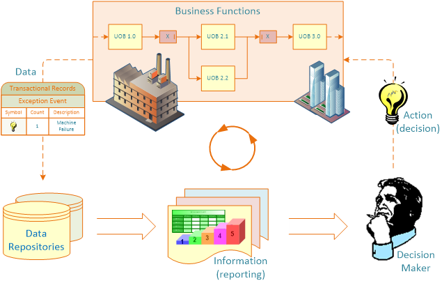

```{r setup, include=FALSE}
knitr::opts_chunk$set(cache = FALSE,
                      echo = FALSE,
                      warning = FALSE,
                      message = FALSE,
                      progress = FALSE,
                      verbose = FALSE,
                      dev = 'png',
                      fig.height = 3,
                      dpi = 300,
                      fig.align = 'center')

options(htmltools.dir.version = FALSE, width = 52)

miamired = '#C3142D'

if(require(pacman)==FALSE) install.packages("pacman")
if(require(devtools)==FALSE) install.packages("devtools")
if(require(countdown)==FALSE) devtools::install_github("gadenbuie/countdown")
if(require(xaringanExtra)==FALSE) devtools::install_github("gadenbuie/xaringanExtra")

pacman::p_load(tidyverse, magrittr, janitor, # data analysis pkgs
               fontawesome, xaringanExtra, countdown) # for slides

ggplot2::theme_set(ggplot2::theme_bw(base_size = 12))
```

```{r xaringan-themer, include=FALSE, warning=FALSE}
if(require(xaringanthemer) == FALSE) install.packages("xaringanthemer")
library(xaringanthemer)

style_mono_accent(base_color = "#84d6d3",
                  base_font_size = "20px")

xaringanExtra::use_xaringan_extra(c("tile_view", "animate_css", "tachyons", "panelset", "broadcast", "share_again", "search", "fit_screen", "editable"))
```

```{r data_deck, include=FALSE}
# ---- Flight Plan QR codes: use the game's own images when they exist, else the copies in this folder ----
qr_path = function(s) {
  p = file.path("../../games/flight-plan/images", paste0("qr_", s, ".png"))
  if (file.exists(p)) p else paste0("qr_", s, ".png")
}

# ---- dashboard and scorecard examples: Cincinnati/Northern Kentucky airport (CVG), July and August 2026 ----
# The BTS on-time files (T_ONTIME_*.csv, ~85 MB each) are shared on Canvas and kept out of the repo.
# When they are on this computer, rebuild the two small summary files in data/; the slides read only those.
raw_url = function(f) paste0('https://raw.githubusercontent.com/fmegahed/isa401/main/data/', f)
daily_file = 'class23_cvg_daily_2026.csv'
carriers_file = 'class23_cvg_carriers_2026.csv'
bts_files = c('../../data/T_ONTIME_July_2026.csv', '../../data/T_ONTIME_August_2026.csv')
cvg_id = 11193   # BTS airport ID for CVG ("Cincinnati, OH")
carrier_names = c(DL = 'Delta', AA = 'American', UA = 'United', G4 = 'Allegiant', WN = 'Southwest',
                  F9 = 'Frontier', AS = 'Alaska')

if (all(file.exists(bts_files))) {
  bts = purrr::map_dfr(bts_files, readr::read_csv, show_col_types = FALSE) |>
    dplyr::mutate(date = as.Date(lubridate::mdy_hms(FL_DATE)))
  stopifnot(all(bts$ORIGIN_CITY_NAME[bts$ORIGIN_AIRPORT_ID == cvg_id] == 'Cincinnati, OH'))
  dep = bts |> dplyr::filter(ORIGIN_AIRPORT_ID == cvg_id)
  arr = bts |> dplyr::filter(DEST_AIRPORT_ID == cvg_id)

  daily_out = dep |>
    dplyr::group_by(date) |>
    dplyr::summarise(scheduled_departures = dplyr::n(),
                     avg_dep_delay_min = round(mean(DEP_DELAY, na.rm = TRUE), 1),
                     late_15_pct = round(100 * mean(DEP_DELAY[!is.na(DEP_DELAY)] >= 15), 1), # DOT: 15 minutes or more is late
                     .groups = 'drop')

  carriers_out = dep |>
    dplyr::group_by(carrier = MKT_UNIQUE_CARRIER) |>
    dplyr::summarise(departures = dplyr::n(),
                     ontime_dep_pct = round(100 * mean(DEP_DELAY[!is.na(DEP_DELAY)] < 15), 1), # DOT: on time = less than 15 min late
                     avg_dep_delay_min = round(mean(DEP_DELAY, na.rm = TRUE), 1),
                     .groups = 'drop') |>
    dplyr::left_join(arr |>
                       dplyr::group_by(carrier = MKT_UNIQUE_CARRIER) |>
                       dplyr::summarise(arrivals = dplyr::n(),
                                        avg_arr_delay_min = round(mean(ARR_DELAY, na.rm = TRUE), 1),
                                        .groups = 'drop'),
                     by = 'carrier') |>
    dplyr::mutate(airline = unname(carrier_names[carrier])) |>
    dplyr::arrange(dplyr::desc(departures))

  readr::write_csv(daily_out, file.path('../../data', daily_file))
  readr::write_csv(carriers_out, file.path('../../data', carriers_file))
}

daily = readr::read_csv(file.path('../../data', daily_file), show_col_types = FALSE)
carriers = readr::read_csv(file.path('../../data', carriers_file), show_col_types = FALSE) |>
  dplyr::filter(departures >= 200)   # airlines with at least 200 CVG departures in the two months
stopifnot(nrow(daily) == 62, min(daily$date) == as.Date('2026-07-01'), max(daily$date) == as.Date('2026-08-31'),
          nrow(carriers) >= 5, !any(is.na(carriers$airline)))

# ---- the scorecard: each KPI vs. a target (example targets) ----
target_ontime = 80; target_dep = 15; target_arr = 15

kpi_cell = function(value, met, label, gap) {
  if (met) paste0("<td class='met'>", label, " <span class='ok'>&#10003;</span></td>")
  else paste0("<td class='miss'>", label, "<div class='gap'>", gap, "</div></td>")
}

score = carriers |>
  dplyr::mutate(
    ontime_met = ontime_dep_pct >= target_ontime,
    dep_met = avg_dep_delay_min <= target_dep,
    arr_met = avg_arr_delay_min <= target_arr,
    n_met = ontime_met + dep_met + arr_met,
    c1 = purrr::pmap_chr(list(ontime_dep_pct, ontime_met), function(v, m)
      kpi_cell(v, m, paste0(format(v, nsmall = 1), "%"), paste0(format(round(target_ontime - v, 1), nsmall = 1), " pts below target"))),
    c2 = purrr::pmap_chr(list(avg_dep_delay_min, dep_met), function(v, m)
      kpi_cell(v, m, paste0(format(v, nsmall = 1), " min"), paste0(format(round(v - target_dep, 1), nsmall = 1), " min over target"))),
    c3 = purrr::pmap_chr(list(avg_arr_delay_min, arr_met), function(v, m)
      kpi_cell(v, m, paste0(format(v, nsmall = 1), " min"), paste0(format(round(v - target_arr, 1), nsmall = 1), " min over target"))))

score_rows = paste0("<tr><td class='air'>", score$airline, "</td><td class='num'>", scales::comma(score$departures), "</td>",
                    score$c1, score$c2, score$c3, "<td class='num ", ifelse(score$n_met == 3, "all", "some"), "'>", score$n_met, " of 3</td></tr>", collapse = "")
score_table = paste0("<table class='score'><thead><tr><th>Airline</th><th class='num'>CVG departures</th>",
                     "<th>On-time departures<br><span>target: ", target_ontime, "% or more</span></th>",
                     "<th>Avg. departure delay<br><span>target: ", target_dep, " min or less</span></th>",
                     "<th>Avg. arrival delay into CVG<br><span>target: ", target_arr, " min or less</span></th>",
                     "<th class='num'>Targets met</th></tr></thead><tbody>", score_rows, "</tbody></table>")
n_all_met = sum(score$n_met == 3)
n_none_met = sum(score$n_met == 0)
```

<style>
/* shared cards */
.card { border:1px solid #d1d5db; border-radius:8px; overflow:hidden; box-shadow:0 1px 3px rgba(0,0,0,0.1); background:#ffffff; }
.card .ch { background:#c3142d; color:#fff; font-weight:700; font-size:14.5px; padding:7px 12px; }
.card .ch.gray { background:#585E60; }
.card .cb { padding:9px 12px; font-size:13.5px; line-height:1.45; }
.card .cb a { color:#1b1b1b; text-decoration:underline; text-decoration-color:#c3142d; }
.note { margin-top:12px; border:1px solid #d1d5db; border-left:6px solid #c3142d; border-radius:8px; padding:9px 16px; background:#ffffff; box-shadow:0 1px 3px rgba(0,0,0,0.1); font-size:14.5px; line-height:1.5; }
.note b.r { color:#c3142d; }
.src { font-size:11.5px; color:#585E60; line-height:1.4; }
.src a { color:#c3142d !important; }
.foot { position:absolute; left:73px; right:96px; bottom:12px; font-size:11.5px; color:#585E60; line-height:1.4; }
.foot a { color:#c3142d !important; }
/* game join QR codes */
.qr-pair { display:grid; grid-template-columns:1fr 1fr; gap:12px; margin-top:4px; }
.qr-box { text-align:center; border:1px solid #e5e7eb; border-radius:8px; padding:8px 6px 6px 6px; background:#ffffff; }
.qr-box .sec { font-weight:700; font-size:15px; color:#1b1b1b; }
.qr-box .sec span { font-weight:400; color:#585E60; font-size:13px; }
.qr-box img { display:block; width:170px; height:170px; margin:6px auto 4px auto; image-rendering:pixelated; }
.qr-box .url { font-size:12px; white-space:nowrap; }
.qr-box .url a { color:#1b1b1b; text-decoration:underline; text-decoration-color:#9ca3af; }
.gd-row { margin-bottom:6px; }
/* deck 23 */
.two { display:grid; grid-template-columns:1fr 1fr; gap:14px; margin-top:10px; }
.four { display:grid; grid-template-columns:repeat(4, minmax(0,1fr)); gap:10px; margin-top:10px; }
.four .cb { font-size:13.5px; line-height:1.45; }
.chain { font-size:15px; line-height:1.9; }
.chain .arr { color:#c3142d; font-weight:700; }
table.score { width:100%; border-collapse:collapse; margin-top:6px; font-size:13.5px; line-height:1.3; border:0; }
table.score th { background:#585E60; color:#fff; text-align:left; padding:6px 9px; font-size:13px; font-weight:700; border:0; vertical-align:bottom; }
table.score th span { font-weight:400; font-size:11.5px; color:#e5e7eb; }
table.score td { padding:5px 9px; border:0; border-bottom:1px solid #e5e7eb; background:#ffffff; vertical-align:top; color:#1b1b1b; }
table.score .num { text-align:right; }
table.score td.air { font-weight:700; }
table.score td.all { font-weight:700; color:#1b1b1b; }
table.score td.some { font-weight:700; color:#c3142d; }
table.score td.met .ok { color:#585E60; font-weight:700; }
table.score td.miss { background:#fbe9eb; color:#c3142d; font-weight:700; }
table.score td.miss .gap { font-size:11px; font-weight:400; }
.wrapped div { margin-bottom:7px; }
details.answer-gate summary { cursor:pointer; color:#c3142d; font-weight:700; font-size:15px; }
</style>

# Learning Objectives

By the end of today, you should be able to:

1. **Define** a business report and its main functions.

2. **Explain** why choosing the right KPIs matters.

3. **Describe** how business reports are automated.

4. **Compare** dashboards and scorecards.

???

Thirty seconds. Today is mostly the paper airplane activity: about 3 minutes of slides, 60 minutes in the game app, then the business reports section.

---

# Key Performance Indicators (KPIs)

<div class="note" style="margin-top:6px; font-size:16px;">A <b class="r">KPI</b> (key performance indicator) is a measure of how well a process or a product performs. A team picks a few KPIs and tracks them over time.</div>

<div class="two">
<div class="card"><div class="ch">Operational performance indicators</div><div class="cb" style="font-size:15px; line-height:1.55;">They measure the <b>process</b>: how the product is made and delivered (time, people, materials, rework).<br><br><b>Example:</b> <b>Cycle time</b>, the time it takes to make one unit.</div></div>
<div class="card"><div class="ch gray">Client/product performance indicators</div><div class="cb" style="font-size:15px; line-height:1.55;">They measure the <b>product</b>: what the client receives.<br><br><b>Example:</b> <b>Accuracy</b>.</div></div>
</div>

<div class="card" style="margin-top:14px;"><div class="ch gray">A usable KPI has</div><div class="cb" style="font-size:15px;">A precise definition, so two people get the same number. A unit. A way to measure it with what you have.</div></div>

???

One and a half minutes. Operational indicators are about how the work gets done. Client or product indicators are about what the client gets. Cycle time and accuracy are the two examples from last year's version of this activity. In the game, each team lists both kinds for its own plane. The feedback on their phones checks whether each KPI can be measured as written: a precise definition, a unit, and a way to measure it.

---

# 0.15 pt Bonus Activity: Paper Airplanes

`r countdown(minutes = 17, seconds = 0, top = 0, font_size = "2em")`

<div style="display:grid; grid-template-columns:1.08fr 1fr; gap:16px; margin-top:8px;">
<div class="card"><div class="ch">Activity Description</div><div class="cb" style="font-size:14.5px; line-height:1.45;">
<div style="border-left:4px solid #c3142d; padding-left:10px; margin-bottom:8px;">Over the next 17 minutes, please design the <b>best paper plane that can consistently hit the target on the whiteboard (from a distance of 6ft)</b>.</div>
<b>Games Rules:</b>
<div class="gd-row">&bull; You are allowed to use any of the material that was brought to class.</div>
<div class="gd-row">&bull; Work with your group to have the best design.</div>
<div class="gd-row">&bull; You can look up designs online or design your own.</div>
<div class="gd-row">&bull; When testing, make sure that there are no people between your launching point and your target.</div>
<div class="gd-row">&bull; A demo will proceed for the teams that want to &ldquo;show-off&rdquo; their talents.</div>
<div class="gd-row">&bull; <b>Winning team gets 0.15 point added to their Exam 02 grade.</b></div>
<div class="gd-row">&bull; <b>Teams are your seating row (L1, L2, L3, R1, R2, R3).</b></div>
</div></div>
<div class="card"><div class="ch gray">Join</div><div class="cb">
<div class="qr-pair">
<div class="qr-box"><div class="sec">Section A <span>(8:30 AM)</span></div><div class="url"><a href="https://isa401-flight-plan.vercel.app/?section=A" target="_blank">isa401-flight-plan.vercel.app/?section=A</a></div></div>
<div class="qr-box"><div class="sec">Section B <span>(10:05 AM)</span></div><div class="url"><a href="https://isa401-flight-plan.vercel.app/?section=B" target="_blank">isa401-flight-plan.vercel.app/?section=B</a></div></div>
</div>
<div style="font-size:13px; color:#585E60; margin-top:8px;">Enter your first name, last initial and seat. Your team works on your phones.</div>
</div></div>
</div>

???

One minute on this slide. Read the activity description out loud once. Then switch the projector to the game app for 60 minutes. The 17-minute countdown here matches the design phase; the class sees the game's own timer (host +/- 1 minute). Host view: https://isa401-flight-plan.vercel.app/host?section=A for Section A and https://isa401-flight-plan.vercel.app/host?section=B for Section B. Camera page on your phone: https://isa401-flight-plan.vercel.app/snap?section=A (or B). Admin key: from Fadel's notes (not in this deck). The run sheet (kept out of the repo) has the clicks for each phase. A row with nobody in it has no team.

---

class: inverse, center, middle

# Paper Airplanes: In the Game App

???

Switch the projector to the game app. Come back to this deck for the business reports section.

---

class: inverse, center, middle

# Business Reports

???

No time of its own. This section runs about 14 minutes.

---

# What Is a Business Report?

<div class="two" style="margin-top:6px;">
<div class="card"><div class="ch">Definition</div><div class="cb" style="font-size:15px; line-height:1.6;">
A report is any communication artifact prepared to convey specific <b>information</b>. A report turns information into data-driven decisions.
<div style="margin-top:8px;"><b>Purpose:</b> to improve managerial decisions.</div>
<div><b>Source:</b> data from inside and outside the organization (via ETL).</div>
<div><b>Format:</b> text + tables + graphs/charts.</div>
<div><b>Distribution:</b> in print, email, portal/intranet, app.</div>
</div></div>
<div class="card"><div class="ch gray">Main functions</div><div class="cb" style="font-size:15px; line-height:1.6;">
<div>&bull; To ensure proper departmental functioning</div>
<div>&bull; To provide information</div>
<div>&bull; To provide the results of an analysis</div>
<div>&bull; To persuade others to act</div>
<div>&bull; To create an organizational memory</div>
</div></div>
</div>

<div class="note" style="margin-top:14px;">The brief your team wrote in the game is a short report. It records what your team decided and why.</div>

.footnote[
<html>
<hr>
</html>

**Source:** Adapted from Sharda, R., Delen, D., & Turban, E. (2013). *Business Intelligence: A managerial perspective on analytics* (Ch. 3). Prentice Hall. Current edition: *Business Analytics, Data Science, and AI: A Managerial Approach* (6th ed., 2026, Ch. 4). Pearson.
]

???

Two minutes. Ask which of the five functions a weekly sales dashboard serves (mostly the first two) and which an investor memo serves (persuade others to act). The textbook was renamed; the 2026 sixth edition covers this material in Chapter 4.

---

# The Business Reporting Process

<div style="display:grid; grid-template-columns:minmax(0,1.6fr) minmax(0,1fr); gap:16px; align-items:center; margin-top:4px;">
<div>

```{r bi_process_fig, out.width = '100%', fig.alt='The business reporting process: transactional records from business functions flow into data repositories, become information in reports, reach a decision maker, and the decision feeds back into the business functions as an action'}

```

</div>
<div class="card"><div class="ch gray">The steps</div><div class="cb chain">
Data acquisition<br><span class="arr">&#8595;</span> Information generation<br><span class="arr">&#8595;</span> Decision making<br><span class="arr">&#8595;</span> Process management<br><span style="color:#585E60; font-size:13.5px; line-height:1.45; display:block; margin-top:6px;">The decision changes the process. The process creates new data, and the report runs again.</span>
</div></div>
</div>

.footnote[
<html>
<hr>
</html>

**Source:** Sharda, R., Delen, D., & Turban, E. (2013). *Business Intelligence: A managerial perspective on analytics* (Ch. 3). Prentice Hall.
]

???

One and a half minutes. Walk the figure clockwise. The business functions (units of business, UOB) record transactions and exceptions. The records are stored, turned into a report, and read by a decision maker. The decision changes the process. A report that runs in a loop like this is a good candidate for automation.

---

# Keys to Successful Reports

<div class="four" style="margin-top:6px;">
<div class="card"><div class="ch">Clarity</div><div class="cb">The reader can follow it without you there to explain it.</div></div>
<div class="card"><div class="ch">Brevity</div><div class="cb">It includes only what the reader needs for the decision.</div></div>
<div class="card"><div class="ch">Completeness</div><div class="cb">It includes everything the reader needs, including how each number is defined.</div></div>
<div class="card"><div class="ch">Correctness</div><div class="cb">The numbers and their definitions are right.</div></div>
</div>

<div class="card" style="margin-top:14px;"><div class="ch gray">Report types (in terms of content and format)</div><div class="cb" style="font-size:15px; line-height:1.6;">
<div><b>Informal:</b> a single letter or a memo.</div>
<div><b>Formal:</b> 10-100 pages; cover + summary + text.</div>
<div><b>Short:</b> periodic, informative, investigative.</div>
</div></div>

.footnote[
<html>
<hr>
</html>

**Source:** Adapted from Sharda, R., Delen, D., & Turban, E. (2013). *Business Intelligence: A managerial perspective on analytics* (Ch. 3). Prentice Hall.
]

???

One and a half minutes. The four keys are from the old slide; the one-line meanings are mine. Ask which one their team's brief had the most trouble with. Most of what they will write early in a job is the short report: periodic (the weekly numbers), informative (what happened) or investigative (why it happened).

---

# Dashboards vs. Scorecards

<div class="two" style="margin-top:6px;">
<div class="card"><div class="ch">Dashboards</div><div class="cb" style="font-size:15px; line-height:1.6;">
<div>&bull; Dashboards provide <b>monitoring tools for operational performance (often in real time)</b>.</div>
<div>&bull; Dashboards monitor performance by <b>tracking metrics (typically over time and often without comparing them to target values)</b>.</div>
</div></div>
<div class="card"><div class="ch gray">Scorecards</div><div class="cb" style="font-size:15px; line-height:1.6;">
<div>&bull; Scorecards provide a <b>snapshot of current performance (as measured using KPIs) vs. their targets</b>.</div>
<div>&bull; Current performance is <b>an aggregated measure</b> (e.g., day/month), i.e., ~ static.</div>
<div>&bull; <b>Goal:</b> make better strategic decisions based on the <i>distance = target &minus; performance</i>.</div>
</div></div>
</div>

<div class="note" style="margin-top:14px;">The next two slides show one of each, built from the same data: every flight that left the Cincinnati/Northern Kentucky airport (CVG) in July and August 2026.</div>

.footnote[
<html>
<hr>
</html>

**Source:** Sisense, &ldquo;Scorecard vs Dashboard: What Each Adds to Business Intelligence&rdquo; <https://www.sisense.com/blog/scorecard-vs-dashboard-adds-business-intelligence/>
]

???

One and a half minutes. A dashboard answers "how are we doing right now?" A scorecard answers "how far are we from the targets we set?" Ask for one example of each from a job or internship: a live call-center dashboard, or a monthly sales vs. quota scorecard.

---

# Example: A Dashboard for CVG Flights

```{r dashboard_chart, fig.width=10, fig.height=3.9, out.width='100%', fig.alt='Three small line charts by day from July 1 to August 31, 2026, for departures from the Cincinnati/Northern Kentucky airport (CVG): scheduled departures per day, average departure delay in minutes, and the share of departures that left 15 or more minutes late. The worst day for delays is labeled in each delay panel, and the latest day (Aug 31) is a red dot.'}
daily_long = daily |>
  tidyr::pivot_longer(-date, names_to = "measure", values_to = "value") |>
  dplyr::mutate(measure = factor(measure,
                                 levels = c("scheduled_departures", "avg_dep_delay_min", "late_15_pct"),
                                 labels = c("Scheduled departures", "Average departure delay (min)", "Departures 15+ min late (%)")))
worst = daily_long |>
  dplyr::filter(measure != "Scheduled departures") |>
  dplyr::group_by(measure) |>
  dplyr::slice_max(value, n = 1, with_ties = FALSE) |>
  dplyr::ungroup()

ggplot2::ggplot(daily_long, ggplot2::aes(x = date, y = value)) +
  ggplot2::geom_line(color = "#585E60", linewidth = 0.7) +
  ggplot2::geom_point(data = worst, color = "#1b1b1b", size = 1.8) +
  ggplot2::geom_text(data = worst, ggplot2::aes(label = format(date, "%b %d")), hjust = -0.15, vjust = 0.2, size = 3.5, color = "#1b1b1b") +
  ggplot2::geom_point(data = daily_long |> dplyr::filter(date == max(date)), color = miamired, size = 2.6) +
  ggplot2::facet_wrap(~ measure, nrow = 1, scales = "free_y") +
  ggplot2::scale_x_date(date_breaks = "2 weeks", date_labels = "%b %d") +
  ggplot2::geom_hline(yintercept = 0, color = "#d1d5db", linewidth = 0.4) +
  ggplot2::expand_limits(y = 0) +
  ggplot2::scale_y_continuous(labels = scales::label_comma(), expand = ggplot2::expansion(mult = c(0.02, 0.08))) +
  ggplot2::labs(x = NULL, y = NULL, title = "Departures from CVG by day, July 1 to August 31, 2026",
                subtitle = "Each panel tracks one measure over time. There are no targets. The red dot is the latest day (Aug 31).") +
  ggplot2::theme_minimal(base_size = 13) +
  ggplot2::theme(plot.title = ggplot2::element_text(face = "bold", size = 15), plot.title.position = "plot",
                 plot.subtitle = ggplot2::element_text(size = 12, color = "#374151"),
                 strip.text = ggplot2::element_text(face = "bold", size = 12.5, hjust = 0),
                 panel.grid.minor = ggplot2::element_blank(),
                 panel.spacing = ggplot2::unit(1.4, "lines"))
```

<div class="foot"><b>Source:</b> Bureau of Transportation Statistics, On-Time Performance, July-August 2026. <b>Data:</b> <a href="`r raw_url(daily_file)`" target="_blank">`r raw_url(daily_file)`</a></div>

???

One and a half minutes. CVG is the Cincinnati/Northern Kentucky airport. Read it the way an airport manager would each morning: how many flights, how late, and how many left 15 or more minutes late. The worst day for average delay was `r format(worst$date[worst$measure == "Average departure delay (min)"], "%B %d")` (`r worst$value[worst$measure == "Average departure delay (min)"]` minutes on average). Over the two months, `r scales::comma(sum(daily$scheduled_departures))` departures were scheduled. A negative average delay means the flights left early on average that day. Nothing on this page says whether a number is good or bad. That is the difference from the next slide.

---

# Example: A Scorecard for CVG Flights

`r score_table`

<div class="src" style="margin-top:8px;">July and August 2026, airlines with at least 200 departures from CVG. Each airline is the one that sold the ticket, so a regional flight sold as Delta counts as Delta. On time means the flight left less than 15 minutes late (DOT's definition). <b>These are example targets.</b> A red cell missed its target and shows the distance to it.</div>

<div class="foot"><b>Source:</b> Bureau of Transportation Statistics, On-Time Performance, July-August 2026. <b>Data:</b> <a href="`r raw_url(carriers_file)`" target="_blank">`r raw_url(carriers_file)`</a></div>

???

One and a half minutes. Same airport and months as the dashboard, but now each KPI sits next to a target. `r n_all_met` of the `r nrow(score)` airlines met all three targets, and `r n_none_met` met none. Read one red cell out loud with its distance. The scorecard is one number per airline for the two months (aggregated, about static), while the dashboard was a line per day. The targets here are examples; in a company, management sets them. Flights with no departure time (most likely cancelled) are left out of the delay numbers.

---

# Out-of-Class: Make this Power BI Scorecard

<iframe title="airline_delay_example" width="100%" height="470" src="https://app.powerbi.com/reportEmbed?reportId=d0cb38f7-baaf-41d9-becf-0dfc22d7aee8&autoAuth=true&ctid=4605e262-b447-4aaa-aea7-f70112a6dda8&config=eyJjbHVzdGVyVXJsIjoiaHR0cHM6Ly93YWJpLXVzLW5vcnRoLWNlbnRyYWwtaC1wcmltYXJ5LXJlZGlyZWN0LmFuYWx5c2lzLndpbmRvd3MubmV0LyJ9" frameborder="0" allowFullScreen="true"></iframe>

???

One minute. Out of class and not graded. The report sits in the Miami Power BI tenant, so students sign in with their Miami account to see it. The iframe source is the one from last year's deck.

---

# Automating Business Reports

<div class="two" style="grid-template-columns:minmax(0,1.1fr) minmax(0,1fr); margin-top:6px;">
<div class="card"><div class="ch">An automated report you already get: Spotify Wrapped</div><div class="cb wrapped" style="font-size:14.5px; line-height:1.5;">
<div><b>Data:</b> every song, artist and podcast you played during the year.</div>
<div><b>Template:</b> the same set of story cards for every user.</div>
<div><b>Personalized charts and text:</b> your top artists, top songs, genres and minutes listened, filled in from your own data.</div>
<div><b>Scheduled delivery:</b> in the mobile app, to every user, once a year in early December.</div>
<div style="color:#585E60; font-size:13.5px;">Wrapped 2025 had &ldquo;more than 300 million engaged users and more than 630 million shares on social media&rdquo; (<a href="https://newsroom.spotify.com/2026-02-10/spotify-q4-2025-earnings/" target="_blank">Spotify, Feb 10, 2026</a>). Spotify has sent it every year since 2016.</div>
</div></div>
<div class="card"><div class="ch gray">The same parts in BI tools</div><div class="cb wrapped" style="font-size:14.5px; line-height:1.5;">
<div><b>Data that stays current:</b> a live connection (Tableau), or <a href="https://learn.microsoft.com/en-us/power-bi/connect-data/refresh-scheduled-refresh" target="_blank">scheduled refresh</a> in the Power BI service.</div>
<div><b>Scheduled delivery:</b> Power BI <a href="https://learn.microsoft.com/en-us/power-bi/collaborate-share/end-user-subscribe" target="_blank">email subscriptions</a> send a report hourly, daily, weekly, monthly, or after each data refresh.</div>
<div><b>Written summaries:</b> <a href="https://help.tableau.com/current/online/en-us/pulse_explore_metrics.htm" target="_blank">Tableau Pulse</a> digests send each person their metrics with AI-written insights, by email, Slack or Teams. <a href="https://learn.microsoft.com/en-us/power-bi/create-reports/copilot-introduction" target="_blank">Copilot in Power BI</a> can write a summary of a report.</div>
</div></div>
</div>

<div class="note" style="margin-top:14px;">An automated report has three parts: data that refreshes, a fixed template, and delivery on a schedule. The AI-written summary is a description of the chart. You still check the data, as in the Class 22 check-ins.</div>

???

Two minutes. Ask who opened their Wrapped last December. Wrapped is a business report: one template, filled in from each user's data, delivered on a schedule. Power BI subscriptions and Tableau Pulse digests do the same thing for a sales team. Notes on the tools: sending subscriptions to other people needs a Pro or PPU license; Copilot in Power BI needs paid Fabric or Premium capacity, so students may not see it in their own accounts; an admin has to turn on Tableau Pulse's AI summaries.

---

class: inverse, center, middle

# Recap

???

No time of its own. The recap runs 2 minutes.

---

# Summary of Main Points

- Define a "business report" and its main functions: any artifact that turns data into information for a decision; to run, inform, analyze, persuade and remember

- Understand the importance of the right KPIs: operational (the process) and client/product (what the client gets), each defined precisely enough to compute the same way twice

- Automate business reports: data that refreshes, a fixed template, and delivery on a schedule

- Dashboards track metrics over time (often in real time); scorecards compare KPIs to targets

???

One minute.

---

# Before Next Class

<div class="note" style="margin-top:6px;"><b class="r">Monday, Nov 16:</b> Exam 02, Data Visualization &amp; Communication.</div>

<div style="display:grid; grid-template-columns:1fr 1fr; gap:16px; margin-top:16px;">
<div class="card">
  <div class="ch">Prepare for Exam 02</div>
  <div class="cb" style="font-size:14.5px; line-height:1.6;">
    <div><b>Practice:</b> <a href="https://isa401-review.vercel.app/#/exam02" target="_blank"><b>isa401-review.vercel.app/#/exam02</b></a></div>
    <div style="color:#585E60;">Ungraded and no sign-in. Start with Answering a Check the AI Question.</div>
    <div style="margin-top:10px;"><b>Structure and details:</b> the <a href="https://miamioh.instructure.com/courses/258169/discussion_topics/2356587" target="_blank"><b>Canvas announcement</b></a>.</div>
  </div>
</div>
<div class="card">
  <div class="ch gray">Suggested</div>
  <div class="cb" style="font-size:14.5px; line-height:1.6;">
    <div>Microsoft Learn: <a href="https://learn.microsoft.com/en-us/power-bi/create-reports/service-dashboards-design-tips" target="_blank"><b>Tips for designing a great Power BI dashboard</b></a>.</div>
    <div style="color:#585E60;">Free online. Covers the audience, fitting one screen, where to put the key numbers, and chart choice.</div>
  </div>
</div>
</div>

???

One minute. The reading is optional. Timing for the deck: about 3 minutes before the game, 60 for the game, and about 14 for the business reports section. Short on time: skip Keys to Successful Reports and the Power BI slide (about 2.5 minutes).
