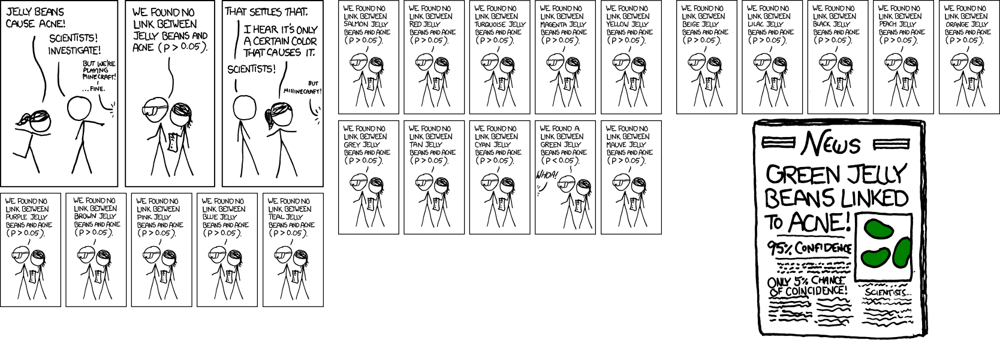
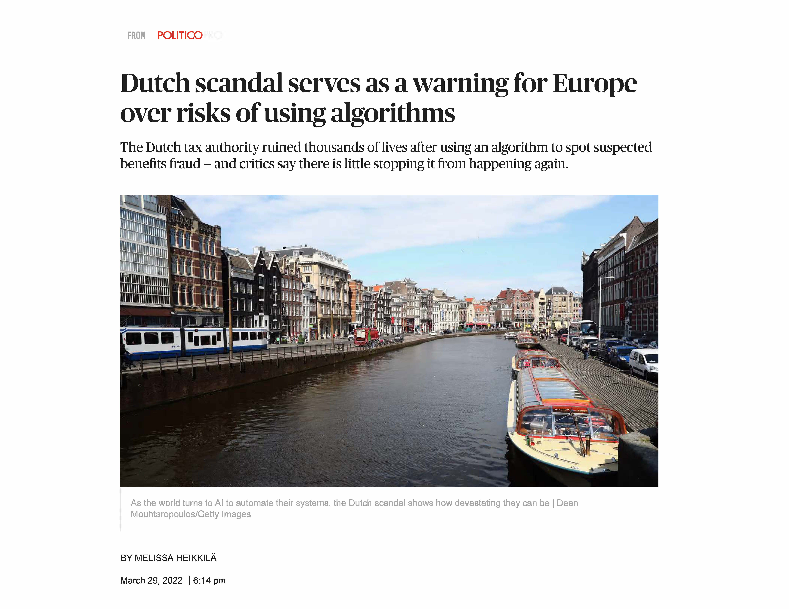
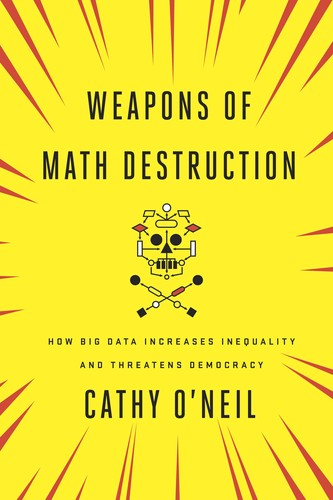
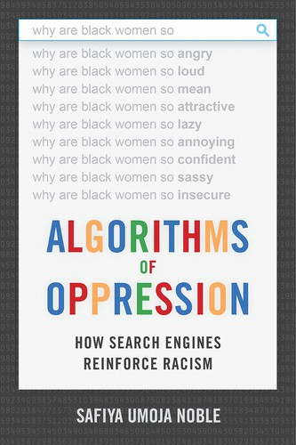
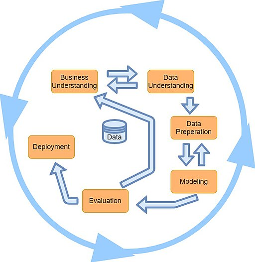
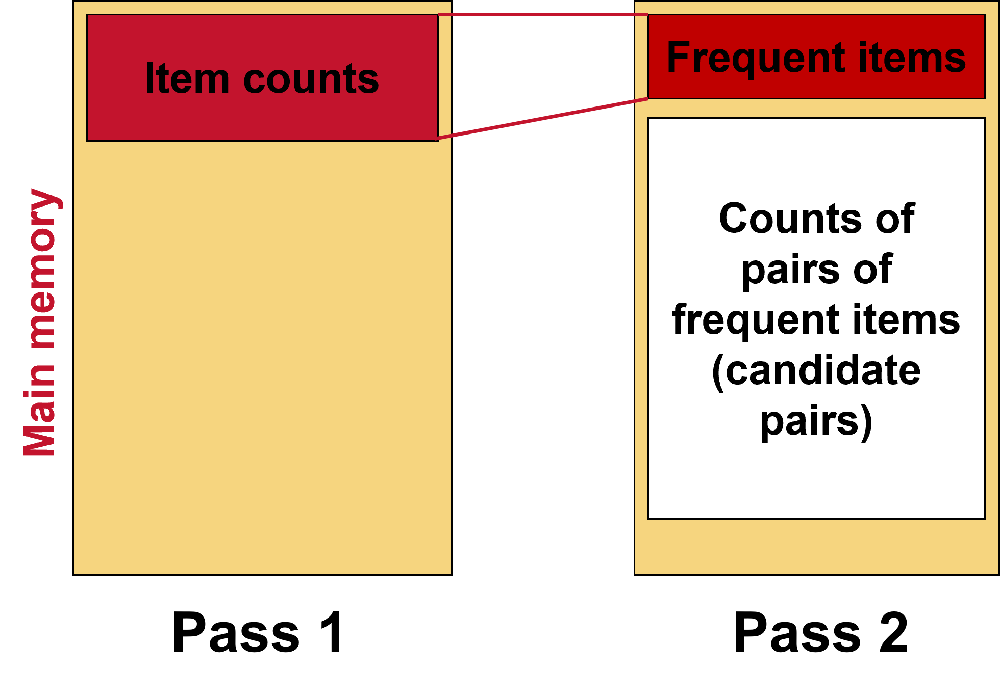

```{r setup, include=FALSE}
knitr::opts_chunk$set(cache = FALSE,
                      echo = FALSE,
                      warning = FALSE,
                      message = FALSE,
                      progress = FALSE,
                      verbose = FALSE,
                      dev = 'png',
                      fig.height = 3,
                      dpi = 300,
                      fig.align = 'center')

options(htmltools.dir.version = FALSE, width = 52)

miamired = '#C3142D'

if(require(pacman)==FALSE) install.packages("pacman")
if(require(devtools)==FALSE) install.packages("devtools")
if(require(countdown)==FALSE) devtools::install_github("gadenbuie/countdown")
if(require(xaringanExtra)==FALSE) devtools::install_github("gadenbuie/xaringanExtra")

pacman::p_load(tidyverse, magrittr, janitor, # data analysis pkgs
               arules, arulesViz, # association rules
               fontawesome, xaringanExtra, countdown) # for slides

ggplot2::theme_set(ggplot2::theme_bw(base_size = 12))

# Code styling shared by all ISA 401 decks: hl_r() + knitr source hook (see style_files/hl_r.R)
source("../../style_files/hl_r.R")
```

```{r xaringan-themer, include=FALSE, warning=FALSE}
if(require(xaringanthemer) == FALSE) install.packages("xaringanthemer")
library(xaringanthemer)

style_mono_accent(base_color = "#84d6d3",
                  base_font_size = "20px")

xaringanExtra::use_xaringan_extra(c("tile_view", "animate_css", "tachyons", "panelset", "broadcast", "share_again", "search", "fit_screen", "editable"))
```

```{r data_deck, include=FALSE}
# ---- The ESP Test QR codes: use the game's own images when they exist, else the copies in this folder ----
qr_path = function(s) {
  p = file.path("../../games/esp-test/images", paste0("qr_", s, ".png"))
  if (file.exists(p)) p else paste0("qr_", s, ".png")
}
raw_url = function(f) paste0('https://raw.githubusercontent.com/fmegahed/isa401/main/data/', f)

# ---- the two basket activities (slides 15 and 17): check the gated answers at knit time ----
baskets = list(B1 = c('Milk', 'Coke', 'Beer'), B2 = c('Milk', 'Pepsi', 'Juice'), B3 = c('Milk', 'Beer'),
               B4 = c('Coke', 'Juice'), B5 = c('Milk', 'Pepsi', 'Beer'), B6 = c('Milk', 'Coke', 'Beer', 'Juice'),
               B7 = c('Coke', 'Beer', 'Juice'), B8 = c('Coke', 'Beer'))
supp = function(items) sum(vapply(baskets, function(b) all(items %in% b), logical(1)))
stopifnot(supp('Milk') == 5, supp('Coke') == 5, supp('Pepsi') == 2, supp('Beer') == 6, supp('Juice') == 4,
          supp(c('Milk', 'Beer')) == 4, supp(c('Coke', 'Beer')) == 4, supp(c('Coke', 'Juice')) == 3,
          supp(c('Milk', 'Coke')) == 2, supp(c('Milk', 'Juice')) == 2, supp(c('Beer', 'Juice')) == 2,
          supp(c('Milk', 'Coke', 'Beer')) == 2, supp(c('Coke', 'Beer', 'Juice')) == 2,
          supp(c('Milk', 'Beer', 'Coke')) / supp(c('Milk', 'Beer')) == 0.5,
          abs((supp(c('Milk', 'Beer', 'Coke')) / supp(c('Milk', 'Beer'))) / (supp('Coke') / 8) - 0.8) < 1e-12)

# ---- Job Scout skills (slides 16, 22 and 23): one posting = one basket, its skills = the items ----
# Job Scout's database as of Nov 15, 2026 (data/chatisa-data/scout.db, a copy kept out of the repo). When it is on
# this computer, rebuild the long file that the slides and the R demo read: one row per posting and skill, full-time
# and internship postings only (the federal postings are mostly compliance and security roles). Otherwise the
# committed file in data/ is read as is.
skills_file = 'class25_job_skills_2026-11-15.csv'
scout_db = '../../data/chatisa-data/scout.db'
if (file.exists(scout_db)) {
  con = DBI::dbConnect(RSQLite::SQLite(), scout_db, flags = RSQLite::SQLITE_RO)
  postings = DBI::dbGetQuery(con, "SELECT id, category, active, skills_json, harvested_at FROM scout_postings
                                   WHERE category IN ('fulltime', 'internship') AND harvested_at < '2026-11-16'")
  DBI::dbDisconnect(con)
  stopifnot(substr(min(postings$harvested_at), 1, 10) == '2026-08-16', substr(max(postings$harvested_at), 1, 10) == '2026-11-15')
  skills_long = postings |>
    dplyr::mutate(skill = purrr::map(skills_json, function(j) { s = jsonlite::fromJSON(j); if (NROW(s)) s$skillId else character(0) })) |>
    dplyr::select(posting_id = id, category, open = active, skill) |>
    tidyr::unnest(skill) |>
    dplyr::distinct()
  readr::write_csv(skills_long, file.path('../../data', skills_file))
}

skills = arules::read.transactions(file.path('../../data', skills_file), format = 'single', sep = ',',
                                   header = TRUE, cols = c('posting_id', 'skill'))
n_post = length(skills); n_skill = ncol(skills)
stopifnot(n_post == 2961, n_skill == 139)
basket_size = mean(arules::size(skills))                        # about 12 skills per posting

mine = function(support) arules::apriori(skills, parameter = list(support = support, confidence = 0.5, minlen = 2, maxlen = 5),
                                         control = list(verbose = FALSE))
skill_rules = mine(0.2)          # the support in the slide's code
low_rules = mine(2 / n_post)     # rules found in as few as 2 postings
high_rules = mine(40 / n_post)   # at least 40 postings
n_rules_001 = length(mine(0.01)) # the spring deck's support, for the speaker notes
stopifnot(length(skill_rules) == 63)
itemsets_all = 2^n_skill         # every possible itemset of Job Scout's skills (for the lattice slide)
sci = function(x, html = TRUE) { e = floor(log10(x)); if (html) sprintf('%.1f &times; 10<sup>%d</sup>', x / 10^e, e) else sprintf('%.1f x 10^%d', x / 10^e, e) }

# the "milk" caution on Job Scout: {excel} => {communication}
ex = arules::subset(skill_rules, lhs %ain% 'excel' & rhs %in% 'communication' & size(lhs) == 1)
ex_q = arules::quality(ex)
p_comm = unname(arules::itemFrequency(skills)['communication'])
stopifnot(length(ex) == 1, ex_q$confidence > 0.89, ex_q$confidence < 0.91, ex_q$lift > 1.10, ex_q$lift < 1.13)

# the jobs still open in ChatISA on Nov 15 (open = 1 in the file): the lift slide and the job-skills slide
skills_csv = readr::read_csv(file.path('../../data', skills_file), show_col_types = FALSE)
open_ids = unique(skills_csv$posting_id[skills_csv$open == 1])
skills_open = skills[arules::transactionInfo(skills)$transactionID %in% open_ids]
n_open = length(skills_open)
rule_q = function(tr, a, b) {   # confidence and lift of {a} -> {b}, and how common b is
  ct = arules::crossTable(tr, measure = 'count'); n = length(tr); conf = ct[a, b] / ct[a, a]
  list(conf = conf, lift = conf / (ct[b, b] / n), p_rhs = ct[b, b] / n)
}
py_all = rule_q(skills, 'python', 'sql'); py_open = rule_q(skills_open, 'python', 'sql'); ex_open = rule_q(skills_open, 'excel', 'communication')
stopifnot(n_open == 716, abs(py_all$conf - 0.7266) < 0.001, abs(py_all$lift - 1.6274) < 0.001,
          abs(py_open$conf - 0.6868) < 0.001, abs(py_open$lift - 1.6070) < 0.001, abs(ex_open$lift - 1.1497) < 0.001)

# the support floor (slide 23): top rules by lift at 2 postings vs. 40 postings
top_by_lift = function(r, n = 3) arules::DATAFRAME(head(sort(r, by = 'lift'), n))
low_top = top_by_lift(low_rules); high_top = top_by_lift(high_rules)
stopifnot(low_top$count[1] == 2, all(high_top$count >= 40))
rule_rows = function(d) paste0("<tr><td>", gsub(",", ", ", d$LHS), " &#8594; ", d$RHS, "</td><td class='num'>", d$count, "</td><td class='num'>",
                               sprintf('%.2f', d$confidence), "</td><td class='num'>", scales::comma(d$lift, accuracy = 0.1), "</td></tr>", collapse = "")
rule_table = function(d) paste0("<table class='rules'><thead><tr><th>Rule</th><th class='num'>Postings</th><th class='num'>Confidence</th>",
                                "<th class='num'>Lift</th></tr></thead><tbody>", rule_rows(d), "</tbody></table>")
fmt_n = function(x) scales::comma(x)

# ---- the basket grid: baskets are rows, items are columns, a dot means "in the basket" ----
# lit: the itemset's columns; fade: columns dropped (Pepsi after pass 1); rows1/rows2: baskets marked grey/red;
# counts: a row with each item's support at the bottom.
item_col = c(Milk = '#0072B2', Coke = '#CC79A7', Pepsi = '#56B4E9', Beer = '#E69F00', Juice = '#D55E00',
             Bread = '#8a6fb0', Diaper = '#009E73')
b5 = list(`1` = c('Bread', 'Coke', 'Milk'), `2` = c('Beer', 'Bread'), `3` = c('Beer', 'Coke', 'Diaper', 'Milk'),
          `4` = c('Beer', 'Bread', 'Diaper', 'Milk'), `5` = c('Coke', 'Diaper', 'Milk'))
items5 = c('Bread', 'Coke', 'Milk', 'Beer', 'Diaper')
b8 = setNames(baskets, paste0('B', 1:8))
items8 = c('Milk', 'Coke', 'Pepsi', 'Beer', 'Juice')

# ---- the job-skills slide: five real postings, five of their skills ----
job_items = c('python', 'sql', 'excel', 'communication', 'tableau')
item_col = c(item_col, python = '#0072B2', sql = '#E69F00', excel = '#009E73', communication = '#CC79A7', tableau = '#D55E00')
job_ids = c(P1 = '0032a428-d51b-4f11-8662-4c40074f22f3', P2 = '00032a45-d7ac-4a07-8d1a-b2044a6bbf2f', P3 = '01151d31-73e1-49f8-b818-d698527a1eb2',
            P4 = '003648e1-f503-4a5b-a9d6-d85755765b23', P5 = '002d4002-9481-4af2-ac6b-ed8011e48eb1')
job_sk = lapply(job_ids, function(id) skills_csv$skill[skills_csv$posting_id == id])
jobs5 = lapply(job_sk, function(s) intersect(job_items, s))
stopifnot(unname(lengths(job_sk)) == c(18, 17, 14, 11, 14), identical(jobs5$P1, c('python', 'sql', 'excel', 'communication')),
          identical(jobs5$P4, c('python', 'communication')))
posting_card = function(sk, name = 'P1') {   # a posting as a card of skill chips: the five slide skills in colour, the rest counted
  shown = intersect(job_items, sk)
  paste0("<div class='post'><div class='post-hd'>", fontawesome::fa('file-lines', fill = '#585E60'), " Posting ", name, "</div>",
         paste0(sprintf("<span class='skchip' style='background:%s'>%s</span>", item_col[shown], shown), collapse = ''),
         sprintf("<span class='skchip more'>+%d more</span>", length(sk) - length(shown)), "</div>")
}
basket_grid = function(bs, items, lit = character(0), fade = character(0), rows1 = integer(0), rows2 = integer(0),
                       counts = FALSE, d = 20, mini = FALSE) {
  dim_others = length(lit) > 0
  cls = function(it) paste(c(if (it %in% lit) 'lit', if (it %in% fade) 'fade'), collapse = ' ')
  # mini (the pictures recap): a coloured bar instead of each item's name
  label = if (mini) paste0("<span class='hd' style='background:", item_col[items], "'></span>") else items
  head = paste0("<th></th>", paste0("<th class='", vapply(items, cls, ''), "' style='color:", item_col[items], "'>", label, "</th>", collapse = ''), "<th></th>")
  rows = vapply(seq_along(bs), function(r) {
    b = bs[[r]]
    cells = vapply(items, function(it) {
      dot = if (it %in% b) sprintf("<span class='dot' style='background:%s; border-color:%s;%s'></span>", item_col[it], item_col[it],
                                   if (dim_others && !(it %in% lit)) ' opacity:.28;' else '') else "<span class='dot off'></span>"
      sprintf("<td class='%s'>%s</td>", cls(it), dot)
    }, '')
    state = if (r %in% rows2) 'r2' else if (r %in% rows1) 'r1' else ''
    sprintf("<tr class='%s'><td class='bn'>%s</td>%s<td class='mk'>%s</td></tr>", state, names(bs)[r], paste(cells, collapse = ''),
            if (state != '') '&#10003;' else '')
  }, '')
  foot = if (counts) paste0("<tr class='ct'><td class='bn'>count</td>",
                            paste0("<td class='", vapply(items, cls, ''), "'>", vapply(items, function(it) sum(vapply(bs, function(b) it %in% b, TRUE)), 0), "</td>", collapse = ''),
                            "<td></td></tr>") else ''
  paste0("<table class='bgrid-t", if (mini) " mini", "' style='--d:", d, "px'><thead><tr>", head, "</tr></thead><tbody>", paste(rows, collapse = ''), foot, "</tbody></table>")
}

# ---- small pictures for "Association Rules in Pictures" ----
basket_svg = function(items) {   # a shopping basket holding coloured item dots
  dots = paste0(sprintf("<circle cx='%d' cy='17' r='5.2' fill='%s'/>", 13 + 12 * (seq_along(items) - 1), item_col[items]), collapse = '')
  paste0("<svg viewBox='0 0 58 44' width='44' height='34' aria-hidden='true'>",
         "<path d='M15 14 Q29 -2 43 14' fill='none' stroke='#585E60' stroke-width='2.4'/>", dots,
         "<path d='M4 21 H54 L49 41 H9 Z' fill='#fdf3d1' stroke='#585E60' stroke-width='2'/>",
         "<path d='M15 25 V37 M24 25 V37 M34 25 V37 M43 25 V37' stroke='#e2c98a' stroke-width='1.6'/></svg>")
}
# the first two floors of the activity's lattice at s = 3: Pepsi fails, so its pairs are never counted
mini_lattice_svg = function(s = 3) {
  it = items8; ab = c(Milk = 'M', Coke = 'C', Pepsi = 'P', Beer = 'B', Juice = 'J')
  sup1 = vapply(it, function(x) supp(x), 0)
  pr = combn(it, 2, simplify = FALSE)
  x1 = setNames(14 + (0:4) * 30, it); x2 = 7 + (0:9) * 14.4
  edges = unlist(lapply(seq_along(pr), function(k) vapply(pr[[k]], function(a) {
    dead = 'Pepsi' %in% pr[[k]]
    sprintf("<line x1='%.1f' y1='70' x2='%.1f' y2='24' stroke='%s' stroke-width='1' %s/>", x1[a], x2[k], if (dead) '#e5e7eb' else '#b8b2a6', if (dead) "stroke-dasharray='2 2'" else '')
  }, '')))
  pairs = vapply(seq_along(pr), function(k) {
    p = pr[[k]]; dead = 'Pepsi' %in% p; fq = !dead && supp(p) >= s
    sprintf("<circle cx='%.1f' cy='20' r='5.6' fill='%s' stroke='%s' stroke-width='%s' %s/>", x2[k], if (fq) '#EFDB72' else '#fff',
            if (fq) '#c3142d' else if (dead) '#d1d5db' else '#8f8778', if (fq) '1.8' else '1.1', if (dead) "stroke-dasharray='2 1.5'" else '')
  }, '')
  singles = vapply(it, function(a) {
    fq = sup1[a] >= s
    paste0(sprintf("<circle cx='%.1f' cy='74' r='8' fill='%s' stroke='%s' stroke-width='1.8'/>", x1[a], if (fq) '#EFDB72' else '#fff', if (fq) '#c3142d' else '#8f8778'),
           sprintf("<text x='%.1f' y='77.5' font-size='9' font-weight='700' text-anchor='middle' fill='%s'>%s</text>", x1[a], item_col[a], ab[a]),
           if (!fq) sprintf("<path d='M%.1f 66 l16 16 M%.1f 66 l-16 16' stroke='#c3142d' stroke-width='2.2'/>", x1[a] - 8, x1[a] + 8) else '')
  }, '')
  paste0("<svg viewBox='0 0 144 92' width='150' height='96' aria-hidden='true'>", paste(edges, collapse = ''), paste(pairs, collapse = ''), paste(singles, collapse = ''), "</svg>")
}
```

<style>
/* shared cards */
.card { border:1px solid #d1d5db; border-radius:8px; overflow:hidden; box-shadow:0 1px 3px rgba(0,0,0,0.1); background:#ffffff; }
.card .ch { background:#c3142d; color:#fff; font-weight:700; font-size:15.5px; padding:7px 12px; }
.card .ch.gray { background:#585E60; }
.card .cb { padding:10px 13px; font-size:16.5px; line-height:1.45; }
.card .cb a { color:#1b1b1b; text-decoration:underline; text-decoration-color:#c3142d; }
.note { margin-top:12px; border:1px solid #d1d5db; border-left:6px solid #c3142d; border-radius:8px; padding:9px 16px; background:#ffffff; box-shadow:0 1px 3px rgba(0,0,0,0.1); font-size:14.5px; line-height:1.5; }
.note b.r { color:#c3142d; }
.src { font-size:11.5px; color:#585E60; line-height:1.4; }
.src a { color:#c3142d !important; }
.foot { position:absolute; left:73px; right:96px; bottom:12px; font-size:11.5px; color:#585E60; line-height:1.4; }
.foot a { color:#c3142d !important; }
/* game join QR codes */
.qr-pair { display:grid; grid-template-columns:1fr 1fr; gap:12px; margin-top:4px; }
.qr-box { text-align:center; border:1px solid #e5e7eb; border-radius:8px; padding:8px 6px 6px 6px; background:#ffffff; }
.qr-box .sec { font-weight:700; font-size:15px; color:#1b1b1b; }
.qr-box .sec span { font-weight:400; color:#585E60; font-size:13px; }
.qr-box img { display:block; width:170px; height:170px; margin:6px auto 4px auto; image-rendering:pixelated; }
.qr-box .url { font-size:12px; white-space:nowrap; }
.qr-box .url a { color:#1b1b1b; text-decoration:underline; text-decoration-color:#9ca3af; }
.gd-row { margin-bottom:6px; }
details.answer-gate summary { cursor:pointer; color:#c3142d; font-weight:700; font-size:15px; }
/* deck 25 */
.two { display:grid; grid-template-columns:1fr 1fr; gap:14px; margin-top:10px; }
.three { display:grid; grid-template-columns:repeat(3, minmax(0,1fr)); gap:12px; margin-top:10px; }
.lst div { margin-bottom:7px; }
.lst div:last-child { margin-bottom:0; }
/* the two books on the ethics slide: tiles that fill the box down to the headline's bottom edge */
.books-card { flex:1; display:flex; flex-direction:column; }
.books-card .books { flex:1; display:grid; grid-template-columns:1fr 1fr; gap:10px; }
.book { display:flex; flex-direction:row; align-items:center; gap:10px; text-align:left; border:1px solid #e5e7eb; border-radius:8px; padding:8px; text-decoration:none !important; color:#1b1b1b !important; background:#fafafa; }
.book .cover { height:128px; width:auto; flex:none; border-radius:3px; box-shadow:0 1px 4px rgba(0,0,0,0.25); }
.book .txt { display:flex; flex-direction:column; }
.book:hover { border-color:#c3142d; }
.book b { font-size:14.5px; line-height:1.25; margin:0 0 5px 0; font-style:italic; }
.book .txt span { font-size:13px; color:#585E60; line-height:1.35; }
.tree { display:grid; grid-template-columns:1fr 1fr; gap:16px; margin-top:8px; }
.tree .card { display:flex; flex-direction:column; }   /* the tiles fill each card, so all four match in height */
.tree .leaves { flex:1; display:grid; grid-template-columns:1fr 1fr; gap:10px; padding:10px 12px; }
.tree .leaf { border:1px solid #e5e7eb; border-radius:8px; padding:9px 11px; font-size:15.5px; line-height:1.4; background:#fafafa; }
.tree .leaf b { display:block; font-size:17px; margin-bottom:3px; }
.tree .sub { font-size:14.5px; color:#585E60; padding:8px 12px 0 12px; }
table.bk { border-collapse:collapse; font-size:14.5px; margin:4px auto 0 auto; }
table.bk th { background:#585E60; color:#fff; padding:5px 12px; font-weight:700; border:0; }
table.bk td { padding:5px 12px; border:0; border-bottom:1px solid #e5e7eb; background:#fff; color:#1b1b1b; font-weight:700; }
table.bk td:first-child { text-align:center; }
.it-milk { color:#386CB0; } .it-coke { color:#F0027F; } .it-diaper { color:#2e9e3e; } .it-beer { color:#c77d16; } .it-bread { color:#8a6fb0; } .it-pepsi { color:#2e9e3e; } .it-juice { color:#8a6fb0; }
.bgrid { display:grid; grid-template-columns:1fr 1fr; gap:6px 24px; font-size:16px; margin-top:8px; }
.bgrid b { display:inline-block; width:34px; }
.frac { display:inline-flex; flex-direction:column; vertical-align:middle; text-align:center; margin:0 4px; }
.frac span:first-child { border-bottom:1.5px solid #1b1b1b; padding:0 4px 2px 4px; }
.frac span:last-child { padding:2px 4px 0 4px; }
.formula { text-align:center; font-size:17px; margin:8px 0; }
table.rules { width:100%; border-collapse:collapse; font-size:13px; line-height:1.3; border:0; }
table.rules th { background:#585E60; color:#fff; text-align:left; padding:5px 8px; font-size:12.5px; font-weight:700; border:0; }
table.rules td { padding:4px 8px; border:0; border-bottom:1px solid #e5e7eb; background:#ffffff; color:#1b1b1b; }
table.rules .num { text-align:right; white-space:nowrap; }
/* Job Scout plots: the code on the left, the plot on the right */
.plot-grid { display:grid; grid-template-columns:minmax(0,0.9fr) minmax(0,1.1fr); gap:18px; margin-top:4px; align-items:center; }
.plot-img img { display:block; width:100%; }
.r-grid { display:grid; grid-template-columns:minmax(0,2.2fr) minmax(0,1fr); gap:14px; margin-top:2px; align-items:start; }
.r-code .remark-code { font-size:12px; line-height:1.35; }
.r-side .card + .card { margin-top:12px; }
.out-small pre, .out-small .remark-code { font-size:11px !important; line-height:1.25; }
.ans { font-size:14.5px; line-height:1.55; }
/* deck 25: one line under the title that says the slide's point */
.lede { font-size:19px; line-height:1.4; margin:2px 0 12px 0; color:#1b1b1b; }
.lede b.r, .card b.r { color:#c3142d; }
/* the basket grid */
.remark-slide-content table.bgrid-t { border-collapse:separate; border-spacing:9px 5px; margin:0 auto; border:0; }
.remark-slide-content table.bgrid-t tr, .remark-slide-content table.bgrid-t tr:nth-child(even), .remark-slide-content table.bgrid-t thead { background:none !important; }
.remark-slide-content table.bgrid-t th { font-weight:800; font-size:17px; padding:2px 6px; border:0; background:none !important; }
.remark-slide-content table.bgrid-t td { padding:3px 7px; border:0; background:none !important; text-align:center; vertical-align:middle; }
.remark-slide-content table.bgrid-t th.lit, .remark-slide-content table.bgrid-t td.lit { background:#fff4d6 !important; border-radius:6px; }
.remark-slide-content table.bgrid-t .fade { opacity:.16; }
.remark-slide-content table.bgrid-t th.fade { text-decoration:line-through; opacity:.5; }
.remark-slide-content table.bgrid-t .dot { display:inline-block; width:var(--d); height:var(--d); border-radius:50%; border:2px solid; vertical-align:middle; box-sizing:border-box; }
.remark-slide-content table.bgrid-t .dot.off { border:2px solid #e5e7eb; background:transparent; }
.remark-slide-content table.bgrid-t td.bn { color:#9ca3af; font-weight:700; font-size:14px; text-align:right; padding-right:4px; }
.remark-slide-content table.bgrid-t td.mk { font-weight:800; font-size:19px; width:20px; text-align:left; }
.remark-slide-content table.bgrid-t tr.r1 td.mk { color:#9ca3af; }
.remark-slide-content table.bgrid-t tr.r2 td.mk { color:#c3142d; }
.remark-slide-content table.bgrid-t tr.r1 td.bn, .remark-slide-content table.bgrid-t tr.r2 td.bn { color:#1b1b1b; }
.remark-slide-content table.bgrid-t tr.ct td { font-weight:800; font-size:16px; color:#1b1b1b; border-top:2px solid #d1d5db; padding-top:5px; }
.remark-slide-content table.bgrid-t.mini { border-spacing:3px 2px; }
.remark-slide-content table.bgrid-t.mini th, .remark-slide-content table.bgrid-t.mini td { padding:0 1px; line-height:0; font-size:0; height:calc(var(--d) + 2px); }
.remark-slide-content table.bgrid-t.mini .hd { display:inline-block; width:var(--d); height:4px; border-radius:2px; vertical-align:middle; }
.remark-slide-content table.bgrid-t.mini td.bn { display:none; }
.remark-slide-content table.bgrid-t.mini td.mk { font-size:12px; line-height:1; width:10px; }
.remark-slide-content table.bgrid-t.mini .dot { border-width:1.5px; }
.remark-slide-content table.bgrid-t.mini th.lit, .remark-slide-content table.bgrid-t.mini td.lit { border-radius:3px; }
/* association rules in pictures: five panels and arrows */
.pics { display:grid; grid-template-columns:minmax(0,1fr) 16px minmax(0,1fr) 16px minmax(0,1fr) 16px minmax(0,1fr) 16px minmax(0,1.12fr); align-items:stretch; margin-top:6px; }
.pic { border:1px solid #e5e7eb; border-radius:10px; background:#fff; box-shadow:0 1px 3px rgba(0,0,0,0.08); padding:9px 8px 10px 8px; text-align:center; position:relative; }
.pic .n { position:absolute; left:7px; top:6px; width:20px; height:20px; border-radius:50%; background:#c3142d; color:#fff; font-weight:800; font-size:12px; line-height:20px; }
.pic .img { height:160px; display:flex; align-items:center; justify-content:center; gap:2px; flex-wrap:wrap; }
.pic b { display:block; font-size:19px; margin:8px 0 4px 0; }
.pic span { display:block; font-size:15.5px; color:#585E60; line-height:1.35; }
.pics .arr { display:flex; align-items:center; justify-content:center; color:#c3142d; font-size:20px; font-weight:800; }
.calc { font-size:16.5px; line-height:1.6; }
.calc .big { font-size:30px; font-weight:800; color:#c3142d; }
.bar { height:14px; background:#e5e7eb; border-radius:7px; overflow:hidden; margin:6px 0 4px 0; }
.bar div { height:100%; background:#c3142d; }
.rules-out { text-align:center; font-size:16px; margin-top:12px; }
/* the stick-figure scenes: a little stage in a card */
.scene-frame { border:1px solid #e5e7eb; border-radius:10px; background:#fff radial-gradient(#e6e6e6 1px, transparent 1.2px) 0 0 / 14px 14px; padding:4px 4px 0 4px; overflow:hidden; }
.scene-frame stick-scene { width:100%; }
/* "made for" label on the custom visuals (the two scenes and the lattice) */
.made-for { font-size:12.5px; font-weight:700; color:#c3142d; background:#fff; padding:5px 12px; border-bottom:1px solid #f0d6da; letter-spacing:.01em; }
.scene-frame .made-for { margin:-4px -4px 4px -4px; }
.il-made { grid-column:1 / span 2; }
/* Where We Are: the project, in progress, in the theme's yellow */
.obj-wip { background:#ffdf65; border-radius:6px; padding:3px 8px; margin-left:-8px; }
.scene-frame stick-scene.tap-to-play::after { content:"\25B6  click to play"; position:absolute; right:10px; bottom:10px; font:600 13px "Source Sans Pro", Arial, sans-serif; color:#1b1b1b; background:#fff; border:1px solid #d1d5db; border-radius:14px; padding:3px 10px; box-shadow:0 1px 2px rgba(0,0,0,0.08); pointer-events:none; }
/* the 3D lattice */
.itemset-lattice { width:960px; margin:0 auto; }
.remark-slide-content .panelset .panel-tabs .panel-tab { padding:0.5em 0.55em; font-size:0.92em; }   /* the five Job Scout tabs on one row */
/* plain-language tiles (big picture, few words) */
.tiles { display:grid; gap:12px; margin-top:8px; }
.tile { border:1px solid #e5e7eb; border-radius:10px; background:#fff; box-shadow:0 1px 3px rgba(0,0,0,0.08); padding:12px 14px; text-align:center; }
.tile .ic { font-size:30px; line-height:1; margin-bottom:6px; }
.tile .ic svg { width:34px !important; height:34px !important; fill:#c3142d; }
.tile b { display:block; font-size:19px; margin-bottom:4px; color:#1b1b1b; }
.tile span { font-size:15px; color:#585E60; line-height:1.35; display:block; }
.tile.gray .ic svg { fill:#585E60; }
.tile .ic { color:#c3142d; } .tile.gray .ic { color:#585E60; }   /* fontawesome fills with currentColor */
/* the meaningfulness comic, with a red box on the one "finding" */
.xk { position:relative; width:97%; margin:6px auto 0 auto; }
.xk img { display:block; width:100%; }
.xk-hit { position:absolute; left:53.0%; top:33.7%; width:7.0%; height:36.0%; border:4px solid #c3142d; border-radius:5px; box-sizing:border-box; box-shadow:0 0 0 3px rgba(195,20,45,.18); pointer-events:none; }
/* rule, confidence and lift in one short sentence each */
.defs { display:grid; grid-template-columns:repeat(3, minmax(0,1fr)); gap:10px; margin:0 0 10px 0; }
.defs div { background:#fff; border:1px solid #e5e7eb; border-left:5px solid #c3142d; border-radius:8px; padding:6px 10px; font-size:14.5px; line-height:1.35; }
.defs b { color:#c3142d; }
.nw { white-space:nowrap; }
.pic span.nw { display:inline; font-size:inherit; color:inherit; }   /* a formula kept on one line */
/* the job-skills slide */
.pics.four { grid-template-columns:minmax(0,1fr) 16px minmax(0,1fr) 16px minmax(0,1fr) 16px minmax(0,1fr); }
.pics.short .pic .img { height:118px; }
.pics.short .pic b { font-size:17px; margin:6px 0 3px 0; }
.pics.short .pic span { font-size:14px; }
.post { text-align:left; padding:0 4px; }
.post-hd { font-size:13px; color:#585E60; font-weight:700; margin-bottom:5px; }
.post-hd svg { width:13px !important; height:13px !important; vertical-align:-2px; }
.skchip { display:inline-block; border-radius:10px; padding:1px 8px; margin:2px; font-size:12.5px; color:#fff; font-weight:700; }
.skchip.more { background:#eef0f2; color:#585E60; font-weight:400; }
/* .pic span and .pic b style the captions; keep them off the chips and the rule */
.pic .skchip { display:inline-block; font-size:12.5px; color:#fff; line-height:1.5; }
.pic .skchip.more { color:#585E60; }
.pic .rule-big span { display:inline; font-size:inherit; line-height:inherit; }
.pic .rule-q b { display:inline; font-size:inherit; margin:0; color:#c3142d; }
.rule-big { font-size:21px; font-weight:800; }
.rule-big .rule-q { font-size:14.5px; font-weight:400; color:#585E60; margin-top:8px; }
.rule-big .rule-q b { color:#c3142d; }
.open-jobs { font-size:13.5px; color:#585E60; line-height:1.3; }
.open-jobs svg { width:26px !important; height:26px !important; }
.open-jobs .big { font-size:32px; font-weight:800; color:#c3142d; line-height:1.15; }
.apps-hd { font-size:15px; font-weight:700; color:#585E60; margin:12px 0 5px 0; }
.tiles.apps { margin-top:0; gap:10px; }
.tiles.apps .tile { padding:8px 8px; }
.tiles.apps .tile .ic { margin-bottom:4px; }
.tiles.apps .tile .ic svg { width:24px !important; height:24px !important; }
.tiles.apps .tile b { font-size:14.5px; margin-bottom:2px; }
.tiles.apps .tile span { font-size:13px; }
</style>

# Before We Start

<div class="three" style="margin-top:12px;">
<div class="card">
  <div class="ch">1 &nbsp; Join today's Zoom</div>
  <div class="cb">Use the Zoom link in the <a href="https://miamioh.instructure.com/courses/258169/modules/981092" target="_blank"><b>Week 0 Module</b></a> on Canvas. <b>Mute</b> your mic and <b>turn off</b> your video.</div>
</div>
<div class="card">
  <div class="ch">2 &nbsp; Phone out, RStudio open</div>
  <div class="cb">You will need your phone early in class. For the R demo at the end, install the two packages now:
  <div style="margin-top:8px;">`r hl_r("install.packages(c('arules', 'arulesViz'))", "63%")`</div></div>
</div>
<div class="card">
  <div class="ch gray">3 &nbsp; Today's plan</div>
  <div class="cb lst">
  <div><b>Part 1.</b> What data mining is.</div>
  <div><b>Part 2.</b> The ESP Test, on your phone.</div>
  <div><b>Part 3.</b> Limits, ethics and the data mining process.</div>
  <div><b>Part 4.</b> Association rules: by hand, then in R on Job Scout postings.</div>
  </div>
</div>
</div>

???

One minute, while people walk in. Phase III starts today. The installs take a minute or two on a slow connection, so ask now.

---

# Learning Objectives

By the end of today, you should be able to:

1. **Describe** the goals and functions of data mining.

2. **Understand** the statistical limits on data mining.

3. **Describe** the data mining process.

4. **Explain** what frequent itemsets are and where they are used.

5. **Explain** how and why association rules are built.

6. **Use** R to find frequent itemsets and association rules.

???

Thirty seconds.

---

# Where We Are

<div class="note" style="margin-top:6px; font-size:16px;"><b class="r">Phase III: Exploratory Data Mining &amp; Project Synthesis.</b> Today and Monday are the two data mining classes; then two project work sessions.</div>

<div class="card" style="margin-top:14px;"><div class="ch gray">Course objectives</div><div class="cb lst">
<div>`r fontawesome::fa('check', fill = '#b9ca4a')` Extract, transform and load (ETL) data using multiple platforms (e.g., R and Tableau).</div>
<div>`r fontawesome::fa('check', fill = '#b9ca4a')` Write basic R scripts to preprocess and clean the data.</div>
<div>`r fontawesome::fa('check', fill = '#b9ca4a')` Explore the data using visualization approaches that are based on sound human factors.</div>
<div style="color:#c3142d;"><b>`r fontawesome::fa('arrow-right', fill = '#c3142d')` Understand how data mining and other analytical tools can capitalize on the insights generated from the data viz process.</b></div>
<div>`r fontawesome::fa('check', fill = '#b9ca4a')` Create interactive dashboards that can be used for business decision making, reporting and/or performance management.</div>
<div class="obj-wip">`r fontawesome::fa('hourglass-half', fill = '#1b1b1b')` Be able to apply the skills from this class in your future career (the project).</div>
</div></div>

???

One minute. Green: done. Red: today and Monday. Yellow: the project, in progress.

---

class: inverse, center, middle

# An Overview of Data Mining

???

No time of its own.

---

# What Is Data Mining?

<div class="lede">The most common definition: the <b class="r">discovery of models from data</b>, patterns that are</div>

<div class="tiles" style="grid-template-columns:repeat(4, minmax(0,1fr));">
<div class="tile"><div class="ic">`r fontawesome::fa('check-double')`</div><b>Valid</b><span>They hold on new data: next month's postings show the pattern too.</span></div>
<div class="tile"><div class="ic">`r fontawesome::fa('hand-pointer')`</div><b>Useful</b><span>You can act on them: which skills to learn together.</span></div>
<div class="tile"><div class="ic">`r fontawesome::fa('lightbulb')`</div><b>Unexpected</b><span>Not obvious already: "jobs want communication" is not news.</span></div>
<div class="tile"><div class="ic">`r fontawesome::fa('eye')`</div><b>Understandable</b><span>People can read them: {python} &#8594; {sql}.</span></div>
</div>

<div class="note" style="margin-top:18px; font-size:16px;"><b class="r">Also part of the job:</b> cleaning out bogus data, showing results better than megabytes of output, and storing the data so it can be found again.</div>

.footnote[
<html>
<hr>
</html>

**Source:** Adapted from Jure Leskovec, Stanford CS246, Lecture Notes, <http://cs246.stanford.edu>
]

???

Three minutes. "Valid" is the property to remember for later today: a pattern that does not hold on new data is not a finding.

---

# Data Mining Models

<div class="tree">
<div class="card"><div class="ch">Descriptive (exploratory) models</div>
<div class="sub">No outcome column (unsupervised). Today and Monday.</div>
<div class="leaves">
<div class="leaf"><b>Association rules</b>Which items are bought together? <span style="color:#585E60;">Job Scout: which skills employers ask for together (today).</span></div>
<div class="leaf"><b>Clustering</b>Which records are alike? <span style="color:#585E60;">Job Scout: groups of similar postings (Monday).</span></div>
</div></div>
<div class="card"><div class="ch gray">Predictive models</div>
<div class="sub">An outcome column (supervised).</div>
<div class="leaves">
<div class="leaf"><b>Regression</b>Predict a number. <span style="color:#585E60;">Job Scout: a posting's salary.</span></div>
<div class="leaf"><b>Classification</b>Predict a category. <span style="color:#585E60;">Job Scout: is the job remote, yes or no?</span></div>
</div></div>
</div>

<div class="note" style="margin-top:14px;">In ISA 401 we only cover <b class="r">descriptive</b> data mining, briefly. The question to ask first: is there a column you are trying to predict?</div>

???

Three minutes. Ask the room for one more example of each from their other classes.

---

# Data Mining Is Hard

<div class="tiles" style="grid-template-columns:repeat(3, minmax(0,1fr)); margin-top:4px;">
<div class="tile"><div class="ic">`r fontawesome::fa('server')`</div><b>Scalability</b><span>Billions of baskets, pages or transactions.</span></div>
<div class="tile"><div class="ic">`r fontawesome::fa('cubes')`</div><b>Dimensionality</b><span>Many columns: Job Scout alone has `r n_skill` skills.</span></div>
<div class="tile"><div class="ic">`r fontawesome::fa('shapes')`</div><b>Complex, mixed data</b><span>Text, images, networks and time, together.</span></div>
<div class="tile"><div class="ic">`r fontawesome::fa('broom')`</div><b>Data quality</b><span>Bogus, missing and duplicated records.</span></div>
<div class="tile"><div class="ic">`r fontawesome::fa('building')`</div><b>Ownership</b><span>Data spread across teams, firms and systems.</span></div>
<div class="tile"><div class="ic">`r fontawesome::fa('user-shield')`</div><b>Privacy</b><span>People's data, with rules about its use.</span></div>
</div>

<div class="note" style="margin-top:14px; font-size:16px;"><b class="r">Not on the list: fitting the model.</b> That part is relatively easy if you understand the data and have it in the right shape, which is why Phases I and II came first.</div>

???

Two minutes.

---

class: inverse, center, middle

# The ESP Test: In the Game App

???

The game's title. Next: the join codes.

---

# The ESP Test

<div style="display:grid; grid-template-columns:1fr 1.05fr; gap:16px; margin-top:10px;">
<div class="card"><div class="ch">How to play</div><div class="cb">
<div class="gd-row"><b>1.</b> Scan your section's code, then enter your first name, last initial and seat.</div>
<div class="gd-row"><b>2.</b> A sender looks at 10 hidden cards, one at a time. Each card is <b style="color:#C3142D">red</b> or <b style="color:#1f5fbf">blue</b>.</div>
<div class="gd-row"><b>3.</b> Call each card on your phone. You have 5 seconds per card.</div>
<div class="gd-row"><b>4.</b> The lab will tell you how you did.</div>
<div style="color:#585E60; margin-top:10px;">The projector shows seat numbers only. Points count for nothing.</div>
</div></div>
<div class="card"><div class="ch gray">Join</div><div class="cb">
<div class="qr-pair">
<div class="qr-box"><div class="sec">Section A <span>(8:30 AM)</span></div><div class="url"><a href="https://isa401-esp-test.vercel.app/?section=A" target="_blank">isa401-esp-test.vercel.app/?section=A</a></div></div>
<div class="qr-box"><div class="sec">Section B <span>(10:05 AM)</span></div><div class="url"><a href="https://isa401-esp-test.vercel.app/?section=B" target="_blank">isa401-esp-test.vercel.app/?section=B</a></div></div>
</div>
</div></div>
</div>

???

One minute here while they scan, then switch the projector to the game (about 8 minutes) and come back after the "What happened" screen. Host view: https://isa401-esp-test.vercel.app/host?section=A for Section A and https://isa401-esp-test.vercel.app/host?section=B for Section B; press X X to reset before each section. Rehearsal: add &demo=1. Admin key: from Fadel's notes (not in this public deck). The run sheet (25_esp_test_run_sheet.pdf, kept out of the repo) has the Space presses, what to say at each step, and the fallbacks. Say nothing about what the test is for.

---

class: inverse, center, middle

# Limits on Data Mining

???

No time of its own.

---

# Meaningfulness of Data Mining Answers

<details class="answer-gate">
<summary>Show the slide</summary>
<div class="three" style="margin-top:6px;">
<div class="note" style="margin-top:0; font-size:13.5px;">A big risk in data mining: you will discover patterns that are <b class="r">meaningless</b>.</div>
<div class="note" style="margin-top:0; font-size:13.5px;"><b class="r">Bonferroni's principle</b> (roughly): if you look in more places for interesting patterns than your amount of data will support, you are bound to find something.</div>
<div class="note" style="margin-top:0; font-size:13.5px;">The lab tried about 15 ways to split the room and reported the biggest gap. That is looking in many places.</div>
</div>
<div class="xk"> 0.05), green shows a link (p < 0.05, boxed in red), and the newspaper headline reads Green Jelly Beans Linked to Acne! 95% confidence, only 5% chance of coincidence"><div class="xk-hit" aria-hidden="true"></div></div>
<div class="src" style="text-align:center;">Comic: Randall Munroe, <a href="https://xkcd.com/882/" target="_blank">xkcd 882, "Significant"</a> (CC BY-NC 2.5), arranged here in three columns: read each column top to bottom; the red box is ours. Text: J. Leskovec, A. Rajaraman, J. Ullman, <a href="http://www.mmds.org" target="_blank"><i>Mining of Massive Datasets</i></a>, Ch. 1.</div>
</details>

???

Two minutes. Unlock with the password (the slide is gated because the deck is posted before class). Twenty colors tested at 5% each: about one false "finding" is expected. The red box marks the one color that "worked". The game did the same thing with about 15 splits of the room. The last screen's simulation line said how often a gap like the lab's shows up in classes of pure guessers: read that number back to them.

---

# Rhine's Paradox

<details class="answer-gate">
<summary>Show the slide</summary>
<div class="two" style="margin-top:8px;">
<div class="card"><div class="ch">The experiment</div><div class="cb lst">
<div>Joseph Rhine was a parapsychologist in the 1950s who hypothesized that some people had <b>extra-sensory perception</b> (ESP).</div>
<div>He asked subjects to guess 10 hidden cards: <b style="color:#C3142D">red</b> or <b style="color:#1f5fbf">blue</b>.</div>
<div>About 1 in 1,000 of them called all 10 right. He decided they had ESP.</div>
<div>He told them so and called them in for another test of the same type. Almost all of them had lost their ESP.</div>
</div></div>
<div class="card"><div class="ch gray">What did he conclude?</div><div class="cb">That you should not tell people they have ESP; it causes them to lose it.<br><br><b>Why is this an incorrect conclusion?</b>
<details class="answer-gate" style="margin-top:8px;"><summary>Show the answer</summary>
<div style="margin-top:6px;">Guessing alone calls all 10 right with probability 1/2<sup>10</sup> = 1/1,024. Test about 1,000 people and about one will. A retest gives them new cards, and they score like everyone else: about 5 of 10. Nothing was lost; there was no ESP to lose. Our psychics and the lab's finding fell apart the same way.</div>
</details>
</div></div>
</div>
</details>

.footnote[
<html>
<hr>
</html>

**Source:** J. Leskovec, A. Rajaraman, J. Ullman: Mining of Massive Datasets (Ch. 1), <http://www.mmds.org>
]

???

Two minutes. Ask the room the question before opening the answer. Link it back to our psychics: their round 2 average was close to 5.

---

# Ethical Issues with Data Mining

<div style="display:grid; grid-template-columns:minmax(0,1.05fr) minmax(0,1fr); gap:16px; margin-top:6px; align-items:stretch;">
<div>

</div>
<div style="display:flex; flex-direction:column;">
<div class="card"><div class="ch">The Dutch childcare benefits case</div><div class="cb">The tax authority used a self-learning algorithm to build risk profiles for childcare-benefit fraud. Families were penalized on suspicion alone; having dual nationality was a big risk indicator. Tens of thousands of families were pushed into debt, and the government resigned over the scandal.</div></div>
<div class="card books-card" style="margin-top:12px;"><div class="ch gray">Two books on the same problem</div><div class="cb books">
<a class="book" href="https://www.penguinrandomhouse.com/books/241363/weapons-of-math-destruction-by-cathy-oneil/" target="_blank"><span class="txt"><b>Weapons of Math Destruction</b><span>Cathy O'Neil<br>Crown, 2016</span></span></a>
<a class="book" href="https://nyupress.org/9781479837243/algorithms-of-oppression/" target="_blank"><span class="txt"><b>Algorithms of Oppression</b><span>Safiya Umoja Noble<br>NYU Press, 2018</span></span></a>
</div></div>
</div>
</div>
<div class="src">Source: Melissa Heikkilä, <a href="https://www.politico.eu/article/dutch-scandal-serves-as-a-warning-for-europe-over-risks-of-using-algorithms/" target="_blank">"Dutch scandal serves as a warning for Europe over risks of using algorithms"</a>, <i>Politico Europe</i>, March 29, 2022.</div>

???

Three minutes. A pattern the model found (dual nationality and fraud risk) was acted on as if it were a finding about each family.

---

class: inverse, center, middle

# The Data Mining Process

???

No time of its own.

---

# The CRISP-DM Process

<div style="display:grid; grid-template-columns:minmax(0,1fr) minmax(0,1fr); gap:18px; align-items:center; margin-top:4px;">
<div>
<div class="card"><div class="ch">CRISP-DM</div><div class="cb lst">
<div>The <b>CRoss-Industry Standard Process for Data Mining</b>: six steps, each with several substeps.</div>
<div><b>Most of the project time is typically spent in steps 1-3.</b></div>
<div><b>Step 1, business understanding:</b> solve the client's real goal. That was Flight Plan's lesson.</div>
<div>You are expected to read the <a href="http://www.cs.unibo.it/~danilo.montesi/CBD/Beatriz/10.1.1.198.5133.pdf" target="_blank"><b>original CRISP-DM paper</b></a> (Wirth and Hipp, 2000).</div>
</div></div>
</div>
<div>

```{r crisp_fig, out.width='80%', fig.alt='The CRISP-DM process: business understanding, data understanding, data preparation, modeling, evaluation and deployment, arranged in a cycle around the data'}

```

</div>
</div>

.footnote[
<html>
<hr>
</html>

**Source:** Wirth, R., & Hipp, J. (2000). CRISP-DM: Towards a standard process model for data mining. *Proceedings of the 4th International Conference on the Practical Applications of Knowledge Discovery and Data Mining*, 29-39.
]

???

Four minutes. Steps 1-3 are business understanding, data understanding and data preparation: Phases I and II of this course. The paper is short (11 pages).

---

class: inverse, center, middle

# Frequent Itemsets, Market Basket Analysis and Association Rule Mining

???

No time of its own.

---

# Association Rule Discovery

<div style="display:grid; grid-template-columns:minmax(0,1.55fr) minmax(0,1fr); gap:16px; margin-top:2px; align-items:start;">
<div>
<div class="scene-frame"><div class="made-for">Made for ISA 401 students at Miami University</div><stick-scene scene="osco" play="click" style="height:320px;" label="A shopper with a basket takes milk, skips the chips, takes diapers and a six-pack of beer, and goes to the checkout. The register scans the basket, and a tally of 1.2 million baskets shows diapers and beer bought together."></stick-scene></div>
<div class="src" style="margin-top:5px;">Osco Drug, 1992, as told in Mark Whitehorn, <a href="https://www.theregister.com/2006/08/15/beer_diapers/" target="_blank">"The parable of the beer and diapers"</a>, <i>The Register</i>, August 15, 2006. Click the scene to play it again.</div>
</div>
<div>
<div class="card"><div class="ch">Supermarket shelf management</div><div class="cb lst">
<div><b>Goal:</b> find items that many customers buy together.</div>
<div><b>Data:</b> the baskets scanned at the register.</div>
<div><b>A classic rule:</b> {diapers, milk} &#8594; {beer}.</div>
</div></div>
<div class="note" style="font-size:16px;">Osco Drug's data did show diapers and beer bought together between 5 and 7 p.m. But the store never moved the beer next to the diapers. That part of the story is a myth.</div>
</div>
</div>

.footnote[
<html>
<hr>
</html>

**Source:** J. Leskovec, A. Rajaraman, J. Ullman: Mining of Massive Datasets, <http://www.mmds.org>
]

???

Two minutes. The scene plays when the slide appears (about 13 seconds); click it to play it again. The shopper takes milk, skips the chips, takes diapers and beer: one basket. The register's scan is the data, and in this one basket diapers and beer sit together. Only across 1.2 million baskets does that pair stand out; the tally stays on screen after the scene ends. In 1992 a Teradata team (then part of NCR) led by Thomas Blischok looked at 1.2 million baskets from Osco Drug stores and found beer and diapers bought together between 5 and 7 p.m. Osco does not appear to have moved anything. The real story is plainer than the legend.

---

# The Market-Basket Model

<div class="lede">Items, baskets, and rules about which items show up together.</div>

<div style="display:grid; grid-template-columns:minmax(0,1fr) minmax(0,1.1fr); gap:20px; align-items:center;">
<div class="card"><div class="ch">The model</div><div class="cb lst">
<div><b>Items:</b> the things a store sells.</div>
<div><b>Baskets:</b> what one customer buys on one trip, a small subset of the items.</div>
<div><b>Rules:</b> people who bought {x, y} tend to buy {z}. Amazon!</div>
</div></div>
<div>
`r basket_grid(b5, items5, d = 30)`
<div class="rules-out"><b>Discovered rules:</b> {<span style="color:#0072B2">Milk</span>} &#8594; {<span style="color:#CC79A7">Coke</span>} &nbsp;&middot;&nbsp; {<span style="color:#009E73">Diaper</span>, <span style="color:#0072B2">Milk</span>} &#8594; {<span style="color:#E69F00">Beer</span>}</div>
</div>
</div>

.footnote[
<html>
<hr>
</html>

**Source:** J. Leskovec, A. Rajaraman, J. Ullman: Mining of Massive Datasets, <http://www.mmds.org>
]

???

Two minutes. This grid comes back on every slide until A-Priori: rows are baskets, columns are items, a dot means the basket holds the item. Read basket 3 across, then read the Milk column down.

---

# Support and Support Threshold

<div class="lede"><b class="r">Support</b> counts the baskets that hold the whole itemset.</div>

<div style="display:grid; grid-template-columns:minmax(0,1.1fr) minmax(0,1fr); gap:20px; align-items:center;">
<div>
`r basket_grid(b5, items5, lit = c('Beer', 'Bread'), rows2 = c(2, 4), d = 30)`
</div>
<div>
<div class="card"><div class="ch">Support of {<span style="color:#fff">Beer, Bread</span>}</div><div class="cb calc">
<span class="big">2</span> of 5 baskets (2 and 4)
<div class="bar"><div style="width:40%"></div></div>
</div></div>
<div class="card" style="margin-top:12px;"><div class="ch gray">Frequent itemset</div><div class="cb">Support &ge; <b>s</b>, a threshold you choose.<br><span style="color:#585E60;">With s = 2, {Beer, Bread} is frequent. With s = 3, it is not.</span></div></div>
</div>
</div>

.footnote[
<html>
<hr>
</html>

**Source:** J. Leskovec, A. Rajaraman, J. Ullman: Mining of Massive Datasets, <http://www.mmds.org>
]

???

Two minutes. Support can be a count (2 baskets) or a share (2 of 5 = 0.4); R's arules uses the share.

---

# Activity: Frequent Itemsets

`r countdown(minutes = 4, seconds = 0, top = 0, font_size = "2em")`

.panelset[
.panel[.panel-name[Activity]

<div style="display:grid; grid-template-columns:minmax(0,1fr) minmax(0,1.05fr); gap:20px; align-items:center;">
<div class="lede" style="margin:0;"><b>With a support threshold of 3 baskets, find all frequent itemsets</b> in these 8 baskets: singles, pairs, triples, and so on.</div>
<div>
`r basket_grid(b8, items8, d = 24)`
</div>
</div>

]

.panel[.panel-name[Your Solution]

**Identify all frequent singletons, doubles, triples, etc.**

.can-edit.key-c25-activity1[Edit me and insert your solution here]

]

.panel[.panel-name[Answer]

<details class="answer-gate">
<summary>Show the answer</summary>
<div style="display:grid; grid-template-columns:minmax(0,1fr) minmax(0,1.05fr); gap:20px; align-items:center; margin-top:6px;">
<div class="card"><div class="ch">Frequent at s = 3</div><div class="cb lst">
<div><b>Singles:</b> <span style="color:#0072B2">Milk</span> 5, <span style="color:#CC79A7">Coke</span> 5, <span style="color:#E69F00">Beer</span> 6, <span style="color:#D55E00">Juice</span> 4. <span style="color:#585E60;"><span style="color:#56B4E9">Pepsi</span> (2) is out, and so is every set with Pepsi.</span></div>
<div><b>Pairs:</b> {Milk, Beer} 4, {Coke, Beer} 4, {Coke, Juice} 3.</div>
<div><b>Triples:</b> none. {Milk, Coke, Beer} and {Coke, Beer, Juice} have 2 each.</div>
</div></div>
<div>
`r basket_grid(b8, items8, fade = 'Pepsi', counts = TRUE, d = 21)`
</div>
</div>
</details>

]
]

???

Four minutes of work, two to go over it. Counting Pepsi first and dropping it is the A-Priori idea students will see in a few slides.

---

# Association Rules: Confidence and Lift

<div class="defs">
<div><b>Rule I &#8594; j:</b> people who buy everything in I often buy j too.</div>
<div><b>Confidence:</b> of the baskets that hold I, the share that also hold j.</div>
<div><b>Lift:</b> how many times more likely j is in a basket with I than in any basket. A lift of 1 means I tells you nothing about j.</div>
</div>

<div style="display:grid; grid-template-columns:minmax(0,1fr) minmax(0,1.05fr); gap:20px; align-items:center;">
<div>
`r basket_grid(b5, items5, lit = c('Diaper', 'Milk'), rows1 = 3:5, d = 28)`
</div>
<div class="card"><div class="ch">Confidence</div><div class="cb calc">
<div class="formula">conf(I &#8594; j) = P(j | I) = <span class="frac"><span>support(I &#8746; {j})</span><span>support(I)</span></span></div>
I = {<span style="color:#009E73">Diaper</span>, <span style="color:#0072B2">Milk</span>}: <b>3 baskets</b> (3, 4, 5).
</div></div>
</div>

.footnote[
<html>
<hr>
</html>

**Adapted from** J. Leskovec, A. Rajaraman, J. Ullman: Mining of Massive Datasets, <http://www.mmds.org>
]

???

Three minutes for the three steps of this slide. Confidence is a conditional probability: keep only the baskets that hold I, then ask how often j is there. First the baskets that hold I.

---
count: false

# Association Rules: Confidence and Lift

<div class="defs">
<div><b>Rule I &#8594; j:</b> people who buy everything in I often buy j too.</div>
<div><b>Confidence:</b> of the baskets that hold I, the share that also hold j.</div>
<div><b>Lift:</b> how many times more likely j is in a basket with I than in any basket. A lift of 1 means I tells you nothing about j.</div>
</div>

<div style="display:grid; grid-template-columns:minmax(0,1fr) minmax(0,1.05fr); gap:20px; align-items:center;">
<div>
`r basket_grid(b5, items5, lit = c('Diaper', 'Milk', 'Beer'), rows1 = 5, rows2 = 3:4, d = 28)`
</div>
<div class="card"><div class="ch">Confidence</div><div class="cb calc">
<div class="formula">conf(I &#8594; j) = P(j | I) = <span class="frac"><span>support(I &#8746; {j})</span><span>support(I)</span></span></div>
I = {<span style="color:#009E73">Diaper</span>, <span style="color:#0072B2">Milk</span>}: 3 baskets. <b>2</b> of them also hold <span style="color:#E69F00">Beer</span>.
<div>conf({Diaper, Milk} &#8594; Beer) = 2 / 3 = <span class="big" style="font-size:24px;">0.67</span></div>
</div></div>
</div>

.footnote[
<html>
<hr>
</html>

**Adapted from** J. Leskovec, A. Rajaraman, J. Ullman: Mining of Massive Datasets, <http://www.mmds.org>
]

???

Then the ones that also hold Beer: 2 of 3.

---
count: false

# Association Rules: Confidence and Lift

<div class="defs">
<div><b>Rule I &#8594; j:</b> people who buy everything in I often buy j too.</div>
<div><b>Confidence:</b> of the baskets that hold I, the share that also hold j.</div>
<div><b>Lift:</b> how many times more likely j is in a basket with I than in any basket. A lift of 1 means I tells you nothing about j.</div>
</div>

<div style="display:grid; grid-template-columns:minmax(0,0.85fr) minmax(0,1.15fr); gap:18px; align-items:start;">
<div>
`r basket_grid(b5, items5, lit = 'Beer', rows2 = 2:4, d = 24)`
</div>
<div>
<div class="card"><div class="ch">Lift</div><div class="cb calc">
<div class="formula" style="margin-top:0;">lift(I &#8594; j) = <span class="frac"><span>P(j | I)</span><span>P(j)</span></span> = <span class="frac"><span>conf(I &#8594; j)</span><span>P(j)</span></span></div>
<span style="color:#E69F00">Beer</span> is in 3 of 5 baskets: P(Beer) = 0.6. lift = (2/3) / 0.6 = <span class="big" style="font-size:24px;">1.11</span><br>
<span style="color:#585E60; font-size:14.5px;">Near 1: no better than chance, however high the confidence. Below 1: j is less likely with I than by chance.</span>
</div></div>
<div class="card" style="margin-top:10px;"><div class="ch gray">In ChatISA's open jobs (`r fmt_n(n_open)` on Nov 15)</div><div class="cb" style="font-size:14.5px; line-height:1.45;">{python} &#8594; {sql}: confidence <b>`r sprintf('%.2f', py_open$conf)`</b>, lift <b>`r sprintf('%.2f', py_open$lift)`</b>: SQL shows up `r sprintf('%.1f', py_open$lift)` times as often as chance predicts.<br>{excel} &#8594; {communication}: confidence <b>`r sprintf('%.2f', ex_open$conf)`</b>, but `r round(100 * ex_open$p_rhs)`% of these jobs ask for communication, so the lift is only <b>`r sprintf('%.2f', ex_open$lift)`</b>. Communication is the "milk" of job postings. <a href="https://chatisa.fsb.miamioh.edu" target="_blank">See the jobs in ChatISA</a></div></div>
</div>
</div>

.footnote[
<html>
<hr>
</html>

**Adapted from** J. Leskovec, A. Rajaraman, J. Ullman: Mining of Massive Datasets, <http://www.mmds.org>
]

???

Lift compares the rule with chance: P(j | I) against P(j). Near 1, knowing the left side tells you nothing that chance would not. The card uses the jobs still open in ChatISA on Nov 15, so students can look them up: Python and SQL really do travel together, while communication is on almost every posting, so any rule that ends in it looks confident.

---

# Activity: Confidence and Lift

`r countdown(minutes = 4, seconds = 0, top = 0, font_size = "2em")`

.panelset[
.panel[.panel-name[Activity]

<div style="display:grid; grid-template-columns:minmax(0,1fr) minmax(0,1.05fr); gap:20px; align-items:center;">
<div class="lede" style="margin:0;"><b>For the rule</b> {<span style="color:#0072B2">Milk</span>, <span style="color:#E69F00">Beer</span>} &#8594; <span style="color:#CC79A7">Coke</span>, <b>compute its confidence and its lift.</b></div>
<div>
`r basket_grid(b8, items8, d = 24)`
</div>
</div>

]

.panel[.panel-name[Your Solution]

**Computing the confidence and lift for** {<span style="color:#0072B2">Milk</span>, <span style="color:#E69F00">Beer</span>} &#8594; <span style="color:#CC79A7">Coke</span>

.can-edit.key-c25-activity2[Edit me and insert your solution here]

]

.panel[.panel-name[Answer]

<details class="answer-gate">
<summary>Show the answer</summary>
<div style="display:grid; grid-template-columns:minmax(0,1fr) minmax(0,1.05fr); gap:20px; align-items:center; margin-top:6px;">
<div class="card"><div class="ch">Confidence and lift</div><div class="cb calc">
{Milk, Beer}: 4 baskets (B1, B3, B5, B6); with Coke too: 2 (B1, B6).<br>
conf = 2 / 4 = <b>0.5</b><br>
P(Coke) = 5 / 8 = 0.625<br>
lift = 0.5 / 0.625 = <span class="big" style="font-size:24px;">0.8</span><br>
<span style="color:#585E60; font-size:15px;">Below 1: baskets with milk and beer are <b>less</b> likely than the average basket to hold Coke.</span>
</div></div>
<div>
`r basket_grid(b8, items8, lit = c('Milk', 'Beer', 'Coke'), rows1 = c(3, 5), rows2 = c(1, 6), d = 21)`
</div>
</div>
</details>

]
]

???

Four minutes of work, two minutes to go over it.

---

# Finding Association Rules

<div class="lede">Find every rule with support &ge; <b>s</b> and confidence &ge; <b>c</b>, in two steps.</div>

<div style="display:grid; grid-template-columns:minmax(0,0.9fr) minmax(0,1.1fr); gap:18px; align-items:center;">
<div>
`r basket_grid(b8, items8, lit = c('Milk', 'Beer'), rows2 = c(1, 3, 5, 6), d = 21)`
</div>
<div>
<div class="card"><div class="ch">1. Find the frequent itemsets: the hard part</div><div class="cb">{<span style="color:#0072B2">Milk</span>, <span style="color:#E69F00">Beer</span>} is in <b>4</b> baskets, so it is frequent at s = 3.</div></div>
<div class="card" style="margin-top:10px;"><div class="ch gray">2. Split each one into rules; keep the confident ones</div><div class="cb calc">
{Milk} &#8594; {Beer}: 4 of 5 Milk baskets = <b>0.80</b> <span style="color:#c3142d; font-weight:800;">&#10003;</span><br>
{Beer} &#8594; {Milk}: 4 of 6 Beer baskets = <b>0.67</b><br>
<span style="color:#585E60; font-size:15px;">With c = 0.7, keep the first.</span>
</div></div>
</div>
</div>

.footnote[
<html>
<hr>
</html>

**Source:** J. Leskovec, A. Rajaraman, J. Ullman: Mining of Massive Datasets, <http://www.mmds.org>
]

???

One minute.

---

# Naive Approach to Counting Frequent Itemsets

<div style="display:grid; grid-template-columns:minmax(0,1.55fr) minmax(0,1fr); gap:16px; margin-top:2px; align-items:start;">
<div>
<div class="scene-frame"><div class="made-for">Made for ISA 401 students at Miami University</div><stick-scene scene="counter-room" play="click" style="height:320px;" label="A stick figure tosses one counter box per pair of items into a room marked main memory. Five items make 10 pairs and fit. With 100,000 items the pairs climb to about five billion and the room bursts at 20 gigabytes."></stick-scene></div>
<div class="src" style="margin-top:5px;">Click the scene to play it again.</div>
</div>
<div class="card"><div class="ch">Count every pair in memory</div><div class="cb lst">
<div>A basket of n items has <span class="frac"><span>n(n &minus; 1)</span><span>2</span></span> pairs.</div>
<div>A store with 10<sup>5</sup> items: about <b>5 &times; 10<sup>9</sup></b> pairs.</div>
<div>At 4 bytes per count: <b style="color:#c3142d;">20 GB</b> of main memory.</div>
<div style="color:#585E60;">Walmart sells about 100,000 items; the web has billions of pages.</div>
</div></div>
</div>

.footnote[
<html>
<hr>
</html>

**Source:** J. Leskovec, A. Rajaraman, J. Ullman: Mining of Massive Datasets, <http://www.mmds.org>
]

???

Two minutes. Five items make 10 pairs, which fit anywhere; 100,000 items make 4,999,950,000 pairs, 20 GB at 4 bytes each. That is the problem A-Priori solves.

---

# A-Priori Algorithm: Monotonicity

<div class="lede" style="font-size:17px; margin-bottom:8px;"><b class="r">Monotonicity:</b> if an itemset is in at least s baskets, so is every part of it. So once an item fails, no set that holds it needs counting.</div>

<div class="itemset-lattice" data-s="3" data-made="Made for ISA 401 students at Miami University" data-note="Job Scout's `r n_skill` skills make <b>`r sci(itemsets_all)`</b> itemsets."></div>

???

Four minutes. MMDS calls the idea monotonicity (data mining texts also call it the downward-closure property). The picture holds every itemset of the activity's 8 baskets, 31 chips, one row per size: single items at the bottom, all five at the top. Each chip is a row of the basket grid, with a dot for each item it holds. It starts at s = 3 with nothing counted. Click "next pass": pass 1 counts the 5 singles, and Pepsi (2 baskets) fails. Click again: pass 2 counts only the 6 pairs without Pepsi; the 4 pairs with Pepsi fade, never counted, and 3 pairs are frequent. Click again: no triple has all its pairs frequent, so A-Priori stops at 11 itemsets counted to find 7 frequent ones. Then click "count everything": 31 counted, the same 7 frequent. Point at a chip to show the sets just below and above it: a frequent set's parts are all frequent. Job Scout's `r n_skill` skills would make `r sci(itemsets_all, html = FALSE)` itemsets.

---
count: false

# A-Priori Algorithm

<div style="display:grid; grid-template-columns:minmax(0,1fr) minmax(0,1fr); gap:18px; margin-top:6px; align-items:center;">
<div class="card"><div class="ch">Two passes</div><div class="cb lst">
<div><b>Pass 1:</b> read the baskets and count each <b>single item</b>. Memory: one counter per item.</div>
<div>Items in at least s baskets are the <b>frequent items</b>.</div>
<div><b>Pass 2:</b> read the baskets again and count <b>only the pairs of frequent items</b>.</div>
<details class="answer-gate"><summary>Show the note</summary><div style="margin-top:4px; font-size:15px;">Support also filters out flukes: a rule found in only a few baskets can look strong by chance. In Job Scout, a support of just 2 postings gives `r fmt_n(length(low_rules))` rules, and the ones with the highest lift each appear in only 2 postings.</div></details>
</div></div>
<div>

```{r apriori_fig, out.width='100%', fig.alt='A-Priori memory use: in pass 1, item counts; in pass 2, the frequent items and counts of pairs of frequent items'}

```

</div>
</div>

.footnote[
<html>
<hr>
</html>

**Source:** J. Leskovec, A. Rajaraman, J. Ullman: Mining of Massive Datasets, <http://www.mmds.org>
]

???

The note is gated only because the deck is posted before class.

---

# Association Rules for Job Skills

<div class="lede" style="font-size:17.5px; margin-bottom:8px;"><b class="r">Our question:</b> which skills do employers ask for together? If a job asks for Python, what else should you be ready for? We mine Job Scout's `r fmt_n(n_post)` postings to find out.</div>

<div class="pics four short">
<div class="pic"><div class="n">1</div><div class="img">`r posting_card(job_sk$P1)`</div><b>A posting is a basket</b><span>The skills it asks for are the items.</span></div>
<div class="arr">&#10140;</div>
<div class="pic"><div class="n">2</div><div class="img">`r basket_grid(jobs5, job_items, mini = TRUE, d = 15)`</div><b>The grid</b><span>A row per posting, a column per skill (5 of `r n_skill` shown).</span></div>
<div class="arr">&#10140;</div>
<div class="pic"><div class="n">3</div><div class="img"><div class="rule-big">{<span style="color:#0072B2">python</span>} &#8594; {<span style="color:#E69F00">sql</span>}<div class="rule-q">confidence <b>`r sprintf('%.2f', py_all$conf)`</b> &middot; lift <b>`r sprintf('%.2f', py_all$lift)`</b></div></div></div><b>A rule</b><span>`r round(100 * py_all$conf)`% of postings that ask for Python also ask for SQL.</span></div>
<div class="arr">&#10140;</div>
<div class="pic"><div class="n">4</div><div class="img"><div class="open-jobs">`r fontawesome::fa('briefcase', fill = '#585E60')`<div class="big">`r fmt_n(n_open)`</div>jobs open in ChatISA<br><a href="https://chatisa.fsb.miamioh.edu" target="_blank">chatisa.fsb.miamioh.edu</a></div></div><b>Use it</b><span>The pair holds in today's open jobs (lift `r sprintf('%.2f', py_open$lift)`). Learn skills that travel together.</span></div>
</div>

<div class="apps-hd">The same idea, with other baskets</div>
<div class="tiles apps" style="grid-template-columns:repeat(5, minmax(0,1fr));">
<div class="tile"><div class="ic">`r fontawesome::fa('stethoscope')`</div><b>Patients &#8594; drugs, side effects</b><span>Drug mixes that lead to a side effect.</span></div>
<div class="tile"><div class="ic">`r fontawesome::fa('graduation-cap')`</div><b>Students &#8594; courses</b><span>Courses taken in the same term.</span></div>
<div class="tile"><div class="ic">`r fontawesome::fa('file-lines')`</div><b>Documents &#8594; words</b><span>Words that appear together: topics.</span></div>
<div class="tile"><div class="ic">`r fontawesome::fa('globe')`</div><b>Web visits &#8594; pages</b><span>Pages viewed in one visit.</span></div>
<div class="tile"><div class="ic">`r fontawesome::fa('industry')`</div><b>Machines &#8594; fault codes</b><span>Faults that happen together.</span></div>
</div>

.footnote[
<html>
<hr>
</html>

**Source:** Job Scout postings harvested August 16 to November 15, 2026. Patients and documents examples: J. Leskovec, A. Rajaraman, J. Ullman, Mining of Massive Datasets, Ch. 6, <http://www.mmds.org>
]

???

Two minutes. This is why we use Job Scout and not groceries: the baskets are job postings and the items are the skills employers ask for, so a rule says which skills travel together, something students can use when they pick courses and apply. Walk the four pictures left to right; the fourth links to the jobs still open in ChatISA. Then the tiles: the same counting works whenever one thing holds a set of others, such as patients and the drugs and side effects in their records, students and their courses, documents and their words, web visits and their pages, machines and their fault codes. Next slide: the code.

---

# Mining Association Rules in R

.r-grid[
.r-code[

```{r skill_rules_code, eval=FALSE, echo=TRUE, hl.size='46%'}
skills = arules::read.transactions(   # Job Scout skills: one posting = one basket
  'https://raw.githubusercontent.com/fmegahed/isa401/main/data/class25_job_skills_2026-11-15.csv',
  format = 'single', sep = ',', header = TRUE, cols = c('posting_id', 'skill'))

arules::summary(skills)

arules::itemFrequency(skills) # returns frequency in alphabetic order
arules::itemFrequency(skills) |> sort(decreasing = TRUE)

arules::itemFrequencyPlot(skills, support = 0.1)
arules::itemFrequencyPlot(skills, topN = 20)

# mine association rules with a certain min support and confidence
skill_rules = arules::apriori(
  skills, parameter = list(
    support = 0.2, confidence = 0.5, minlen = 2, maxlen = 5)  )

arules::summary(skill_rules)
arules::inspect(skill_rules)

arules::sort(skill_rules, by = 'lift', decreasing = TRUE)[1:3] |> arules::inspect()
```

]
.r-side[
<div class="card"><div class="ch">The data: Job Scout</div><div class="cb" style="font-size:14px; line-height:1.5;">One posting is one basket, and the skills it asks for are its items: `r fmt_n(n_post)` full-time and internship postings and `r n_skill` skills, harvested August 16 to November 15, 2026.<br><br><b>Data:</b> <a href="`r raw_url(skills_file)`" target="_blank">`r skills_file`</a></div></div>
<div class="card" style="margin-top:12px;"><div class="ch gray">We will go through</div><div class="cb" style="font-size:15px; line-height:1.5;"><ul style="margin:0 0 8px 0; padding-left:20px;"><li>What each function is doing</li><li>The outputs from each step</li></ul>Then we change the support and watch what happens.</div></div>
]
]

???

Ten minutes. Copy the code into RStudio and run it line by line; it needs arules installed and loads nothing, since every call names its package. The support is 0.2 here (Groceries used 0.01): a Job Scout posting asks for about `r round(basket_size)` skills, so 0.01 finds `r fmt_n(n_rules_001)` rules and inspect() would print all of them; 0.2 finds `r length(skill_rules)`. After each change of support, run only arules::summary(skill_rules) and the arules::sort(...)[1:3] line: arules::inspect(skill_rules) at 2 postings would print `r round(length(low_rules) / 1e6, 1)` million rules and freeze RStudio (yours and the students'); mining them alone takes a few seconds. Then lower the support to 2 postings, support = 2/`r n_post`: `r fmt_n(length(low_rules))` rules, and the top three by lift each appear in only 2 postings (lift `r fmt_n(round(low_top$lift[1]))`). Then raise it to 40 postings, support = 40/`r n_post`: `r fmt_n(length(high_rules))` rules, and the top ones each appear in 40 or more postings. Ask which of the two lists you would show a hiring manager. That is the game's lesson again: more places to look, more things that look like findings.

---

# Association Rules in Job Scout Postings

.panelset[
.panel[.panel-name[Data]

.out-small[

```{r js_summary, R.options = list(width = 110)}
arules::summary(skills)
```

]

]

.panel[.panel-name[Top Rules]

.out-small[

```{r js_top, R.options = list(width = 110)}
arules::inspect(arules::head(skill_rules, n = 5, by = "lift"))
```

]

<div class="src" style="margin-top:6px;">Support 0.2, confidence 0.5: `r length(skill_rules)` rules.</div>

]

.panel[.panel-name[Scatter Plot of All Rules]

.plot-grid[
.plot-code[

```{r js_scatter_code, ref.label='js_scatter', eval=FALSE, echo=TRUE, hl.size='66%'}
```

]
.plot-img[

```{r js_scatter, results='hide', fig.width=6.4, fig.height=4.3, out.width='100%', fig.alt=paste('Scatter plot of the', length(skill_rules), 'Job Scout rules at support 0.2: support on the x axis, lift on the y axis, shaded by confidence')}
# internal to arulesViz, hence the :::
arulesViz:::plot.rules(skill_rules,
  measure = c('support', 'lift'),
  shading = 'confidence')
```

]
]

]

.panel[.panel-name[Graph of the Top 5 Rules]

.plot-grid[
.plot-code[

```{r js_graph_code, ref.label='js_graph', eval=FALSE, echo=TRUE, hl.size='66%'}
```

]
.plot-img[

```{r js_graph, results='hide', fig.width=6.4, fig.height=4.3, out.width='100%', fig.alt='Graph of the five Job Scout rules with the highest lift: skills and rules as vertices'}
# top 5 rules by lift, as a graph
skill_rules |>
  arules::head(n = 5, by = 'lift') |>
  arulesViz:::plot.rules(method = 'graph')
```

]
]

]

.panel[.panel-name[The Support Floor]

<div class="two" style="margin-top:0;">
<div class="card"><div class="ch">Support of 2 postings: `r fmt_n(length(low_rules))` rules</div><div class="cb">`r rule_table(low_top)`</div></div>
<div class="card"><div class="ch gray">Support of 40 postings: `r fmt_n(length(high_rules))` rules</div><div class="cb">`r rule_table(high_top)`</div></div>
</div>

<div class="note">The top rules by lift at a support of 2 postings look like discoveries, but each appears in only 2 of the `r fmt_n(n_post)` postings.</div>

]
]

???

Three minutes. Rendered at knit time from the same data file. The support floor tab is the summary of today: the lower the threshold, the more places the algorithm looks.

---

class: inverse, center, middle

# Recap

???

No time of its own.

---

# Association Rules in Pictures

<div class="pics">
<div class="pic"><div class="n">1</div><div class="img">`r basket_svg(c('Bread', 'Coke', 'Milk'))` `r basket_svg(c('Beer', 'Bread'))` `r basket_svg(c('Beer', 'Diaper', 'Milk'))`</div><b>Baskets</b><span>One trip to the store is one basket of items.</span></div>
<div class="arr">&#10140;</div>
<div class="pic"><div class="n">2</div><div class="img">`r basket_grid(b5, items5, mini = TRUE, d = 15)`</div><b>The grid</b><span>A row per basket, a column per item.</span></div>
<div class="arr">&#10140;</div>
<div class="pic"><div class="n">3</div><div class="img">`r basket_grid(b5, items5, lit = c('Beer', 'Bread'), rows2 = c(2, 4), mini = TRUE, d = 15)`</div><b>Support</b><span>Count the rows that hold the whole set: 2.</span></div>
<div class="arr">&#10140;</div>
<div class="pic"><div class="n">4</div><div class="img">`r basket_grid(b5, items5, lit = c('Diaper', 'Milk', 'Beer'), rows1 = 5, rows2 = 3:4, mini = TRUE, d = 15)`</div><b>Confidence, lift</b><span><span class="nw">P(Beer | Diaper, Milk) = 2/3</span>. Lift compares it with chance: <span class="nw">P(Beer) = 0.6</span>.</span></div>
<div class="arr">&#10140;</div>
<div class="pic"><div class="n">5</div><div class="img">`r mini_lattice_svg(3)`</div><b>A-Priori</b><span>Count single items first. Pepsi fails, so no set with Pepsi is counted.</span></div>
</div>

<div class="note" style="margin-top:16px; font-size:16px;"><b class="r">In R,</b> <code>arules::apriori()</code> does all five on Job Scout: `r fmt_n(n_post)` postings (baskets) and `r n_skill` skills (items), giving rules like {python} &#8594; {sql}.</div>

???

One minute. The whole method on one slide: a good one for students to photograph. Walk it left to right once.

---

# Summary of Main Points

- Describe the goals and functions of data mining: finding valid, useful, unexpected and understandable patterns; descriptive, or predictive when there is an outcome column

- Understand the statistical limits on data mining: look in enough places and you will find something (Bonferroni's principle); a pattern counts only if it holds on new data

- Describe the data mining process: CRISP-DM's six steps, with most of the time in business understanding, data understanding and data preparation

- Explain what frequent itemsets are: sets of items found in at least s baskets

- Explain how and why association rules are built: support finds frequent itemsets (A-Priori), confidence and lift rank the rules

- Use R to find frequent itemsets and association rules: `arules::read.transactions()`, `arules::apriori()` and `arules::inspect()`

???

One minute.

---

# Before Next Class

<div class="note" style="margin-top:6px;"><b class="r">Monday, Nov 23:</b> Clustering. No class on Wednesday, Nov 25 (Thanksgiving).</div>

<div style="display:grid; grid-template-columns:1fr 1fr; gap:16px; margin-top:16px;">
<div class="card">
  <div class="ch">Project</div>
  <div class="cb" style="font-size:14.5px; line-height:1.6;">
    <div><b>Work sessions:</b> Monday, Nov 30 and Wednesday, Dec 2 (peer feedback on Dec 2).</div>
    <div><b>Final submission:</b> Friday, Dec 4, at 11:59 PM.</div>
    <div><b>Presentations:</b> Section B on Wednesday, Dec 9 (10:15 AM); Section A on Friday, Dec 11 (8:00 AM).</div>
  </div>
</div>
<div class="card">
  <div class="ch gray">Suggested</div>
  <div class="cb" style="font-size:14.5px; line-height:1.6;">
    <div>Read the <a href="http://www.cs.unibo.it/~danilo.montesi/CBD/Beatriz/10.1.1.198.5133.pdf" target="_blank"><b>original CRISP-DM paper</b></a> (11 pages).</div>
    <div style="margin-top:8px;">Chapter 6 of <a href="http://www.mmds.org" target="_blank"><b>Mining of Massive Datasets</b></a> covers frequent itemsets and A-Priori in more depth.</div>
  </div>
</div>
</div>

<script>
(function () {
  // Light password gate for the answer boxes (class answer-gate): the password is stored only as a 32-bit
  // FNV-1a hash, so it is not readable in the page source. sessionStorage remembers an unlock for the session.
  var HASH = "806d8122";
  var KEY = "isa401_gate_25";
  function fnv(str) {
    var x = 0x811c9dc5;
    for (var i = 0; i !== str.length; i = i + 1) { x ^= str.charCodeAt(i); x = Math.imul(x, 16777619) >>> 0; }
    return ("0000000" + x.toString(16)).slice(-8);
  }
  function unlocked() { try { return sessionStorage.getItem(KEY) === "1"; } catch (e) { return false; } }
  function remember() { try { sessionStorage.setItem(KEY, "1"); } catch (e) {} }

  function arm(d) {
    if (d.getAttribute("data-gated")) { return; }
    d.setAttribute("data-gated", "1");
    var prompt = null;
    d.addEventListener("toggle", function () {
      if (!d.open) { return; }
      if (unlocked()) { if (prompt) { prompt.remove(); prompt = null; } return; }
      d.open = false;
      if (prompt) { prompt.querySelector("input").focus(); return; }
      prompt = document.createElement("div");
      prompt.setAttribute("style", "display:flex; align-items:center; gap:8px; margin:6px 0 0 0; font-size:13px;");
      prompt.innerHTML = "<span style='color:#585E60;'>Password</span>" +
        "<input type='password' autocomplete='off' style='font-family:Source Code Pro, monospace; font-size:13px; padding:4px 8px; border:1px solid #d1d5db; border-radius:6px; width:140px;'>" +
        "<button type='button' style='background:#c3142d; color:#fff; border:0; border-radius:6px; padding:5px 14px; font-weight:700; font-size:13px; cursor:pointer;'>Unlock</button>" +
        "<span class='gate-msg' style='color:#c3142d;'></span>";
      d.parentNode.insertBefore(prompt, d.nextSibling);
      var input = prompt.querySelector("input");
      var msg = prompt.querySelector(".gate-msg");
      // keep remark's keyboard shortcuts from firing while typing
      ["keydown", "keypress", "keyup"].forEach(function (t) { input.addEventListener(t, function (e) { e.stopPropagation(); }); });
      input.addEventListener("focus", function () { if (window.slideshow) { window.slideshow.pause(); } });
      input.addEventListener("blur", function () { if (window.slideshow) { window.slideshow.resume(); } });
      function tryIt() {
        if (fnv(input.value.toLowerCase().split(" ").join("")) === HASH) { remember(); prompt.remove(); prompt = null; d.open = true; }
        else { msg.textContent = "Not it."; input.select(); }
      }
      prompt.querySelector("button").addEventListener("click", tryIt);
      input.addEventListener("keydown", function (e) { if (e.key === "Enter") { tryIt(); } });
      input.focus();
    });
  }
  function armAll() { document.querySelectorAll("details.answer-gate").forEach(arm); }
  armAll();
  if (window.slideshow) { if (!window.answerGateHooked) { window.answerGateHooked = true; window.slideshow.on("afterShowSlide", armAll); } }
})();
</script>

???

One minute. The readings are optional. Timing for the deck: about 11 minutes before the game, 9 for the game (with its slide), and about 54 after it, about 74 in all. Short on time: skip the market-basket model slide and the naive-approach slide (about 4 minutes), or shorten the R demo.
